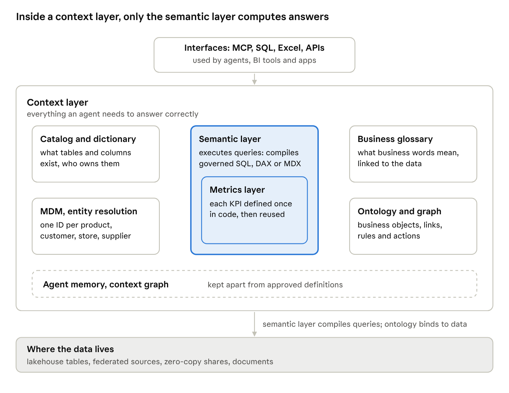
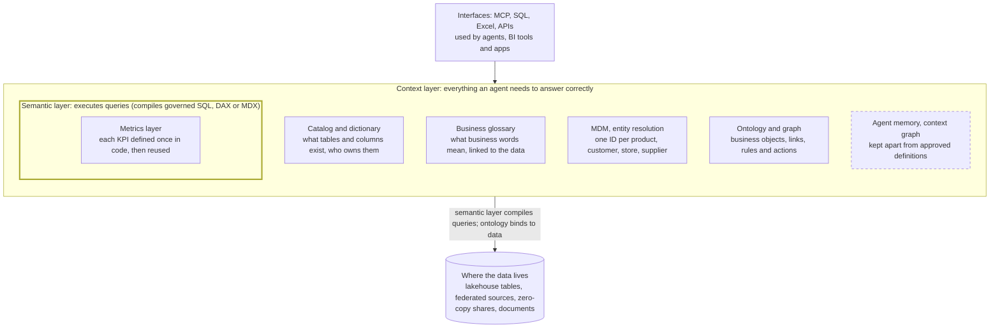
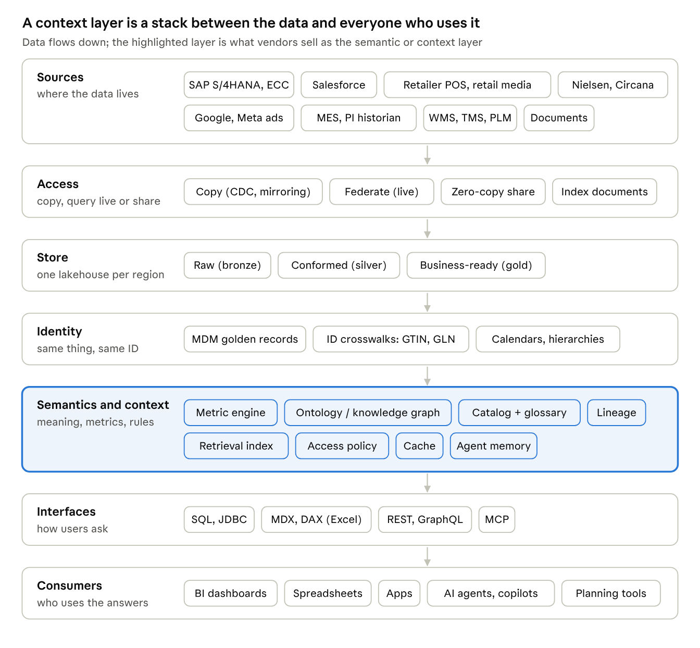
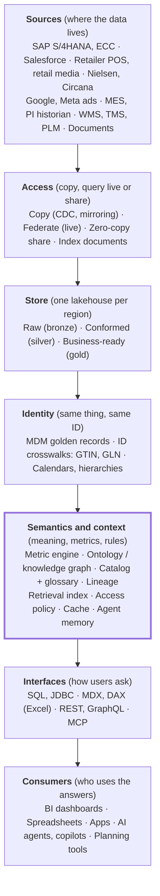
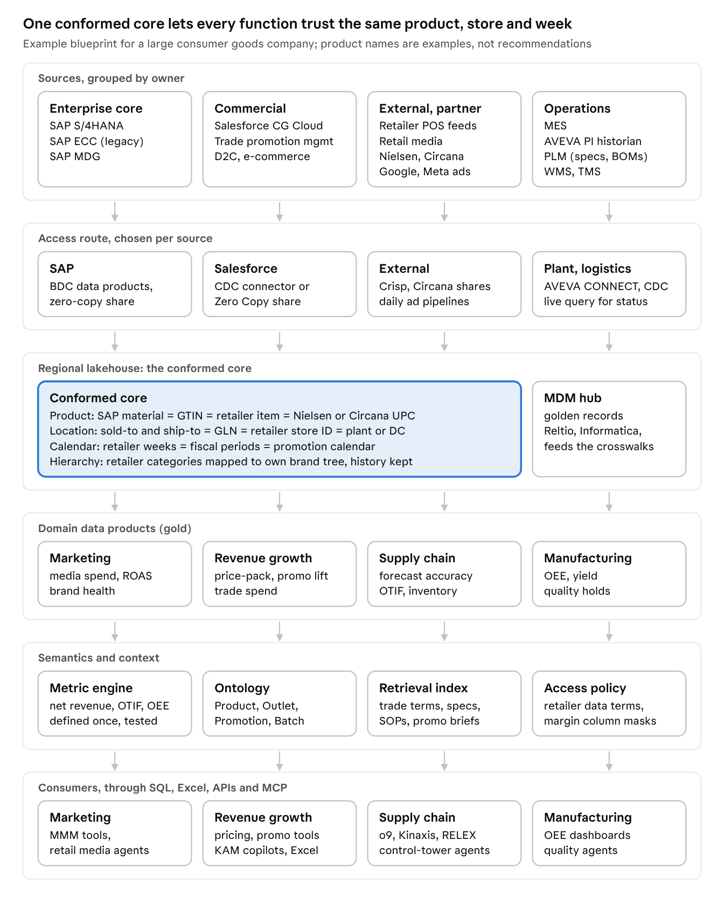
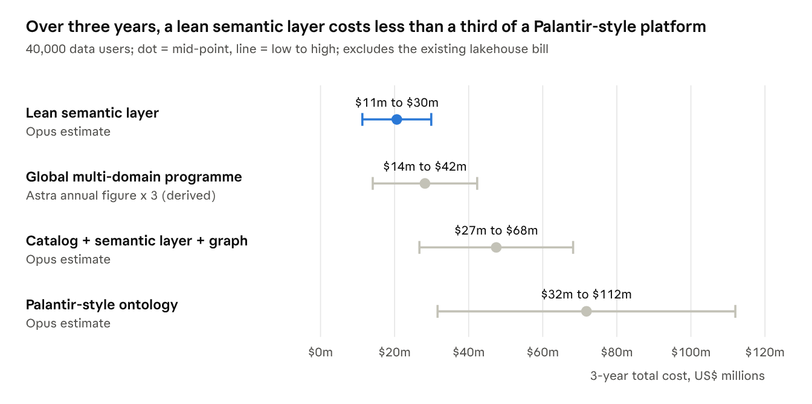

# Context Layers and Semantic Layers: Market Research

16 November 2026 · Research merged from two independent passes (latest Claude Opus and latest GPT Astra)

Live version: https://claude.ai/artifact/EDaTUuxW4f4cV5YMAKgE6i

Each diagram appears twice: as a picture (in `images/`) and as editable Mermaid code underneath.

## How this was researched

Two models researched the same questions independently, then the results were merged into this one doc. Each model worked without seeing the other's findings, so where they agree you can trust it more, and where they disagree it is flagged.

- **Latest Opus** (Claude): four parallel research agents, one each on the vendor market, real company case studies, architecture and data dictionaries, and enterprise pricing.
- **Latest Astra** (OpenAI, through Codex with web search): one deep pass over every question.
- **Merge**: claims backed by an opened source page are kept with their link. Claims only one model found are marked *(one source)*. Vendor marketing figures are labelled as vendor claims.

Why one merged doc rather than two: you asked for one doc to save, and two separate reports would repeat most of the same vendors and links. Each model's full raw report is kept beside this doc in `kanban/research-docs/context-layers-2026-11/` so nothing is lost in the merge.

## Executive summary

A context layer is a stack, not a product: the market is eight overlapping categories that the big platforms are absorbing, and the hard part for a consumer goods company is not the software but agreeing definitions and lining up product, store and calendar identifiers across systems.

| Your question | Short answer |
| --- | --- |
| What is in the market? | Eight overlapping categories: semantic layers (dbt, Cube, AtScale), warehouse-native semantics (Snowflake, Databricks, Microsoft Fabric, SAP, Google), ontology and knowledge graph platforms (Palantir, Neo4j, Stardog), catalogs (Atlan, Collibra, Alation), MDM, federation, enterprise search (Glean), and retail data providers with their own models (Crisp, Circana, NIQ). Platforms are buying independents: SAP bought Reltio and Dremio, Salesforce bought Informatica, ServiceNow bought data.world, Snowflake bought Select Star. An open standard, Apache Ossie (formerly OSI), has 50+ members but not Google, AWS, SAP or Palantir. |
| What do companies use them for? | Most of all, giving AI agents and text-to-SQL the right definitions so they stop inventing numbers. Then one version of finance and commercial KPIs (Diageo's single net sales value), supply chain decisions (General Mills' logistics agent, about $14m a year, vendor-reported), marketing measurement joined to retailer sales, and product knowledge graphs (IKEA). |
| How do they build them? | From one of four starting points: metrics first, ontology first, catalog first, or search and retrieval first. Mature programmes combine a governed metric layer with retrieval over everything else. AI now drafts definitions, but people approve them; Spotify's experts accepted only 12.5% of AI-proposed examples. |
| How will it help the business long term? | Companies expect one number everywhere (including in agents), faster delivery, and a reusable base for decisions. Every published with-versus-without test favours adding a semantic layer (for example dbt: 64.5% to 72.7%; Snowflake: 57% to 78%), but almost all are vendor-run on small question sets, and dbt's own test found better data modelling mattered more than the layer itself. |
| How long did it take? | Two clocks. The data foundation takes two to four years (Kimberly-Clark two years, Airbnb about three, PepsiCo about four). Each use case on top then takes weeks to months (Nestle's first agent in 8 weeks, Heineken US apps in 3 months, Mars to 28,000 users in 12 months). |
| Store in one place, or connect? | Both, decided per source. Most large consumer goods companies copy into one lakehouse first, then add the layer on top; zero-copy appears mainly at Salesforce front-ends and where regulation stops data moving (L'Oreal). SAP licence terms now push SAP data out through SAP Business Data Cloud, and "zero-copy" still carries fees across regions. |
| Do they need a data dictionary? | Yes, but it is four things: a business glossary, a technical data dictionary, an entity model or ontology, and metric definitions written as code. The hardest part is identity crosswalks (SAP material to GTIN to retailer item to Nielsen code). Expect 3 to 6 months for a first domain and 18 to 36 months to cover the company (both models agree). |
| What does it cost at Unilever, IKEA or Nestle scale? | Opus estimates, over three years for a 40,000-user company: $11m-$30m for a lean semantic layer on an existing lakehouse, $27m-$68m for catalog plus semantic layer plus knowledge graph, and $32m-$112m for a Palantir-style ontology. People, not software, are 55-70% of the cost in the first two. Astra's annual programme estimate ($4.7m-$14.1m a year) lands in the same range. No contract value has been published for Unilever, Nestle or Ingka. |
| What components does it need? | About 14: connectors, storage or federation, catalog, glossary, ontology, metric engine, MDM, search index, access policy, lineage, cache, interfaces (SQL, Excel, APIs, MCP) and, per Astra, an evaluation harness. Inputs are operational tables, retailer and data-provider shares, documents and approved definitions; outputs are governed numbers, cited context and, in ontology products, actions written back to systems. |

**Where the two models disagreed.** Whether one semantic layer should sit over everything (Opus) or one register of meanings with domain engines underneath (Astra); whether GTIN is a safe universal product key; how much to pay for people; and Denodo's price per core. Each disagreement is flagged in its section.

## What the terms mean

Of the 13 terms in this market, only the semantic (metrics) layer computes answers; the others describe, identify, connect, remember or carry context to an agent ([Cube](https://cube.dev/blog/the-context-layer-needs-a-semantic-layer)).

*Diagram: inside a context layer, only the semantic layer computes answers.*

The context layer holds definitions and bindings, not the data itself. Two framings compete: a16z say the context layer "should essentially become a superset" of the semantic layer ([a16z](https://a16z.com/your-data-agents-need-context/)), while Cube says the semantic layer is "the one part that actually executes" inside it ([Cube](https://cube.dev/blog/the-context-layer-needs-a-semantic-layer)). They describe the same stack from different seats. MIT CISR and Atlan stretch both terms wider still, so with any vendor ask what is represented, what is executed and what is governed ([MIT CISR](https://cisr.mit.edu/publication/2026_0501_SemanticLayer_LefebvreWixomLegnerVandermeulenBeath), [Atlan FAQ](https://docs.atlan.com/agents/faq/context-layer)) (Astra).

| Term | What it is | What it is not | Example products |
| --- | --- | --- | --- |
| Semantic layer | Executable definitions of measures, dimensions and join paths that compile to correct SQL, DAX or MDX at query time ([dbt architecture](https://docs.getdbt.com/docs/use-dbt-semantic-layer/sl-architecture), [LookML](https://docs.cloud.google.com/looker/docs/what-is-lookml)) (both). | Not a glossary or catalog: a context source can describe a measure without executing it ([Atlan FAQ](https://docs.atlan.com/agents/faq/context-layer)) (Astra). | [dbt Semantic Layer](https://docs.getdbt.com/docs/use-dbt-semantic-layer/setup-sl), [Cube](https://docs.cube.dev/docs/introduction), AtScale, LookML, Power BI semantic models, [Snowflake semantic views](https://docs.snowflake.com/en/user-guide/views-semantic/overview), [Databricks metric views](https://docs.databricks.com/aws/en/metric-views/) |
| Context layer | Everything an agent needs to answer correctly: definitions, metadata, lineage, ownership, policies, canonical entities, documents and tribal knowledge ([a16z](https://a16z.com/your-data-agents-need-context/)). A stack of 12-14 components, not one product (Opus). | Not automatically an engine that computes numbers ([Cube](https://cube.dev/blog/the-context-layer-needs-a-semantic-layer)). Buying one category does not supply the others (Astra). | Atlan Context Lakehouse ([Atlan](https://atlan.com/know/context-layer-stopped-being-theoretical-activate-2026/)), [Snowflake Horizon Context](https://docs.snowflake.com/en/release-notes/2026/other/2026-10-12-horizon-context-preview) (preview), Databricks Genie Ontology ([Databricks](https://databricks.com/blog/whats-new-unity-catalog-data-ai-summit-2026)), [Google Knowledge Catalog](https://cloud.google.com/blog/products/data-analytics/introducing-the-google-cloud-knowledge-catalog), [AWS Context](https://aws.amazon.com/blogs/machine-learning/context-intelligence-for-your-data-and-ai-agents-at-scale/) ("coming soon") |
| Metrics layer | The metric-only core of a semantic layer: each KPI defined once in code, versioned and reused. Airbnb's Minerva held 12,000+ metrics in one reviewed repository ([Airbnb](https://medium.com/airbnb-engineering/how-airbnb-achieved-metric-consistency-at-scale-f23cc53dea70)) (Opus). | Not an entity model: it cannot join retailer sales to SAP shipments without shared identifiers (Opus). | [MetricFlow](https://www.getdbt.com/blog/dbt-labs-affirms-commitment-to-open-semantic-interchange-by-open-sourcing-metricflow), [Databricks metric views](https://docs.databricks.com/aws/en/uc-semantics/metric-views/), [Snowflake semantic views](https://docs.snowflake.com/en/user-guide/views-semantic/semantic-view-yaml-spec), [Apache Ossie](https://ossie.apache.org/) (interchange format) |
| Ontology | Typed business objects, properties, relationships, rules and, in some products, actions, bound to source data ([Palantir](https://www.palantir.com/docs/foundry/ontology/core-concepts/)) (both). | Not a query engine: Fabric IQ's ontology "isn't itself a general-purpose data-query engine" ([Microsoft Learn](https://learn.microsoft.com/en-us/fabric/iq/ontology/overview)). | Palantir Ontology, Fabric IQ ontology (preview), SAP Knowledge Graph and Ontology Manager (beta planned Q1 2027, [ERP Today](https://erp.today/sap-teched-2026-whats-rolling-out-and-whats-planned-through-2027/)), [TopBraid EDG](https://docs.topquadrant.com/9.0/user_guide/guidance_specific_to_asset_collection_type/working_with_ontologies/working_with_ontologies.html), [Timbr](https://timbr.ai/doc/docs/getting-started/intro-timbr/) |
| Knowledge graph | A graph of entities and relationships, often with instance data and provenance, that agents traverse for multi-hop questions ([Neo4j](https://neo4j.com/product/knowledge-layer/), [Cognite](https://www.cognite.com/en/industrial-knowledge-graph)). | Not necessarily a copy: virtual graphs translate queries to the sources ([Stardog](https://docs.stardog.com/virtual-graphs/)) (both). Not a finance-grade calculation engine (Astra). | Neo4j, Stardog, Cognite Data Fusion, Glean, [Microsoft GraphRAG](https://microsoft.github.io/graphrag/), [Kinaxis semantic graph](https://www.kinaxis.com/en/semantic-graph) |
| Data catalog | An inventory of tables, columns, owners, classifications, lineage and usage, searchable by people and agents ([Azure Architecture Center](https://learn.microsoft.com/en-us/azure/architecture/example-scenario/dataplate2e/data-platform-end-to-end)). | Descriptive only: it does not compute answers (Opus). | Unity Catalog, Snowflake Horizon, Purview, Google Knowledge Catalog, [Atlan](https://docs.atlan.com/agents/how-tos/build-a-context-layer), Collibra, [Alation](https://alation.github.io/agent-studio-docs/integrations/mcp/using-the-mcp-server/), [DataHub](https://datahub.com/?p=15016) |
| Business glossary | Agreed meanings of business words, such as "net revenue" or "case fill rate", each linked to the data that implements it ([Collibra University](https://cdn-university.collibra.com/wp-content/COOK/Business-Glossary-Case_360780.html)). | Not executable: two dashboards can still compute "net revenue" differently (Opus). | Collibra, Purview glossary, Atlan, Alation |
| Data dictionary | Technical descriptions at column and table level: field, type, key, update frequency (both). | Not business meaning, identity or a calculation: it answers "what is this field?", not "what do we mean?" (both). | Unity Catalog, Snowflake Horizon, Purview Data Map, DataHub |
| MDM | Master data management: one identifier per customer, product, supplier or location, with golden records and crosswalks ([AWS Entity Resolution](https://docs.aws.amazon.com/entityresolution/latest/userguide/what-is-service.html), [SAP MDG](https://www.sap.com/products/data-cloud/master-data-governance.html)) (both). | Not a metric definition: MDM answers "which product?", not "how is net revenue calculated?" ([Reltio](https://www.reltio.com/products/entity-resolution/)) (Astra). | Reltio (SAP since May 2026, [SAP](https://news.sap.com/2026/05/sap-completes-acquisition-of-reltio/)), Informatica (Salesforce), Stibo, [Profisee](https://profisee.com/press-release/profisee-brings-end-to-end-master-data-management-fully-into-microsoft-fabric-at-fabcon-2026-adds-fabric-open-mirroring-support-and-copilot-connectivity-via-profisee-mcp-server/), SAP MDG |
| Data virtualisation | A query engine that leaves data at source and pushes "filters, joins, and calculations" to it at run time ([Denodo](https://www.denodo.com/en/data-virtualization/overview)) (both). | Not free of source load or latency ([Databricks](https://docs.databricks.com/aws/en/query-federation/)); not the same as a zero-copy share. | Denodo, Starburst and Trino, Dremio (SAP), Databricks Lakehouse Federation, Timbr |
| Data product | A curated, owned dataset published for reuse, with a named owner accountable for quality ([data mesh principles](https://martinfowler.com/articles/data-mesh-principles.html)). | Not a full semantic model: sharing one moves data and some metadata, not the definitions ([Databricks](https://docs.databricks.com/aws/en/delta-sharing/)) (Opus). | SAP BDC data products ([SAP](https://news.sap.com/2025/02/sap-databricks-open-bold-new-era-data-ai/)), [AWS CPG Data Products guidance](https://aws.amazon.com/solutions/guidance/cpg-data-products-on-aws/), Crisp harmonised retail data ([Crisp](https://www.gocrisp.com/our-platform)) |
| Context graph or agent memory | A context graph links operational things (services, teams, incidents, code, datasets) for agents; Uber's has 24 million nodes ([Uber](https://www.uber.com/blog/efficient-software-factory/)) (both). Memory keeps user, team and company context and past corrections ([Ramp](https://support.ramp.com/how-glass-works/), [OpenAI](https://openai.com/index/inside-our-in-house-data-agent/)). | Not approved corporate knowledge: something learned in a conversation should not overwrite a definition (Astra). | Uber ContextGraph, Ramp Glass, [Microsoft Work IQ](https://learn.microsoft.com/en-us/microsoft-365/copilot/extensibility/work-iq/), [Neo4j Context Engine](https://neo4j.com/press-releases/neo4j-context-engine/) (private preview) |
| MCP | Model Context Protocol: the standard way agents call tools and read resources from servers ([MCP spec](https://modelcontextprotocol.io/specification/2025-11-25)). | Not a context layer and not access control: the spec says implementers "SHOULD" build consent and access controls (Opus). | MCP servers from dbt, Cube, AtScale, Looker, Atlan, Starburst (Opus), plus [Kyvos](https://docs.support.kyvosinsights.com/wiki/spaces/KD20269/pages/1496881576/Kyvos%2BModel%2BContext%2BProtocol%2BMCP%2BServer), [GoodData](https://www.gooddata.ai/docs/cloud/ai/mcp-server/) and Alation (Astra) |

## Market landscape

Eight overlapping categories make up this market, and platforms are absorbing independents: SAP took [Reltio](https://news.sap.com/2026/03/sap-to-acquire-reltio) and [Dremio](https://news.sap.com/2026/07/sap-completes-dremio-acquisition/), Salesforce [Informatica](https://www.salesforce.com/news/press-releases/2025/11/18/salesforce-completes-acquisition-of-informatica/), Snowflake [Select Star](https://www.techzine.eu/news/analytics/136690/snowflake-acquires-select-star-for-broader-data-context/), ServiceNow [data.world](https://www.techzine.eu/news/data-management/131208/servicenow-acquires-data-world-to-make-data-ai-ready).

Both passes describe several markets, not one. Executable metrics, governed metadata, enterprise search, operational ontologies and agent memory solve different problems, and buying one does not supply the others ([dbt Semantic Layer](https://docs.getdbt.com/docs/use-dbt-semantic-layer/setup-sl), [Atlan context layer](https://docs.atlan.com/agents/faq/context-layer), [Palantir Ontology](https://www.palantir.com/docs/foundry/architecture-center/ontology-system), [Ramp agent memory](https://support.ramp.com/how-glass-works/)) (Astra). Opus maps seven categories and sees the warehouse platforms "pulling the independents into partner roles" ([Databricks](https://www.databricks.com/blog/redefining-semantics-data-layer-future-bi-and-ai), [01net/Business Wire](https://www.01net.it/atscale-announces-equity-financing-led-by-snowflake/)) (Opus). The one large merger among independents is Fivetran and dbt Labs, completed 1 June 2026 ([dbt Labs](https://www.getdbt.com/blog/fivetran-dbt-labs-complete-merger-to-create-the-data-infrastructure-for-trusted-ai-agents)) (Opus).

### Vendors by category

Store column: **Stores** = copies data into its own store; **In place** = queries data where it lives (federation, pushdown, zero-copy); **Metadata** = holds definitions or metadata only; **Hybrid** = both. Provenance after each vendor name. Accuracy, speed and saving figures are vendor claims unless stated.

| Vendor | Category | What it does (one line) | Stores data or queries in place | Agent features 2025-26 | Named customers (CPG/retail first) |
| --- | --- | --- | --- | --- | --- |
| [dbt Labs / Fivetran](https://www.getdbt.com/blog/fivetran-dbt-labs-complete-merger-to-create-the-data-infrastructure-for-trusted-ai-agents) (both) | Semantic layer | MetricFlow compiles YAML metric definitions into multi-dialect SQL; Apache 2.0 since 14 Oct 2025 ([dbt Labs](https://www.getdbt.com/blog/dbt-labs-affirms-commitment-to-open-semantic-interchange-by-open-sourcing-metricflow)) | Metadata: queries run in the customer's warehouse | MCP server exposing models, metrics, lineage and freshness ([dbt MCP](https://docs.getdbt.com/docs/dbt-ai/about-mcp)); JDBC and GraphQL APIs ([dbt setup](https://docs.getdbt.com/docs/use-dbt-semantic-layer/setup-sl)); Agents Schema, dbt Wizard (beta) ([dbt Labs](https://www.getdbt.com/blog/fivetran-dbt-labs-complete-merger-to-create-the-data-infrastructure-for-trusted-ai-agents)) | No CPG name; 100,000+ data teams; Fivetran customers OpenAI, Zendesk, Coupa, HubSpot ([dbt Labs](https://www.getdbt.com/blog/fivetran-dbt-labs-complete-merger-to-create-the-data-infrastructure-for-trusted-ai-agents)) |
| [Cube](https://cube.dev/blog/announcing-embedded-agentic-analytics) (both) | Semantic layer | Open-source Cube Core plus a commercial agentic BI product ([Cube](https://cube.dev/blog/cube-core-and-cube)) | In place, with pre-aggregation caching (Opus, not re-verified in 2026) | D3 AI Data Analyst and AI Data Engineer, June 2025 ([SiliconANGLE](https://siliconangle.com/2025/06/02/semantic-data-layer-startup-cube-automates-analytics-ai-agents)); Analytics Chat API, MCP, June 2026 ([Cube](https://cube.dev/blog/announcing-embedded-agentic-analytics)); Semantic SQL API now preferred over JSON REST ([Cube](https://cube.dev/blog/cube-core-and-cube)) | Brex ([Cube](https://cube.dev/blog/announcing-embedded-agentic-analytics)) |
| [AtScale](https://www.atscale.com/?p=27063) (both) | Semantic layer | Universal semantic layer with the widest BI protocol coverage: SQL, DAX, MDX, MCP ([01net/Business Wire](https://www.01net.it/atscale-announces-equity-financing-led-by-snowflake/)) | In place, with in-memory aggregates; "no data duplication" for Power BI ([AtScale](https://www.atscale.com/?p=27063)) | One-Click Modeling, where "AI scans source data to find metrics, dimensions, and relationships"; open-source SML ([AtScale](https://www.atscale.com/?p=27063)) | **Home Depot** (BigQuery, Excel, 20TB cube), **Bluemercury**, TELUS, Vodafone Portugal, HSBC ([AtScale](https://www.atscale.com/?p=27063)); Fidelity ([01net/Business Wire](https://www.01net.it/atscale-announces-equity-financing-led-by-snowflake/)) |
| [Kyvos](https://www.kyvosinsights.com/kyvos-mcp-server/) (both) | Semantic layer | Semantic layer with pre-aggregated models for very large data | Stores pre-aggregates | MCP server, local or remote, OAuth 2.0 ([Kyvos](https://www.kyvosinsights.com/kyvos-mcp-server/)); natural-language-to-SQL ([Kyvos docs](https://docs.support.kyvosinsights.com/wiki/spaces/KD20269/pages/1496881576/Kyvos%2BModel%2BContext%2BProtocol%2BMCP%2BServer)) | Unnamed retailer, "24B records... 40M customers" (vendor claim) ([Kyvos](https://www.kyvosinsights.com/kyvos-mcp-server/)) |
| [GoodData.AI](https://www.gooddata.ai/press-releases/gooddata-kicks-off-2026-with-mcp-server-launch-and-major-enterprise-wins/) (both) | Semantic layer | Headless BI with a semantic layer; renamed GoodData.AI April 2026 | In place | MCP server (January 2026) to "build, update, and operate analytics"; BI Modernization extracts legacy BI logic ([GoodData](https://www.gooddata.ai/press-releases/gooddata-kicks-off-2026-with-mcp-server-launch-and-major-enterprise-wins/)); read and metadata-changing MCP tools ([GoodData docs](https://www.gooddata.ai/docs/cloud/ai/mcp-server/)) | Unnamed asset manager and payments firm ([GoodData](https://www.gooddata.ai/press-releases/gooddata-kicks-off-2026-with-mcp-server-launch-and-major-enterprise-wins/)) |
| [Honeydew](https://honeydew.ai/blog/honeydew-and-snowflake-semantic-views/) (both) | Semantic layer | Git-native YAML semantic layer that extends Snowflake semantic views, including multi-fact and variable-grain cases ([Honeydew](https://honeydew.ai/blog/honeydew-and-snowflake-semantic-views/)) | Metadata: runs on Snowflake | Converts both ways with Ossie ([Ossie ecosystem](https://ossie.apache.org/ecosystem/)) | **Pizza Hut**: "50% faster insight development" (supplier/investor claim) ([Snowflake](https://www.snowflake.com/en/blog/investment-honeydew-business-intelligence/)) |
| [Strategy Mosaic](https://software.strategy.com/blog/how-diageo-scales-enterprise-ai-with-a-governed-semantic-layer) (both) | Semantic layer | "Universal intelligence layer" (formerly MicroStrategy) | In place | Ossie import and export ([Ossie ecosystem](https://ossie.apache.org/ecosystem/)); Diageo's Autobot assistant on governed measures ([Strategy/Diageo](https://software.strategy.com/blog/how-diageo-scales-enterprise-ai-with-a-governed-semantic-layer)) | **Diageo** (performance management, gross profit, brands) ([Strategy/Diageo](https://software.strategy.com/blog/how-diageo-scales-enterprise-ai-with-a-governed-semantic-layer), [Diageo case](https://software.strategy.com/customer-stories/diageo)) |
| [ThoughtSpot](https://www.thoughtspot.com/press-releases/thoughtspot-introduces-spotter-semantics-to-bring-trust-and-context-to-enterprise-ai) (Opus) | Semantic layer | Spotter Semantics, an "agentic semantic layer" with a Metrics Catalog (12 Mar 2026) | In place | MCP server; "deterministic... not text-to-SQL powered by LLMs" ([ThoughtSpot](https://www.thoughtspot.com/press-releases/thoughtspot-introduces-spotter-semantics-to-bring-trust-and-context-to-enterprise-ai)) | **Sephora**; boilerplate names **Unilever**, **Huel**, Lyft, Comcast, Roche, Schneider Electric ([ThoughtSpot](https://www.thoughtspot.com/press-releases/thoughtspot-introduces-spotter-semantics-to-bring-trust-and-context-to-enterprise-ai)) |
| [Snowflake](https://constellationr.com/insights/news/snowflake-summit-2026-context-custom-model-training-iceberg-v3) (both) | Warehouse-native semantics and context | Semantic views, Cortex Analyst and Agents, Horizon Catalog and Horizon Context ([Snowflake docs](https://docs.snowflake.com/en/release-notes/2025/june-summit), [spec](https://docs.snowflake.com/en/user-guide/views-semantic/semantic-view-yaml-spec)) | Stores (Snowflake, Iceberg) plus zero-copy to SAP, Salesforce, Workday ([Snowflake IR](https://investors.snowflake.com/news/news-details/2026/Snowflake-Pioneers-New-Open-Framework-for-Interoperable-Enterprise-Data-and-AI/default.aspx)) | Managed MCP server GA 4 Nov 2025 ([Snowflake docs](https://docs.snowflake.com/release-notes/2025/other/2025-11-04-cortex-agents-mcp)); Analyst-to-Agents move 28 Aug 2026 ([Snowflake docs](https://docs.snowflake.com/release-notes/2026/other/2026-08-28-cortex-analyst-transition-cortex-agents)); Horizon Context preview 12 Oct 2026 ([release note](https://docs.snowflake.com/en/release-notes/2026/other/2026-10-12-horizon-context-preview)) | **Kraft Heinz** (migration and retailer sharing, 2022) ([Snowflake](https://www.snowflake.com/en/blog/kraft-heinz-fosters-collaboration-retail-partners/)); AstraZeneca ([SAP](https://news.sap.com/2025/11/sap-snowflake-data-enterprise-ai-business-data-fabric/)); Affirm, Indeed, NTT DOCOMO ([Snowflake IR](https://investors.snowflake.com/news/news-details/2026/Snowflake-Pioneers-New-Open-Framework-for-Interoperable-Enterprise-Data-and-AI/default.aspx)) |
| [Databricks](https://databricks.com/blog/whats-new-unity-catalog-data-ai-summit-2026) (both) | Warehouse-native semantics and context | Unity Catalog metric views, Unity Catalog Semantics and Genie Ontology, "a continuously learned enterprise context layer" | Stores (Delta, Iceberg) plus Delta Sharing ([Databricks](https://databricks.com/blog/whats-new-unity-catalog-data-ai-summit-2026)) | Metric views GA 2 Apr 2026 ([Databricks](https://www.databricks.com/blog/redefining-semantics-data-layer-future-bi-and-ai)); semantics exposed "through MCPs"; Power BI and Tableau metric import (beta) ([Databricks](https://databricks.com/blog/whats-new-unity-catalog-data-ai-summit-2026)) | **PepsiCo** (Unity Catalog platform, 2024) ([Databricks](https://www.databricks.com/blog/how-pepsico-established-enterprise-grade-data-intelligence-platform-powered-databricks-unity)); **Zalando**, iFood ([Databricks](https://www.databricks.com/blog/redefining-semantics-data-layer-future-bi-and-ai)) |
| [Microsoft](https://learn.microsoft.com/en-us/fabric/iq/overview) (both) | Warehouse-native semantics and context | Power BI and Fabric semantic models plus Fabric IQ ontology, which "binds them to live enterprise data" | Hybrid: OneLake mirroring copies, shortcuts reference in place ([Microsoft Learn](https://learn.microsoft.com/en-us/fabric/iq/overview)); Direct Lake loads needed columns ([Direct Lake](https://learn.microsoft.com/en-us/fabric/fundamentals/direct-lake-overview)) | Fabric IQ GA 2 Jun 2026, ontology still preview (both: [Let's Data Science](https://letsdatascience.com/news/microsoft-expands-fabric-iq-as-a-context-layer-for-ai-agents-e9a90bd8), [Microsoft Learn](https://learn.microsoft.com/fabric/iq/overview)); Power BI Authoring MCP ([Microsoft Learn](https://learn.microsoft.com/en-us/power-bi/developer/mcp/mcp-servers-overview)) | None for Fabric IQ. Platform customers: **P&G** (Azure IoT Operations) ([Microsoft](https://www.microsoft.com/en/customers/story/25077-procter-and-gamble-iot-operations)), **Nestlé** (RISE with SAP on Azure) ([Microsoft](https://www.microsoft.com/en/customers/story/23963-nestle-azure)), **Coca-Cola** ($1.1bn, five years, 2024) ([Coca-Cola](https://www.coca-colacompany.com/media-center/the-coca-cola-company-and-microsoft-announce-five-year-strategic-partnership-to-accelerate-cloud-and-generative-ai-initiatives)) |
| [Google Cloud](https://cloud.google.com/blog/products/data-analytics/introducing-the-google-cloud-knowledge-catalog) (both) | Warehouse-native semantics and context | LookML generates SQL from defined dimensions and joins ([LookML](https://docs.cloud.google.com/looker/docs/what-is-lookml)); Knowledge Catalog (Dataplex renamed) is a "universal context engine" | Stores in BigQuery; harvests metadata from Atlan, Collibra, SAP, Palantir and others ([Google Cloud](https://cloud.google.com/blog/products/data-analytics/introducing-the-google-cloud-knowledge-catalog)) | Managed Looker MCP server (preview); Conversational Analytics agent GA ([Google Cloud](https://cloud.google.com/blog/products/business-intelligence/looker-updates-for-agentic-bi-at-next26)) | **Unilever** (five-year partnership, Feb 2026; not proof of LookML) ([Google](https://www.googlecloudpresscorner.com/2026-02-17-Unilever-and-Google-Cloud-Partner-to-Pioneer-Next-Generation-of-Consumer-Goods-Technologies)); YouTube ([Google Cloud](https://cloud.google.com/blog/products/business-intelligence/looker-updates-for-agentic-bi-at-next26)); Bloomberg Media ([Google Cloud](https://cloud.google.com/blog/products/data-analytics/introducing-the-google-cloud-knowledge-catalog)) |
| [AWS](https://aws.amazon.com/blogs/machine-learning/context-intelligence-for-your-data-and-ai-agents-at-scale/) (Opus) | Warehouse-native semantics and context | AWS Context maps relationships across existing data into a knowledge graph, learning join paths from agent use | Metadata, published to S3 Tables in Iceberg | Agentic search APIs and MCP tools; "coming soon" since 17 Jun 2026 ([AWS](https://aws.amazon.com/blogs/machine-learning/context-intelligence-for-your-data-and-ai-agents-at-scale/)) | None named |
| [SAP](https://news.sap.com/2026/05/sap-sapphire-sap-unveils-autonomous-enterprise/) (both) | Warehouse-native semantics and context | Business Data Cloud, Datasphere and SAP Knowledge Graph; data products keep "original business context and semantics" ([SAP](https://news.sap.com/2025/02/sap-databricks-open-bold-new-era-data-ai/), [SAP architecture](https://architecture.learning.sap.com/docs/ai-native-north-star-architecture/foundation-layer)) | Hybrid: managed copies in BDC, zero-copy out to Databricks, Snowflake, Athena; Dremio federation ([Futurum](https://futurumgroup.com/insights/can-sap-finally-kill-the-etl-monster-the-dremio-and-prior-labs-acquisition-explained/)) | 50+ Joule Assistants orchestrating 200+ agents; A2A with Google and Microsoft; no MCP in the Sapphire release ([SAP](https://news.sap.com/2026/05/sap-sapphire-sap-unveils-autonomous-enterprise/)) | **Nestlé** (SAP harmonisation, 112 countries) ([Nestlé](https://www.nestle.com/investors/annual-report/executing-strategy/accelerating-business-transformation)); AstraZeneca ([SAP](https://news.sap.com/2025/11/sap-snowflake-data-enterprise-ai-business-data-fabric/)); RWE ([SAP](https://news.sap.com/2026/05/sap-sapphire-sap-unveils-autonomous-enterprise/)) |
| [Salesforce](https://www.softwarereviews.com/vendor-technology-notes/dreamforce-2026-data-360-tableau-informatica) (both) | Warehouse-native semantics and context | Data 360 repositioned as "a governed context service for any authorized agent"; Tableau Semantics | Hybrid: stores profiles, zero-copy to Snowflake, Databricks, BigQuery; replication still fits some cases ([Salesforce](https://www.salesforce.com/data/connectivity/zero-copy/)) | Headless Data 360 MCP GA with "nearly 200 APIs"; Agent Context Engine GA "December" ([Info-Tech](https://www.softwarereviews.com/vendor-technology-notes/dreamforce-2026-data-360-tableau-informatica)) | None in opened sources |
| [Palantir](https://fool.com/earnings/call-transcripts/2026/05/04/palantir-pltr-q1-2026-earnings-transcript) (both) | Ontology and knowledge graph | Ontology of objects, links, logic and actions; AIP runs agents over it ([Palantir](https://www.palantir.com/docs/foundry/architecture-center/ontology-system)) | Stores: integrates data into Foundry | Ontology MCP: external agents read objects and run predefined actions only ([Palantir docs](https://palantir.com/docs/foundry/ontology-mcp/overview/)) | **Tyson, General Mills, Wendy's** (no use cases) ([AgNavigator](https://www.agnavigator.com/Article/2025/11/04/palantir-uses-ai-to-help-agrifood-businesses-releases-q3-results)); GE Aerospace, AIG ([Motley Fool](https://fool.com/earnings/call-transcripts/2026/05/04/palantir-pltr-q1-2026-earnings-transcript)). Unilever deployment not established (Astra) |
| [Neo4j](https://neo4j.com/press-releases/neo4j-context-engine/) (both) | Ontology and knowledge graph | Graph database; Context Engine adds a predefined six-layer Business Ontology and graph memory | Disputed: Opus says stores the graph; Astra notes an advertised virtual graph ([Neo4j](https://neo4j.com/product/knowledge-layer/)) | Context Engine, private preview 20 Oct 2026 ([Neo4j](https://neo4j.com/press-releases/neo4j-context-engine/)); MCP server from Q4 2025 ([Intelligent CIO](https://www.intelligentcio.com/north-america/2025/10/03/neo4j-invests-us-100m-in-genai-launches-new-agentic-ai-offerings/)) | **L'Oréal** Beauty Genius (April 2026) ([Neo4j](https://neo4j.com/customer-stories/loreal-graphsummit-2026/)); 84 of the Fortune 100 ([Intelligent CIO](https://www.intelligentcio.com/north-america/2025/10/03/neo4j-invests-us-100m-in-genai-launches-new-agentic-ai-offerings/)) |
| [Stardog](https://www.stardog.com/product/) (both) | Ontology and knowledge graph | RDF knowledge graph; virtual graphs translate SPARQL into source queries ([Stardog docs](https://docs.stardog.com/virtual-graphs/)) | Hybrid: "virtualize or materialize", up to "1 trillion triples" ([Stardog](https://www.stardog.com/product/)) | Voicebox LLM agent writes queries; MCP not mentioned ([Stardog](https://www.stardog.com/product/)) | **Bosch**, Boehringer Ingelheim, NASA, Morgan Stanley, RTX ([Stardog](https://www.stardog.com/product/)) |
| [Graphwise](https://graphwise.ai/?p=254087) (Opus) | Ontology and knowledge graph | Ontotext GraphDB plus PoolParty taxonomy tools, merged 2024 | Stores (GraphDB) | GraphRAG and knowledge-graph pipelines; named Gartner AI context platforms vendor ([Graphwise](https://graphwise.ai/?p=254087)) | None in opened sources |
| [TopQuadrant](https://docs.topquadrant.com/9.0/user_guide/guidance_specific_to_asset_collection_type/working_with_ontologies/working_with_ontologies.html) (both) | Ontology and knowledge graph | TopBraid EDG governs ontologies, classes and constraints using SHACL | Not stated in either pass | AI-agent automation in EDG 8.3/8.4 (Opus, search results only, unverified) | None named |
| [RelationalAI](https://www.opensourceforu.com/2025/09/snowflake-salesforce-dbt-labs-blackrock-introduce-open-semantic-interchange/) (both) | Ontology and knowledge graph | Knowledge graphs built over Snowflake tables as a Native App; OSI co-lead | In place on Snowflake (Opus, materials not opened) | Supply-chain knowledge graph and semantic layer for Blue Yonder ([Blue Yonder](https://blueyonder.com/why-blue-yonder/ai-and-machine-learning)) | **Blue Yonder** ([Blue Yonder](https://blueyonder.com/why-blue-yonder/ai-and-machine-learning)) |
| [Timbr](https://www.timbr.ai/platform) (both) | Ontology and knowledge graph | "Ontology-based semantic layer... built on SQL ontologies" | In place: "virtualized access... with no data movement" ([Timbr](https://www.timbr.ai/platform), [Timbr docs](https://timbr.ai/doc/docs/getting-started/intro-timbr/)) | LLM-assisted ERD translation, OWL import, LangChain and LangGraph ([Timbr](https://www.timbr.ai/platform)) | None named |
| [metaphacts](https://blog.metaphacts.com/building-explainable-trustworthy-recommendation-systems-ikea-at-kgc2023) (Astra) | Ontology and knowledge graph | Knowledge graph combining product data, an ontology and design rules | Not stated | Explainable recommendations from designer rules (2023) | **Inter IKEA** (2023, older) ([metaphacts](https://blog.metaphacts.com/building-explainable-trustworthy-recommendation-systems-ikea-at-kgc2023)) |
| [Celonis](https://www.celonis.com/news/article/finally-enterprise-ai-gets-the-context-it-needs-to-succeed-celonis-next-2026) (Opus) | Ontology and knowledge graph | Process Intelligence Graph with a new Context Model of process data and business knowledge | Hybrid: zero-copy transformations "up to 10 times faster" (vendor claim) | MCP Agent Toolkit for Copilot Studio and Bedrock agents ([Celonis](https://www.celonis.com/news/article/finally-enterprise-ai-gets-the-context-it-needs-to-succeed-celonis-next-2026)) | **Conrad**, TD Synnex (Opus table) ([Celonis](https://www.celonis.com/news/article/finally-enterprise-ai-gets-the-context-it-needs-to-succeed-celonis-next-2026)) |
| [Atlan](https://atlan.com/know/context-layer-stopped-being-theoretical-activate-2026/) (both) | Catalog, glossary and context platform | Active metadata platform sold as "the context layer": metadata, lineage, owners, policies, definitions ([Atlan docs](https://docs.atlan.com/agents/faq/context-layer)) | Metadata; Iceberg Context Lakehouse readable "via MCP, API, or SQL" | Context Agents, Context Repos, Context Lakehouse (29 Apr 2026); one million AI descriptions in two weeks (vendor claim) ([Atlan](https://atlan.com/know/context-layer-stopped-being-theoretical-activate-2026/)) | Unnamed "global lifestyle brand" (pilot); Elastic, Engine ([Atlan](https://atlan.com/know/context-layer-stopped-being-theoretical-activate-2026/)); Fox, Workday ([Atlan about](https://atlan.com/about.md)) |
| [Collibra](https://www.collibra.com/products/innovations) (both) | Catalog, glossary and context platform | Calls itself "the enterprise AI control plane"; governs terms, quality, lineage, context ([Collibra](https://www.collibra.com/blog/context-is-the-new-ip-collibra-is-where-enterprises-come-to-protect-it)) | Metadata; two-way sync with Snowflake Horizon ([Collibra](https://www3.collibra.com/company/newsroom/press-releases/snowflake-and-collibra-expand-partnership-to-bring-governed-business-context-and-semantics)) | Governed context compiler into Snowflake and Databricks formats (preview July 2026) ([Collibra](https://www.collibra.com/products/innovations)); 100+ customers on MCP ([Collibra](https://www.collibra.com/company/newsroom/press-releases/collibra-launches-ai-command-center-to-scale-agentic-ai)) | **Colruyt Group** (retailer) ([Datashift](https://www.datashift.eu/case-studies/how-colruyt-group-built-a-stronger-data-foundation-with-collibra-and-datashift)); 78 of the Fortune 500 ([Collibra](https://www3.collibra.com/company/newsroom/press-releases/snowflake-and-collibra-expand-partnership-to-bring-governed-business-context-and-semantics)) |
| [Alation](https://www.alation.com/news-and-press/alation-launches-aios-intelligence-operating-system/) (both) | Catalog, glossary and context platform | Data catalog; AIOS bundles Agent Studio, governance and conversational analytics (14 Jul 2026) | Metadata | Hosted MCP server, tools scoped per user ([Alation docs](https://alation.github.io/agent-studio-docs/integrations/mcp/using-the-mcp-server/), [PyPI](https://pypi.org/project/alation-ai-agent-mcp/)) | No CPG name; Ciena, 6,000 assets in two weeks (vendor evidence) ([Alation](https://www.alation.com/customers/ciena-ai-data-catalog/)) |
| [Informatica (Salesforce)](https://www.salesforce.com/news/press-releases/2026/05/20/informatica-announces-headless-data-management-aws/) (both) | Catalog, glossary and context platform | Catalog (CLAIRE, Metadata Explorer), data quality and MDM in one suite | Hybrid: catalogs in place, masters into a hub | MCP servers on AWS Agent Registry (preview) and Amazon Quick ([Salesforce](https://www.salesforce.com/news/press-releases/2026/05/20/informatica-announces-headless-data-management-aws/)); Claude Code plugin ([Info-Tech](https://www.softwarereviews.com/vendor-technology-notes/dreamforce-2026-data-360-tableau-informatica)) | None in opened sources |
| [ServiceNow](https://newsroom.servicenow.com/press-releases/details/2026/ServiceNow-launches-the-real-time-data-foundation-that-puts-autonomous-AI-to-work-across-the-enterprise/default.aspx) (both) | Catalog, glossary and context platform | Context Engine "maps every person, role, asset, service, and policy"; Data Catalog from data.world | In place: Live Connect "without pipelines, data copies" | Context Engine (6 May 2026); MCP Registry in Innovation Lab ([ServiceNow](https://newsroom.servicenow.com/press-releases/details/2026/ServiceNow-launches-the-real-time-data-foundation-that-puts-autonomous-AI-to-work-across-the-enterprise/default.aspx)) | **Zespri** (food marketer), PayPal ([ServiceNow](https://newsroom.servicenow.com/press-releases/details/2026/ServiceNow-launches-the-real-time-data-foundation-that-puts-autonomous-AI-to-work-across-the-enterprise/default.aspx)) |
| [IBM watsonx.data intelligence](https://www.ibm.com/new/announcements/agentic-data-intelligence-is-now-available-in-ibm-watsonx-data-intelligence-software) (Opus) | Catalog, glossary and context platform | Formerly IBM Knowledge Catalog; gives agents definitions, lineage, policies and quality | Metadata | Open-source MCP server and Agent Skills (17 Jun 2026) ([IBM](https://www.ibm.com/new/announcements/agentic-data-intelligence-is-now-available-in-ibm-watsonx-data-intelligence-software)) | None named |
| [Select Star (Snowflake)](https://www.techzine.eu/news/analytics/136690/snowflake-acquires-select-star-for-broader-data-context/) (Opus) | Catalog, glossary and context platform | Catalog connectors (PostgreSQL, Tableau, Power BI, dbt, Airflow) extending Horizon beyond Snowflake | Metadata | Feeds Horizon Catalog context | None named |
| [Secoda (Atlassian)](https://www.techtarget.com/searchITOperations/news/366636012/Atlassians-Secoda-acquisition-adds-data-catalog-for-Rovo-AI) (Opus) | Catalog, glossary and context platform | Adds structured-data context and "a customer-specific corporate ontology" to Atlassian's Teamwork Graph | Metadata | Context for Rovo agents | None named |
| [Ataccama](https://www.ataccama.com/customer-story/before-mondelez-international-could-trust-ai-it-had-to-trust-its-data) (Astra) | Catalog, glossary and context platform | Data quality, catalog and lineage with business stewardship | Not stated | In the Ossie ecosystem ([Ossie ecosystem](https://ossie.apache.org/ecosystem/)) | **Mondelez** (September 2026) ([Ataccama](https://www.ataccama.com/customer-story/before-mondelez-international-could-trust-ai-it-had-to-trust-its-data)) |
| [Reltio (SAP)](https://news.sap.com/2026/03/sap-to-acquire-reltio) (both) | MDM | Entity resolution, survivorship and golden records across SAP and non-SAP sources ([Reltio](https://www.reltio.com/products/entity-resolution/)) | Stores golden records | AgentFlow agents; MCP support ([ITdaily](https://itdaily.com/news/business/sap-reltio-afronding/)) | No CPG name; 200+ large enterprises, $185m ARR ([BARC](https://barc.com/barc-perspective-sap-acquires-reltio/)) |
| [Informatica MDM (Salesforce)](https://www.salesforce.com/news/press-releases/2026/05/20/informatica-announces-headless-data-management-aws/) (Opus) | MDM | MDM hub inside the Informatica suite | Stores golden records | MDM MCP server; MDM agents cut mastering "from months to hours" (vendor claim; Info-Tech calls it directional) ([Info-Tech](https://www.softwarereviews.com/vendor-technology-notes/dreamforce-2026-data-360-tableau-informatica)) | None in opened sources |
| [Stibo Systems](https://www.stibosystems.com/press-releases/stibo-systems-launches-mcp-server-to-connect-enterprise-master-data-to-ai-agents-at-scale) (both) | MDM | Product, supplier, customer and location master data, strong in retail ([Stibo retail](https://www.stibosystems.com/industries/retail)) | Stores | MCP server on STEP's "semantic data graph modelling" (29 Jun 2026) ([Stibo](https://www.stibosystems.com/press-releases/stibo-systems-launches-mcp-server-to-connect-enterprise-master-data-to-ai-agents-at-scale)) | Bonduelle seen in a blog (Opus, unverified, no link) |
| [Profisee](https://profisee.com/press-release/profisee-brings-end-to-end-master-data-management-fully-into-microsoft-fabric-at-fabcon-2026-adds-fabric-open-mirroring-support-and-copilot-connectivity-via-profisee-mcp-server/) (both) | MDM | Fabric-native MDM, GA 19 Mar 2026 | Stores golden records in Fabric | Two-way MCP server with write-back where authorised | None named |
| [SAP MDG](https://www.sap.com/products/data-cloud/master-data-governance.html) (both) | MDM | Matching, merging, golden records and governed workflows | Stores in S/4 or a hub | None found; BARC says Reltio may "complement or even replace" it ([BARC](https://barc.com/barc-perspective-sap-acquires-reltio/)) | None named |
| Semarchy (Opus) | MDM | MDM platform | Not stated | None found | Claims a 2026 Gartner MDM Leader spot (search results only, unverified) |
| [Denodo](https://www.denodo.com/en/denodo-platform/denodo-platform) (both) | Virtualisation and federation | Logical data access with its own semantic layer and query optimisation | In place, with selective caching | AI SDK with MCP server (Opus, unverified); joined OSI 24 Mar 2026 ([Denodo](https://denodo.com/en/press-release/2026-03-24/denodo-joins-snowflake-and-industry-leaders-advance-data-and-ai-interoperability-through-open)) | None in opened sources |
| [Starburst](https://www.starburst.io/blog/starburst-galaxy-ai-on-iceberg-foundations/) (both) | Virtualisation and federation | Trino and Iceberg federation with data products | In place | AI-oriented interfaces (March 2026) ([Starburst](https://www.starburst.io/blog/starburst-galaxy-ai-on-iceberg-foundations/)); AIDA and "enterprise context layer" (Opus, unverified) | None in opened sources |
| [Dremio (SAP)](https://news.sap.com/2026/07/sap-completes-dremio-acquisition/) (both) | Virtualisation and federation | Iceberg-native lakehouse and federation; semantic layers for preparation, business, application ([Dremio docs](https://docs.dremio.com/current/help-support/well-architected-framework/semantic/)) | In place: data "stay\[s\] in its original cloud storage" ([Futurum](https://futurumgroup.com/insights/can-sap-finally-kill-the-etl-monster-the-dremio-and-prior-labs-acquisition-explained/)) | AI Semantic Layer and hosted MCP server; Ossie contributor ([Apache Ossie](https://ossie.apache.org/updates/ossie-enters-apache-incubator/)) | None in opened sources |
| [Glean](https://futurumgroup.com/insights/glean-doubles-arr-to-200m-can-its-knowledge-graph-beat-copilot/) (both) | Enterprise search and agent context | "Permissions-aware knowledge graph" over SaaS content, people and activity ([Glean docs](https://docs.glean.com/security/knowledge-graph)) | Stores an index (derived copies) plus live MCP calls | MCP as server and host, coordinating Canva, Box, Agentforce ([Futurum](https://futurumgroup.com/insights/glean-doubles-arr-to-200m-can-its-knowledge-graph-beat-copilot/)) | No CPG name; McCarthy Holdings, about two hours a week saved (company estimate) ([Glean](https://www.glean.com/resources/customer-stories/mccarthy-holdings-inc)) |
| [Microsoft Work IQ](https://learn.microsoft.com/en-us/microsoft-365/copilot/extensibility/work-iq/) (Astra) | Enterprise search and agent context | Context and memory across Microsoft 365 and connected business systems | Not stated | MCP, REST and agent interoperability; API usage billed separately ([Work IQ](https://learn.microsoft.com/en-us/microsoft-365/copilot/extensibility/work-iq/)) | None named |
| [Ramp Glass](https://support.ramp.com/how-glass-works/) (Astra) | Enterprise search and agent context | Agent memory in personal, space and company tiers, refreshed by daily routines | Stores memory; company memory capped at 8,000 characters | Selective retrieval, not whole files in every prompt ([Ramp](https://support.ramp.com/how-glass-works/)) | None named |
| [Crisp](https://www.gocrisp.com/our-platform) (both) | CPG and retail data provider | Cleanses and models data "from 40+ retailers and distributors" ([AlleyWatch](https://alleywatch.com/2025/12/crisp-vertical-ai-platform-cpg-retail-data-infrastructure-supply-chain-automation-analytics-are-traasdahl/)); retail semantic foundation ([Crisp](https://www.gocrisp.com/our-platform)) | Stores and harmonises; delivers by sharing (Snowflake for Ritual) ([Crisp](https://www.gocrisp.com/case-studies/ritual)) | AI Agent Studio and Crisp AI Agent (2025) ([AlleyWatch](https://alleywatch.com/2025/12/crisp-vertical-ai-platform-cpg-retail-data-infrastructure-supply-chain-automation-analytics-are-traasdahl/)) | **Nestlé USA** (UNFI, \~1,500 SKUs) ([Crisp](https://www.gocrisp.com/case-studies/nestle-usa)); **poppi** ([Crisp](https://www.gocrisp.com/case-studies/poppi)); **Ritual** ([Crisp](https://www.gocrisp.com/case-studies/ritual)) |
| [Circana](https://www.circana.com/post/ai-access-vs-ai-intelligence-a-cto-guide) (both) | CPG and retail data provider | Syndicated data; Liquid AI answers from "governed Circana data, business rules, and analytical logic" | Stores syndicated data; harmonised store/item/day ([Circana](https://www.circana.com/post/circana-s-liquid-supply-chain-solution-creates-an-inventory-command-center-for-cross-retailer-insigh)) | MCP to Copilot, Claude, Gemini, ChatGPT; A2A to enterprise agents (7 Oct 2026) ([Circana](https://www.circana.com/post/ai-access-vs-ai-intelligence-a-cto-guide)) | Unnamed Australian retailer (Opus table) ([Circana](https://www.circana.com/post/ai-access-vs-ai-intelligence-a-cto-guide)) |
| [NIQ](https://nielseniq.com/global/en/news-center/2026/niq-launches-ask-arthur-chat-to-expand-access-to-consumer-insights-through-ai/) (both) | CPG and retail data provider | Syndicated consumer data; Connect positioned as a large-scale integration engine ([NIQ](https://investors.nielseniq.com/news/news-details/2026/NIQ-Announces-Strong-Fourth-Quarter-and-Full-Year-2025-Results/default.aspx)) | Stores syndicated data | Optiq "accessible within NIQ tools and frontier LLMs"; Ask Arthur chat ([NIQ](https://nielseniq.com/global/en/news-center/2026/niq-launches-ask-arthur-chat-to-expand-access-to-consumer-insights-through-ai/)) | None named |
| [SPINS](https://theshelbyreport.com/2026/09/23/spins-launches-agentic-discovery-for-ai-powered-commerce/) (both) | CPG and retail data provider | Product Knowledge Graph; 325+ product attributes (2024) ([SPINS](https://www.spins.com/wp-content/uploads/2024/07/SPINS-IFT-2024-Values-Oriented-PRESENTATION.pdf)) | Stores | Agentic Discovery measures how products appear in AI shopping answers (Sep 2026) ([Shelby Report](https://theshelbyreport.com/2026/09/23/spins-launches-agentic-discovery-for-ai-powered-commerce/)) | None named |
| [Walmart Scintilla](https://theshelbyreport.com/2026/09/24/walmart-evolves-scintilla-into-commerce-intelligence-platform/) (both) | CPG and retail data provider | Walmart first-party supplier data, formerly Luminate ([Walmart](https://corporate.walmart.com/news/2024/10/02/walmart-data-ventures-signals-growth-at-inspire-announces-new-name-for-insights-ecosystem)) | Retailer-hosted | Assistant "Marty"; Scintilla In-Store tasks (Feb 2026) ([Walmart](https://corporate.walmart.com/news/2026/02/23/introducing-scintilla-in-store-the-future-of-third-party-retail-execution-at-walmart)); no MCP mentioned | 2,000+ suppliers at Inspire 2026 ([Shelby Report](https://theshelbyreport.com/2026/09/24/walmart-evolves-scintilla-into-commerce-intelligence-platform/)) |
| [dunnhumby / Tesco Media and Insight Platform](https://www.dunnhumby.com/wp-content/uploads/2023/10/Tesco-Media-Insight-Platform-Loreal_CaseStudy.pdf) (Astra) | CPG and retail data provider | Clubcard-derived audiences and propensity models for retail media | Retailer-hosted | None found | **L'Oréal** (2022 campaign, 45,000 new shoppers) ([dunnhumby](https://www.dunnhumby.com/wp-content/uploads/2023/10/Tesco-Media-Insight-Platform-Loreal_CaseStudy.pdf)) |
| [o9 Solutions](https://o9solutions.com/news/o9-is-raising-the-bar-for-enterprise-planning-and-execution) (both) | CPG and retail data provider (planning) | Enterprise Knowledge Graph behind its Digital Brain for demand, supply, IBP and RGM ([o9](https://o9solutions.com/news/o9-named-a-leader-in-the-nucleus-research-scp-technology-value-matrix-2025)) | Stores in o9 platform | Specialised AI agents GA June 2025 ([o9](https://o9solutions.com/news/o9-is-raising-the-bar-for-enterprise-planning-and-execution)) | None named; "30+ industries" |
| [Blue Yonder](https://blueyonder.com/why-blue-yonder/ai-and-machine-learning) (both) | CPG and retail data provider (planning) | Rebuilt on Snowflake with "a common data model and a supply chain knowledge graph" ([diginomica](https://diginomica.com/blue-yonder-expands-its-agentic-ai-footprint-warehouse-floors-microsoft-teams)) | Stores on Snowflake | Agents across planning, transport, warehouse, retail (Mar 2026) ([diginomica](https://diginomica.com/blue-yonder-expands-its-agentic-ai-footprint-warehouse-floors-microsoft-teams)); OSI launch partner | None named |
| [RELEX](https://www.relexsolutions.com/news/relex-launches-relex-open-giving-customers-three-ways-to-accelerate-ai-adoption/) (both) | CPG and retail data provider (planning) | Unified merchandising: assortment, space, inventory, pricing, promotions ([RELEX](https://www.relexsolutions.com/unified-merchandising-platform/)) | Stores in RELEX | RELEX Open: external agents connect two-way over MCP (7 May 2026) | 700+ customers ([RELEX](https://www.relexsolutions.com/news/relex-launches-relex-open-giving-customers-three-ways-to-accelerate-ai-adoption/)) |
| [Kinaxis](https://www.kinaxis.com/en/semantic-graph) (both) | CPG and retail data provider (planning) | Semantic graph relating products, suppliers, orders, sites and constraints ([Kinaxis](https://www.kinaxis.com/en/semantic-graph)) | Stores | Maestro Agent Studio; MCP server via Genpact (Opus, unverified) | None named |

Not tabled: internal builds such as Uber's ContextGraph ([Uber](https://www.uber.com/gb/en/blog/efficient-software-factory/)), Shopify's River ([Shopify](https://shopify.engineering/under-the-river)) and Walmart's Element/WIBEY ([Walmart](https://tech.walmart.com/content/walmart-global-tech/en_us/blog/post/wibey-announcement.html)) (Astra). They are company accounts, not products for sale.

### Market moves 2025-2026

| Date | Event | Why it matters |
| --- | --- | --- |
| 20 Oct 2026 | Neo4j Context Engine, private preview ([Neo4j](https://neo4j.com/press-releases/neo4j-context-engine/)) | Graph vendors now ship a predefined business ontology, not just a database |
| 12 Oct 2026 | Snowflake Horizon Context preview: metadata from 18 external systems ([release note](https://docs.snowflake.com/en/release-notes/2026/other/2026-10-12-horizon-context-preview)) (Astra) | First dated availability for a feature announced in June without dates ([Runtime](https://www.runtime.news/snowflake-thinks-context-is-king/)) |
| 7 Oct 2026 | Circana exposes Liquid AI over MCP and A2A ([Circana](https://www.circana.com/post/ai-access-vs-ai-intelligence-a-cto-guide)) | Syndicated data reaches agents directly, with its own product and market model |
| 6 Oct 2026 | Forrester: Microsoft recasts Fabric as "a governed context layer for enterprise AI" ([Forrester](https://www.forrester.com/blogs/microsoft-fabcon-2026-enterprise-ai-needs-a-governed-context-layer-not-just-data/)) | Analyst confirmation that Microsoft is competing for the context layer |
| 5 Oct 2026 | Collibra buys trail ML ([Unite.AI](https://unite.ai/collibra-buys-trail-ml-adding-agent-powered-ai-governance-automation)) | Catalogs are moving into AI governance |
| 24 Sep 2026 | Walmart turns Scintilla into a commerce intelligence platform ([Shelby Report](https://theshelbyreport.com/2026/09/24/walmart-evolves-scintilla-into-commerce-intelligence-platform/)) | The largest retailer's supplier data gains a conversational layer |
| 23 Sep 2026 | SPINS launches Agentic Discovery on its Product Knowledge Graph ([Shelby Report](https://theshelbyreport.com/2026/09/23/spins-launches-agentic-discovery-for-ai-powered-commerce/)) | Product attributes now matter for visibility in AI shopping agents |
| Sep 2026 | Dreamforce: Headless Data 360 MCP GA; Agent Context Engine GA "December" ([Info-Tech](https://www.softwarereviews.com/vendor-technology-notes/dreamforce-2026-data-360-tableau-informatica)) | Salesforce pitches Data 360 as a context service for any agent |
| 28 Aug 2026 | Snowflake recommends moving from Cortex Analyst to Cortex Agents ([Snowflake docs](https://docs.snowflake.com/release-notes/2026/other/2026-08-28-cortex-analyst-transition-cortex-agents)) | Semantic views carry over; the text-to-SQL product is folded into agents |
| 13 Aug 2026 | Gartner *Market Overview for AI Context Platforms* ([Neo4j](https://neo4j.com/press-releases/neo4j-context-engine/), [Graphwise](https://graphwise.ai/?p=254087)) | "AI context platforms" becomes a named analyst market |
| 14 Jul 2026 | Alation AIOS ([Alation](https://www.alation.com/news-and-press/alation-launches-aios-intelligence-operating-system/)) | Last large independent catalog re-badges as an AI platform |
| 10 Jul 2026 | OSI enters the Apache Incubator as Apache Ossie ([Apache Ossie](https://ossie.apache.org/updates/ossie-enters-apache-incubator/)) | Vendor-neutral governance for the semantic interchange spec |
| 6 Jul 2026 | SAP completes Dremio (both: [SAP](https://news.sap.com/2026/07/sap-completes-dremio-acquisition/), [SAP Q3](https://www.sap.com/docs/download/investors/2026/sap-2026-q3-statement.pdf)) | SAP gains Iceberg-native federation over non-SAP data |
| 29 Jun 2026 | Stibo MCP server ([Stibo](https://www.stibosystems.com/press-releases/stibo-systems-launches-mcp-server-to-connect-enterprise-master-data-to-ai-agents-at-scale)) | Product master data, key for CPG, becomes agent-callable |
| 17 Jun 2026 | AWS Context announced, "coming soon" ([AWS](https://aws.amazon.com/blogs/machine-learning/context-intelligence-for-your-data-and-ai-agents-at-scale/)); IBM Agentic Data Intelligence ([IBM](https://www.ibm.com/new/announcements/agentic-data-intelligence-is-now-available-in-ibm-watsonx-data-intelligence-software)) | Every hyperscaler and IBM now claims a context layer |
| 16 Jun 2026 | Databricks Unity Catalog Semantics and Genie Ontology ([Databricks](https://databricks.com/blog/whats-new-unity-catalog-data-ai-summit-2026)) | Lakehouse adds glossary, domains and a learned context layer |
| 11 Jun 2026 | Cube Embedded Agentic Analytics ([Cube](https://cube.dev/blog/announcing-embedded-agentic-analytics)) | Independent semantic layers reposition as agent products |
| 2 Jun 2026 | Snowflake Summit: Horizon Context, Semantic Studio ([Constellation](https://constellationr.com/insights/news/snowflake-summit-2026-context-custom-model-training-iceberg-v3)); Microsoft Fabric IQ GA, ontology still preview ([Let's Data Science](https://letsdatascience.com/news/microsoft-expands-fabric-iq-as-a-context-layer-for-ai-agents-e9a90bd8)) | Both platforms bundle semantics and context in the same week |
| 1 Jun 2026 | Fivetran and dbt Labs merger completes ([dbt Labs](https://www.getdbt.com/blog/fivetran-dbt-labs-complete-merger-to-create-the-data-infrastructure-for-trusted-ai-agents)) | Ingestion and the leading open semantic layer under one owner |
| 20 May 2026 | Informatica "headless" data management: MCP servers on AWS ([Salesforce](https://www.salesforce.com/news/press-releases/2026/05/20/informatica-announces-headless-data-management-aws/)) | Salesforce-owned catalog and MDM reachable from AWS agents |
| 12 May 2026 | SAP Sapphire: Business AI Platform with SAP Knowledge Graph at its core ([SAP](https://news.sap.com/2026/05/sap-sapphire-sap-unveils-autonomous-enterprise/)) | SAP argues the context layer belongs in BDC |
| 7 May 2026 | SAP closes Reltio (Astra: [SAP Q3](https://www.sap.com/docs/download/investors/2026/sap-2026-q3-statement.pdf); Opus: "by 12 May", [ITdaily](https://itdaily.com/news/business/sap-reltio-afronding/)); RELEX Open with MCP ([RELEX](https://www.relexsolutions.com/news/relex-launches-relex-open-giving-customers-three-ways-to-accelerate-ai-adoption/)) | SAP now owns the MDM vendor furthest on Gartner "vision" ([Reltio](https://www.reltio.com/resources/blog/2026-gartner-magic-quadrant-mdm)) |
| 6 May 2026 | ServiceNow Context Engine and Data Catalog ([ServiceNow](https://newsroom.servicenow.com/press-releases/details/2026/ServiceNow-launches-the-real-time-data-foundation-that-puts-autonomous-AI-to-work-across-the-enterprise/default.aspx)); Collibra AI Command Center ([Collibra](https://www.collibra.com/company/newsroom/press-releases/collibra-launches-ai-command-center-to-scale-agentic-ai)) | data.world surfaces inside ServiceNow's agent stack |
| 4 May 2026 | SAP agrees to buy Dremio and invest €1bn in Prior Labs ([Futurum](https://futurumgroup.com/insights/can-sap-finally-kill-the-etl-monster-the-dremio-and-prior-labs-acquisition-explained/)); Palantir Q1 revenue $1.633bn, +85% ([Motley Fool](https://fool.com/earnings/call-transcripts/2026/05/04/palantir-pltr-q1-2026-earnings-transcript)) | SAP's third data buy in six weeks; ontology-first platform growing fast |
| 29 Apr 2026 | Atlan Activate: Context Lakehouse, Context Agents, Context Repos ([Atlan](https://atlan.com/know/context-layer-stopped-being-theoretical-activate-2026/)) | Leading independent catalog rebrands as "the context layer" |
| 22 Apr 2026 | Google renames Dataplex to Knowledge Catalog; managed Looker MCP (preview) ([Google Cloud](https://cloud.google.com/blog/products/data-analytics/introducing-the-google-cloud-knowledge-catalog), [Google Cloud](https://cloud.google.com/blog/products/business-intelligence/looker-updates-for-agentic-bi-at-next26)) | LookML and BigQuery measures pulled into one context engine |
| Apr 2026 | Gartner MDM Magic Quadrant returns after five years ([Reltio](https://www.reltio.com/resources/blog/2026-gartner-magic-quadrant-mdm)); GoodData renames to GoodData.AI ([GoodData](https://www.gooddata.ai/press-releases/gooddata-kicks-off-2026-with-mcp-server-launch-and-major-enterprise-wins/)) | MDM back on the analyst agenda as agent groundwork |
| 2 Apr 2026 | Databricks metric views GA; open-sourcing into Apache Spark ([Databricks](https://www.databricks.com/blog/redefining-semantics-data-layer-future-bi-and-ai)) | Lakehouse-native metrics, with a Spark open-source path |
| 27 Mar 2026 | SAP agrees to buy Reltio ([SAP](https://news.sap.com/2026/03/sap-to-acquire-reltio)) | BARC warns of "a SAP-bound master data layer" ([BARC](https://barc.com/barc-perspective-sap-acquires-reltio/)) |
| 24 Mar 2026 | Denodo joins OSI ([Denodo](https://denodo.com/en/press-release/2026-03-24/denodo-joins-snowflake-and-industry-leaders-advance-data-and-ai-interoperability-through-open)) | Virtualisation vendors join the standard |
| 19 Mar 2026 | Profisee Fabric-native MDM GA plus MCP server (both: [Profisee](https://profisee.com/press-release/profisee-brings-end-to-end-master-data-management-fully-into-microsoft-fabric-at-fabcon-2026-adds-fabric-open-mirroring-support-and-copilot-connectivity-via-profisee-mcp-server/)) | MDM moves inside the Microsoft estate |
| 12 Mar 2026 | ThoughtSpot Spotter Semantics ([ThoughtSpot](https://www.thoughtspot.com/press-releases/thoughtspot-introduces-spotter-semantics-to-bring-trust-and-context-to-enterprise-ai)) | BI vendors build their own semantic layers |
| Mar 2026 | Blue Yonder expands agents ([diginomica](https://diginomica.com/blue-yonder-expands-its-agentic-ai-footprint-warehouse-floors-microsoft-teams)); Starburst Galaxy AI on Iceberg ([Starburst](https://www.starburst.io/blog/starburst-galaxy-ai-on-iceberg-foundations/)) | Planning and federation vendors add agent layers |
| 23 Feb 2026 | Walmart Scintilla In-Store ([Walmart](https://corporate.walmart.com/news/2026/02/23/introducing-scintilla-in-store-the-future-of-third-party-retail-execution-at-walmart)) (Astra) | Retailer data moves from insight to store tasks |
| 17 Feb 2026 | Unilever and Google Cloud five-year partnership ([Google](https://www.googlecloudpresscorner.com/2026-02-17-Unilever-and-Google-Cloud-Partner-to-Pioneer-Next-Generation-of-Consumer-Goods-Technologies)) (Astra) | Largest CPG platform signal of the period; semantic engine not disclosed |
| Jan 2026 | GoodData MCP server ([GoodData](https://www.gooddata.ai/press-releases/gooddata-kicks-off-2026-with-mcp-server-launch-and-major-enterprise-wins/)); Gartner D&A Governance MQ, Atlan to Leader ([Atlan](https://atlan.com/atlan-named-leader-in-gartner-da-governance-magic-quadrant/)); AtScale joins OSI (Opus, date from search results only) | MCP spreads to every semantic vendor |
| 18 Dec 2025 | AtScale's largest round, led by Snowflake Ventures ([01net/Business Wire](https://www.01net.it/atscale-announces-equity-financing-led-by-snowflake/)) | Platforms fund independents for their BI connectors |
| Dec 2025 | Crisp raises $26m Series B1, $127m total ([AlleyWatch](https://alleywatch.com/2025/12/crisp-vertical-ai-platform-cpg-retail-data-infrastructure-supply-chain-automation-analytics-are-traasdahl/)); Atlassian discloses Secoda (5 Dec) ([TechTarget](https://www.techtarget.com/searchITOperations/news/366636012/Atlassians-Secoda-acquisition-adds-data-catalog-for-Rovo-AI)) | CPG retail-data layer funded; a fourth catalog absorbed |
| 24-25 Nov 2025 | Snowflake agrees to buy Select Star ([Techzine](https://www.techzine.eu/news/analytics/136690/snowflake-acquires-select-star-for-broader-data-context/)) | Everest: "catalog-of-catalogs" tools face a "less certain" future ([Everest](https://www.everestgrp.com/blogs/snowflakes-select-star-move-when-data-finally-meets-its-context/)) |
| 18 Nov 2025 | Salesforce completes Informatica, about $8bn (both: [Salesforce](https://www.salesforce.com/news/press-releases/2025/11/18/salesforce-completes-acquisition-of-informatica/), [Salesforce IR](https://investor.salesforce.com/news/news-details/2025/Salesforce-Completes-Acquisition-of-Informatica/); price per [TechTarget](https://www.techtarget.com/searchITOperations/news/366636012/Atlassians-Secoda-acquisition-adds-data-catalog-for-Rovo-AI)) | Largest deal: catalog, MDM and quality in a CRM vendor |
| 4 Nov 2025 | Snowflake-managed MCP server GA ([Snowflake docs](https://docs.snowflake.com/release-notes/2025/other/2025-11-04-cortex-agents-mcp)); SAP and Snowflake zero-copy ([SAP](https://news.sap.com/2025/11/sap-snowflake-data-enterprise-ai-business-data-fabric/)) | SAP data reachable in Snowflake without copying |
| 13-14 Oct 2025 | Fivetran-dbt merger announced; MetricFlow relicensed Apache 2.0 for OSI ([dbt Labs](https://www.getdbt.com/blog/dbt-labs-affirms-commitment-to-open-semantic-interchange-by-open-sourcing-metricflow)) | The reference metric engine becomes open source |
| 3 Oct 2025 | Neo4j commits $100m to product and startups ([Intelligent CIO](https://www.intelligentcio.com/north-america/2025/10/03/neo4j-invests-us-100m-in-genai-launches-new-agentic-ai-offerings/)) | Graph vendor bets on agent use |
| 23-24 Sep 2025 | Open Semantic Interchange launched by Snowflake with 16 partners ([OpenSourceForU](https://www.opensourceforu.com/2025/09/snowflake-salesforce-dbt-labs-blackrock-introduce-open-semantic-interchange/)) | First cross-vendor semantic standard; Blue Yonder in the launch group |
| Jul 2025 | ServiceNow closes data.world ([ServiceNow Q2 2025](https://newsroom.servicenow.com/press-releases/details/2025/ServiceNow-Reports-Second-Quarter-2025-Financial-Results/default.aspx)) (Astra); Collibra buys Deasy Labs, 24 Jul ([TechTarget](https://www.techtarget.com/data-technologies/news/366627998/Collibras-acquisition-of-Deasy-targets-unstructured-data)) | Opus found only the May agreement; Astra supplies the close |
| Jun 2025 | Snowflake semantic views: defining GA ([Snowflake docs](https://docs.snowflake.com/en/release-notes/2025/june-summit)); Cube D3 agents, 2 Jun ([SiliconANGLE](https://siliconangle.com/2025/06/02/semantic-data-layer-startup-cube-automates-analytics-ai-agents)); o9 agents GA ([o9](https://o9solutions.com/news/o9-is-raising-the-bar-for-enterprise-planning-and-execution)); Glean $150m Series F at $7.2bn ([Futurum](https://futurumgroup.com/insights/glean-doubles-arr-to-200m-can-its-knowledge-graph-beat-copilot/)) | Warehouse-native semantics arrive; planning agents ship |
| 29 May 2025 | AtScale open-sources SML ([AtScale](https://www.atscale.com/?p=27063)) | An open modelling language before OSI |
| 7 May 2025 | ServiceNow agrees to buy data.world ([Techzine](https://www.techzine.eu/news/data-management/131208/servicenow-acquires-data-world-to-make-data-ai-ready)) | First catalog absorbed by a workflow platform |
| Feb 2025 | SAP launches Business Data Cloud with SAP Databricks ([SAP](https://news.sap.com/2025/02/sap-databricks-open-bold-new-era-data-ai/)) | SAP data products with zero-copy sharing out |
| 2025 | Snowflake Ventures invests in Honeydew ([Snowflake](https://www.snowflake.com/en/blog/investment-honeydew-business-intelligence/)) (Astra; Opus could not open the page) | Another platform stake in an independent semantic layer |

### Apache Ossie (formerly OSI)

Apache Ossie is a pre-1.0 YAML spec in Apache incubation, with nearly every vendor except Google, AWS, SAP, Palantir, Neo4j and IBM ([Ossie ecosystem](https://ossie.apache.org/ecosystem/)) (Opus).

- **Who started it.** Snowflake launched it on 23 September 2025 with co-leads Salesforce, BlackRock, dbt Labs and RelationalAI. Twelve supporters joined, including Atlan, Alation, Blue Yonder, Cube, Honeydew, Mistral AI, Select Star, Sigma and ThoughtSpot ([OpenSourceForU](https://www.opensourceforu.com/2025/09/snowflake-salesforce-dbt-labs-blackrock-introduce-open-semantic-interchange/)).
- **Who is in now.** It grew "from 17 launch partners to more than 50 organizations" ([Apache Ossie](https://ossie.apache.org/updates/ossie-enters-apache-incubator/)). Opus counts about 90 on the ecosystem page, including Databricks, Microsoft, Oracle, ServiceNow, Informatica, Qlik, Starburst, Dremio, Denodo, Collibra, AtScale, Kyvos, GoodData, Strategy, Celonis, Ataccama, Instacart and NVIDIA ([Ossie ecosystem](https://ossie.apache.org/ecosystem/)).
- **Who is not.** Google (Looker), AWS, SAP, Palantir, Neo4j and IBM are absent ([Ossie ecosystem](https://ossie.apache.org/ecosystem/)). SAP's absence matters most for CPG, where Datasphere and the Knowledge Graph hold ERP semantics (Opus assessment). Dremio is an Ossie contributor but is now SAP-owned ([Apache Ossie](https://ossie.apache.org/updates/ossie-enters-apache-incubator/), [SAP](https://news.sap.com/2026/07/sap-completes-dremio-acquisition/)).
- **What it covers.** Datasets, fields, metrics, dimensions, relationships and an `ai_context` block, under Apache 2.0. Compliance tests "verify consistent query results, not just matching model structure" ([Apache Ossie home](https://ossie.apache.org/)) (both).
- **Working converters.** Ossie-to-MetricFlow and Apache Polaris converters are merged ([Apache Ossie](https://ossie.apache.org/updates/ossie-enters-apache-incubator/)). Databricks, Snowflake, Honeydew, Holistics, Strategy and SqlDBM list import or export ([Ossie ecosystem](https://ossie.apache.org/ecosystem/)). Collibra can publish "as OSI documents" in preview ([Collibra](https://www3.collibra.com/company/newsroom/press-releases/snowflake-and-collibra-expand-partnership-to-bring-governed-business-context-and-semantics)).
- **Maturity.** The example file is version `0.3.0.dev0`, and there is no standard semantic query language yet (Opus; [Apache Ossie](https://ossie.apache.org/updates/ossie-enters-apache-incubator/)). Working groups cover Metric Language, Catalog and Ontology. Incubation "does not guarantee graduation" ([Ossie ecosystem](https://ossie.apache.org/ecosystem/)).
- **What it is not.** It is an interchange format, not an execution engine. It is not proof that security, time intelligence and vendor extensions round-trip without loss ([Apache Ossie](https://ossie.apache.org/)) (Astra). Astra recommends an export and import test on the client's hardest measures.

Forrester advises favouring "RDF ontologies and Apache Ossie" to avoid hyperscaler lock-in ([Forrester](https://www.forrester.com/blogs/microsoft-fabcon-2026-enterprise-ai-needs-a-governed-context-layer-not-just-data/)).

### Analyst views

No major analyst publishes a dedicated semantic-layer evaluation except GigaOm, and Gartner's new AI context platforms report could only be read second-hand (Opus).

| Analyst | Publication and date | What it says | Verification |
| --- | --- | --- | --- |
| Gartner | *Market Overview for AI Context Platforms*, 13 Aug 2026, Carlsson, Jaffri, Long, Miclaus ([Neo4j](https://neo4j.com/press-releases/neo4j-context-engine/)) | Market $28bn (2026) to $78bn (2030), 29.5% CAGR; MCP is "baseline requirements rather than differentiators"; up to 80% agent accuracy gain by 2027; representative vendors AWS, Databricks, Google, IBM, Microsoft, Snowflake, Graphwise ([Graphwise](https://graphwise.ai/?p=254087)) | **Not verified.** Reported by two listed vendors; Gartner's page returned 403. Opus judges the $28bn "surprisingly large" and likely to include adjacent markets |
| Gartner | *Magic Quadrant for D&A Governance Platforms*, Jan 2026, 15 vendors | Atlan moved from Visionary to Leader ([Atlan](https://atlan.com/atlan-named-leader-in-gartner-da-governance-magic-quadrant/)); Collibra claims "2x" Leader ([Collibra](https://www3.collibra.com/company/newsroom/press-releases/snowflake-and-collibra-expand-partnership-to-bring-governed-business-context-and-semantics)) | Vendor-reported only |
| Gartner | *Magic Quadrant for MDM*, Apr 2026, first in about five years | Reltio Leader, furthest on vision ([Reltio](https://www.reltio.com/resources/blog/2026-gartner-magic-quadrant-mdm)); Profisee ([Profisee](https://profisee.com/press-release/profisee-brings-end-to-end-master-data-management-fully-into-microsoft-fabric-at-fabcon-2026-adds-fabric-open-mirroring-support-and-copilot-connectivity-via-profisee-mcp-server/)) and Stibo ([Stibo](https://www.stibosystems.com/press-releases/stibo-systems-launches-mcp-server-to-connect-enterprise-master-data-to-ai-agents-at-scale)) Leaders | Vendor-reported; Informatica and Semarchy claims seen in search results only |
| Gartner | *Market Guide for Agentic Analytics*, Feb 2026 | Cited by Cube and GoodData ([GoodData](https://www.gooddata.ai/press-releases/gooddata-kicks-off-2026-with-mcp-server-launch-and-major-enterprise-wins/)) | Vendor-reported; content not seen |
| GigaOm | 2025 Radar for Semantic Layers and Metrics Stores | Cube "Leader and Outperformer" ([Cube](https://cube.dev/blog/cube-cloud-named-leader-and-outperformer-in-2025-gigaom-radar-for-semantic)); AtScale "Leader and Fast Mover" ([01net/Business Wire](https://www.01net.it/atscale-announces-equity-financing-led-by-snowflake/)) | Vendor-reported; Microsoft's Leader claim not opened. The only dedicated semantic-layer evaluation found |
| Forrester | Blog on Microsoft FabCon, 6 Oct 2026, Indranil Bandyopadhyay | "Context cannot be defined by data and technology teams alone"; favour RDF ontologies and Ossie ([Forrester](https://www.forrester.com/blogs/microsoft-fabcon-2026-enterprise-ai-needs-a-governed-context-layer-not-just-data/)) | **Verified** (page read) |
| Forrester | Blog on Databricks, 7 Jul 2026 | Context is one of four Databricks priorities, via Genie Ontology ([Forrester](https://www.forrester.com/blogs/databricks-unleashes-the-genie-the-power-of-the-four-cs/)) | **Verified** |
| Forrester | *Make Data AI Ready Via Semantic Layer Platforms*, Jun 2026 | Distributed by Strategy | **Not verified**: page could not be opened; no Forrester Wave on semantic layers found |
| BARC | Perspective on SAP/Reltio | "Without such a context layer, AI... produces results that cannot be trusted"; risk of "a SAP-bound master data layer" ([BARC](https://barc.com/barc-perspective-sap-acquires-reltio/)) | **Verified** |
| IDC | Stewart Bond quote in Alation's AIOS release, Jul 2026 | "What's missing isn't another AI platform; it's an operating system" ([Alation](https://www.alation.com/news-and-press/alation-launches-aios-intelligence-operating-system/)) | Quote in vendor release only; no IDC MarketScape found |
| MIT CISR | *The Case for a Semantic Layer*, May 2026 | Interviews across 41 organisations; only 21% reported well-developed curation in a 2024 survey ([MIT CISR](https://cisr.mit.edu/publication/2026_0501_SemanticLayer_LefebvreWixomLegnerVandermeulenBeath)) (Astra) | **Verified** (page read) |
| Nucleus Research | SCP Technology Value Matrix 2025 | o9 named a Leader ([o9](https://o9solutions.com/news/o9-named-a-leader-in-the-nucleus-research-scp-technology-value-matrix-2025)) (Astra) | Vendor-reported |
| Info-Tech | Dreamforce 2026 note | Salesforce strategy "coherent", risk is execution; can Tableau Semantics become "a genuinely open enterprise semantic layer"? ([Info-Tech](https://www.softwarereviews.com/vendor-technology-notes/dreamforce-2026-data-360-tableau-informatica)) | **Verified** |
| Constellation | Snowflake Summit 2026 | Snowflake no longer needs "to own the data format to own the customer relationship" ([Constellation](https://constellationr.com/insights/news/snowflake-summit-2026-context-custom-model-training-iceberg-v3)) | **Verified** |
| Everest Group | Snowflake/Select Star | "If context cannot move across clouds, enterprises will end up with... a more fragmented ecosystem" ([Everest](https://www.everestgrp.com/blogs/snowflakes-select-star-move-when-data-finally-meets-its-context/)) | **Verified** |
| Futurum | SAP/Dremio; Glean | "No enterprise is 100% SAP" ([Futurum](https://futurumgroup.com/insights/can-sap-finally-kill-the-etl-monster-the-dremio-and-prior-labs-acquisition-explained/)); Glean must hold off Microsoft 365 Copilot ([Futurum](https://futurumgroup.com/insights/glean-doubles-arr-to-200m-can-its-knowledge-graph-beat-copilot/)) | **Verified** |
| William McKnight (TechTarget) | Neo4j Context Engine, Oct 2026 | Must "move beyond read-only retrieval"; warns of "graph sprawl" ([TechTarget](https://www.techtarget.com/data-technologies/news/366652383/Neo4j-joins-the-context-cavalcade-with-suite-for-informing-AI-agents)) | **Verified** |
| Sceptics | Joe Reis, 11 Mar 2026 (satire); Runtime | "Context fabric" looks like data fabric renamed ([Joe Reis](https://joereis.substack.com/p/gartner-declares-2026-the-year-of)); Snowflake's pitch came with no availability dates ([Runtime](https://www.runtime.news/snowflake-thinks-context-is-king/)) | **Verified** |

### Where the two passes disagreed

They contradicted each other only on Neo4j: Opus says it copies data into the graph; Astra cites an advertised virtual graph ([Neo4j](https://neo4j.com/product/knowledge-layer/)). Elsewhere Astra settled Opus's open points: Reltio closed 7 May 2026 and data.world in July 2025 ([SAP Q3](https://www.sap.com/docs/download/investors/2026/sap-2026-q3-statement.pdf), [ServiceNow Q2 2025](https://newsroom.servicenow.com/press-releases/details/2025/ServiceNow-Reports-Second-Quarter-2025-Financial-Results/default.aspx)). Astra also confirmed dbt's MCP server, Blue Yonder's RelationalAI graph and Snowflake's Honeydew stake, which Opus had marked unverified.

## What companies use them for

Supply chain and finance carry the strongest named results: General Mills' $14m-a-year logistics agent and Diageo's single Net Sales Value definition. Most other uses are early or vendor-reported.

| Function | What the layer does there | Named examples |
| --- | --- | --- |
| Advertising and marketing | Links advertised products, places and days to retail sales; resolves consumer identities into golden records; aligns campaign and targeting definitions | [Crisp/poppi](https://www.gocrisp.com/case-studies/poppi): agency Tinuiti joins retailer sales to media by SKU, geography and day; 80% higher in-store purchase rate in TikTok-targeted areas (vendor claim, Astra). [Nestle/Treasure Data](https://www.treasure.ai/customers/nestle-global-cpg): Mexico golden record, click-through +71%, cost per lead -49% (vendor claim, Opus). [Tesco Media and Insight Platform/L'Oreal](https://www.dunnhumby.com/wp-content/uploads/2023/10/Tesco-Media-Insight-Platform-Loreal_CaseStudy.pdf): Clubcard audiences, £115,000 budget, 45,000 new shoppers, 2022 (Astra). [PepsiCo/Salesforce Data 360](https://www.salesforce.com/customer-stories/pepsico-data-360/): one business profile per store across snacks and beverages (Opus). [Netflix UDA](https://www.infoq.com/news/2025/12/netflix-upper-uda-architecture): aligned campaign, promotion and targeting definitions (Opus) |
| Sales and revenue growth management | One set of commercial measures (volume, mix, price, cost) for pricing, promotion and retailer performance; maps distributor and retailer items into internal hierarchies | [Diageo/Strategy](https://www.strategy.com/software/blog/how-diageo-scales-enterprise-ai-with-a-governed-semantic-layer): "Autobot" answers "what is driving gross profit" (both); about 400 users (Opus). [Kimberly-Clark/Snowflake](https://www.snowflake.com/en/customers/all-customers/case-study/kimberly-clark/): pricing, promotion and retailer analysis on a 400-KPI library (Opus). [Nestle USA/Crisp](https://www.gocrisp.com/case-studies/nestle-usa): mapped about 1,500 UNFI SKUs and $300m of sales into Nestle hierarchies (Astra). [Walmart Wally](https://corporate.walmart.com/news/2025/03/18/walmart-develops-genai-powered-assistant-for-walmart-merchants): merchant assistant on a semantic layer (Opus). [Walmart Scintilla In-Store](https://corporate.walmart.com/news/2026/02/23/introducing-scintilla-in-store-the-future-of-third-party-retail-execution-at-walmart): supplier reps get store-level tasks, February 2026 (Astra). [Coca-Cola Bottling Co. United](https://consumergoods.com/coca-cola-united-testing-generative-ai-tool-streamline-data-access): GenAI BI pilot, January 2025 (Opus) |
| Supply chain and demand planning | Joins orders, inventory, capacity, freight and cost into one model so recommendations and alerts span the network | [General Mills/Palantir](https://www.palantir.com/assets/xrfr7uokpv1b/1aLBn65y83vdytjpXJKZcO/16989b788b34cb677f6d763d56a72349/Building_an_Intelligent_AI-Driven_Supply_Chain_at_General_Mills_-_AIPCon_March_-24_Impact_Study.pdf): logistics agent, over 70% of recommendations accepted, about $14m a year on part of the network (Opus). [Unilever](https://www.unilever.com/news/news-search/2026/building-resilience-driving-growth-inside-unilevers-aipowered-supply-chain/): Forecast Engine, 5m product and customer combinations, 40 markets, 104-week horizon (Astra). [PepsiCo Foods](https://www.databricks.com/dataaisummit/session/game-day-global-scale-how-pepsico-foods-uses-ai-feed-world-cup): about 125m weekly forecasts; Genie queries demand drivers (Opus). [Heineken US](https://readray.ai/notes/en/palantir-aipcon-20251112/ai-driven-supply-chain-heineken-aipcon): stock-out and container-priority apps on Palantir (Opus, AI-generated notes, low confidence). [Kinaxis](https://www.kinaxis.com/en/semantic-graph) and [o9](https://o9solutions.com/news/o9-named-a-leader-in-the-nucleus-research-scp-technology-value-matrix-2025): planning platforms with their own semantic graph (Astra) |
| Manufacturing, quality and plant systems | Ties machines, bills of material, batches and quality data to products; puts factory signals in context for central analytics | [P&G/Microsoft](https://www.microsoft.com/en/customers/story/25077-procter-and-gamble-iot-operations): Azure IoT Operations, up to 90% less time to deploy a model version (Astra). [P&G/Semantic Arts](https://www.semanticarts.com/case-study-proctor-and-gamble): R&D ontology of under 500 core concepts (Opus). [Mars/Accenture](https://newsroom.accenture.com/news/2022/accenture-collaborates-with-mars-to-develop-factory-of-the-future-using-ai-cloud-edge-and-digital-twins): digital twins from late 2020 (Astra). [Siemens/metaphactory](https://metaphactory.com/smart-manufacturing-planning-execution-at-siemens): plans needing review fell from about 1,400 to 40 (Opus). [Bosch](https://www.inf.unibz.it/~calvanese/papers-html/ISWC-2020-bosch.html): virtual knowledge graph over production line data (Opus). [AB InBev/Creactives](https://www.creactives.com/?p=5523): materials master across 11 ERPs (Opus) |
| Finance | One definition of revenue, net sales value and cost across BI tools and agents | [Diageo](https://www.01net.it/strategy-and-diageo-show-how-a-universal-context-layer-can-simplify-data-complexity-and-accelerate-ai-readiness-at-gartner-data-analytics-summit-london-2026/): one net sales value across Power BI, Qlik, Excel and agents (both). [Kimberly-Clark](https://www.snowflake.com/en/customers/all-customers/case-study/kimberly-clark/): cost benchmarking that took 30,000 hours now "a click" (Opus). [Uber Finch](https://www.uber.com/us/en/blog/unlocking-financial-insights-with-finch/): finance agent on single-table marts (Opus). [Brex/Cube](https://cube.dev/case-studies/brex-embedded-ai-financial-analyst): answer relevance from the high 50s% to about 90% (vendor, Opus) |
| HR | People questions answered without analyst queues; permission-aware HR documents | [Mars/Databricks Genie](https://www.databricks.com/customers/mars/genie): HR common data model ("associate 360") with semantic views of Mars terms (Opus). [Mars, CDO Magazine](https://www.cdomagazine.tech/data-analytics/why-a-common-data-model-became-vital-to-mars-analytics-evolution): context layer named one of three foundations for AI in BI (Opus). [PepsiCo](https://www.databricks.com/blog/how-pepsico-established-enterprise-grade-data-intelligence-platform-powered-databricks-unity): row and column security on restricted HR tables (Opus) |
| AI agents and text-to-SQL | Gives agents the right table, definition and memory; governed metrics refuse rather than guess | [Uber context graph](https://www.uber.com/blog/efficient-software-factory/): 24m nodes, 80m edges; correct answer in 38 seconds versus a wrong one in 20 minutes (both). [OpenAI](https://openai.com/index/inside-our-in-house-data-agent/): six context layers over 70,000 datasets (Opus). [Spotify](https://engineering.atspotify.com/2026/6/encoding-your-domain-expert-the-context-layer-behind-spotifys-data-assistant): 177 expert-owned clusters, 2,100+ users (Opus). [Ramp Glass](https://support.ramp.com/how-glass-works/): personal, space and company memory (Astra). [Mercedes-Benz Korea](https://www.databricks.com/blog/unlocking-semantics-ai-how-mercedes-benz-korea-built-trusted-talk-data-scale): 500+ KPIs as metric views for BI and agents (Opus) |
| Product catalogue and consumer service | Product knowledge graphs and governed product data for recommendations and customer-facing agents | [IKEA Knowledge Graph](https://medium.com/flat-pack-tech/ikeas-knowledge-graph-and-why-it-has-three-layers-a38fca436349): concept, category and data layers behind recommendations (Opus). [Inter IKEA/metaphacts](https://blog.metaphacts.com/building-explainable-trustworthy-recommendation-systems-ikea-at-kgc2023): designer rules for small spaces in the graph (Astra). [L'Oreal/Neo4j](https://neo4j.com/customer-stories/loreal-graphsummit-2026/): Beauty Genius recommendations (Astra). [Walmart Retail Graph](https://medium.com/walmartglobaltech/retail-graph-walmarts-product-knowledge-graph-6ef7357963bc): product knowledge graph, 2020 (Opus). [Nestle/Salesforce](https://www.salesforce.com/customer-stories/nestle/agentic-consumer-service/): consumer-service agent, 40% resolved without a person in the pilot (vendor claim, Opus) |

### Consumer goods and retail companies, by name

"Store" means copied into a central warehouse or lakehouse; "Connect" means queried in place, zero-copy or virtual; "Hybrid" means both.

| Company | What they built or said | Tools | Store or connect | Source |
| --- | --- | --- | --- | --- |
| AB InBev | Materials master governance across 11 ERPs, 3.25m materials, 200+ plants; claims 40% fewer new material requests in year one and €100m+ of excess inventory found (vendor, Opus) | Creactives | Hybrid | [Creactives](https://www.creactives.com/?p=5523) |
| Carrefour | Moved 26 models, about 3,000 KPIs and 1,000+ users from a BI-bundled semantic layer to a universal one; Google Sheets became the main interface (Opus) | AtScale | Connect (virtual) | [AtScale, Jun 2026](https://www.atscale.com/blog/carrefour-universal-semantic-layer/) |
| Coca-Cola system | CONA serves 11 bottlers and about 35,000 users from SAP data loaded once; bottlers "beginning to experiment with semantic layers" (Opus). The Coca-Cola Company has a $1.1bn Microsoft deal, not a disclosed semantic layer (Astra) | Fivetran, Snowflake on Azure | Store | [Fivetran](https://www.fivetran.com/de/case-studies/coke-one-north-america-accelerates-real-time-sap-insights-for-35-000-users), [Coca-Cola, 2024](https://www.coca-colacompany.com/media-center/the-coca-cola-company-and-microsoft-announce-five-year-strategic-partnership-to-accelerate-cloud-and-generative-ai-initiatives) |
| Colruyt | Collibra programme grew from one business unit to a permanent product team (Astra) | Collibra | Connect (catalog) | [Datashift](https://www.datashift.eu/case-studies/how-colruyt-group-built-a-stronger-data-foundation-with-collibra-and-datashift) |
| Diageo | One governed definition layer, including one net sales value, serving Power BI, Qlik, Excel and agents (both). Results are from a "test phase" (Opus) | Strategy Mosaic over Databricks, Snowflake, BigQuery | Hybrid | [Strategy blog](https://www.strategy.com/software/blog/how-diageo-scales-enterprise-ai-with-a-governed-semantic-layer), [Strategy case](https://software.strategy.com/customer-stories/diageo) |
| Fortune 100 consumer goods company (unnamed) | Supply chain digital twin over 7+ ERPs; "up to $100m" estimated annual saving (vendor estimate, Opus) | Palantir Foundry | Store | [Palantir docs](https://palantir.com/docs/foundry/use-case-examples/optimizing-production-with-erp-data-across-the-supply-chain/) |
| General Mills | Palantir Ontology over 200 master and operational tables since 2019; logistics agent saving about $14m a year (vendor, Opus) | Palantir Foundry, AIP | Store | [Palantir impact study](https://www.palantir.com/assets/xrfr7uokpv1b/1aLBn65y83vdytjpXJKZcO/16989b788b34cb677f6d763d56a72349/Building_an_Intelligent_AI-Driven_Supply_Chain_at_General_Mills_-_AIPCon_March_-24_Impact_Study.pdf) |
| Heineken | Metadata catalog across 100+ operating companies: 6.7m tables, 95m columns, 42,800 BI reports. US supply chain apps on Palantir built in three months (Opus) | Genpact PowerMe; Palantir | Connect (catalog) plus Store | [Genpact](https://preview.genpact.com/content/dam/genpact/web/documents/From_outdated_to_cutting_edge_US.pdf.coredownload.inline.pdf), [AI notes](https://readray.ai/notes/en/palantir-aipcon-20251112/ai-driven-supply-chain-heineken-aipcon) |
| IKEA (Inter IKEA, Ingka) | Knowledge graph in three layers: hundreds of concepts, thousands of categories, an automated data layer; recommendations live, Digital Product Passports planned (Opus). Ingka runs a separate data platform (Astra) | W3C semantic standards, metaphactory | Hybrid | [IKEA, 2022](https://medium.com/flat-pack-tech/ikeas-knowledge-graph-and-why-it-has-three-layers-a38fca436349), [Semantic Data Europe 2025](https://backend.henrystewartconferences.com/session/events-semantic-data-europe-2025-bridging-physical-and-digital-ikea-knowledge-graph), [Ingka, PlatformCon 2025](https://2025.platformcon.com/sessions/delivering-a-greenfield-data-platform-with-togetherness-at-its-heart-through-a-team-of-teams-setup) |
| Kimberly-Clark | 500+ data lakes to one in two years; 400-KPI library; 28,000 reports removed; natural-language queries (Opus) | Snowflake, Tredence | Store | [Snowflake case](https://www.snowflake.com/en/customers/all-customers/case-study/kimberly-clark/) |
| Kingfisher | 40 glossaries merged into one of 4,000+ KPIs and terms, used by 750 analysts (Opus) | Collibra | Connect (catalog) | [Collibra case](https://www.casestudies.com/company/collibra/case-study/collibra-improves-customer-engagement-for-european-diy-retailer-kingfisher) |
| Kraft Heinz | Moved from Hadoop to Snowflake and shares data with retailers for joint planning, 2022; no later context layer shown (Astra) | Snowflake | Store plus sharing | [Snowflake, 2022](https://www.snowflake.com/en/blog/kraft-heinz-fosters-collaboration-retail-partners/) |
| L'Oreal | Beauty Tech Data Platform: 100 TB, 8,000+ governed datasets, about 5,000 users, cross-cloud query (Opus). Beauty Genius recommendations on Neo4j, 2026 (Astra) | BigQuery, BigQuery Omni; Neo4j | Hybrid | [Google Cloud, 2022](https://cloud.google.com/blog/products/serverless/loreal-combines-google-cloud-serverless-and-data-offerings), [Neo4j, 2026](https://neo4j.com/customer-stories/loreal-graphsummit-2026/) |
| Mars | HR common data model with Genie agents (Opus). GenAI platform from 200 to 28,000 users in 12 months (Opus). Factory digital twins since 2020 (Astra) | Azure Databricks, Unity Catalog, Genie | Store | [Databricks](https://www.databricks.com/customers/mars/genie), [Tredence](https://www.tredence.com/forrester-mars-casestudy) |
| Mondelez | Catalog, quality and lineage work; stewardship moved to business owners before trusting AI, September 2026 (Astra) | Ataccama | Not stated | [Ataccama](https://www.ataccama.com/customer-story/before-mondelez-international-could-trust-ai-it-had-to-trust-its-data) |
| Nestle | Consumer-service agent reads product data in Snowflake zero-copy and KPIs from Tableau Semantics (Opus). Golden-record customer data in Mexico and Brazil (Opus). SAP on Azure across 112 countries, 2025 (Astra) | Salesforce Agentforce, Data 360, Tableau Semantics, Snowflake; RISE with SAP on Azure | Connect (agent) plus Store | [Salesforce, Oct 2026](https://www.salesforce.com/customer-stories/nestle/agentic-consumer-service/), [Microsoft, 2025](https://www.microsoft.com/en/customers/story/23963-nestle-azure) |
| P&G | R&D and materials ontologies (Opus). Data from 100+ plants to Azure, 2022 (Opus). Azure IoT Operations at factories, 2025 (Astra) | Semantic Arts; Microsoft Azure | Store (edge to Azure) | [Semantic Arts](https://www.semanticarts.com/case-study-proctor-and-gamble), [ERP Today, 2022](https://erp.today/pg-and-microsoft-co-innovate-to-build-the-future-of-digital-manufacturing/) |
| PepsiCo | Data Foundation of 6 PB with catalog and lineage, built over about four years (both). Genie on demand drivers; zero-copy into Salesforce for one profile per store (Opus) | Azure Databricks, Unity Catalog, Genie; Salesforce Data 360 | Hybrid | [Databricks, 2024](https://www.databricks.com/blog/how-pepsico-established-enterprise-grade-data-intelligence-platform-powered-databricks-unity), [Salesforce](https://www.salesforce.com/customer-stories/pepsico-data-360/) |
| Tesco | Clubcard audience data in a 2022 L'Oreal campaign; Mistral AI relationship in the 2026 annual report; no semantic engine disclosed (Astra) | dunnhumby; Mistral AI | Not stated | [Tesco AR 2026](https://www.tescoplc.com/media/gmylxjfw/tesco_ar26_interactive.pdf) |
| Unilever | Reusable data products: "AI loves context, context loves data" (Opus). Five-year Google Cloud partnership, February 2026 (both). Forecast Engine and Data Product Management roles (Astra). Current stack Azure Databricks (Opus) | Databricks Unity Catalog on Azure, moving to Google Cloud (Vertex AI, Gemini) | Store (consolidating on Google Cloud) | [CIO Dive](https://ciodive.com/news/unilever-tailors-ai-focus-business-outcomes/832799), [Google Cloud](https://www.googlecloudpresscorner.com/2026-02-17-Unilever-and-Google-Cloud-Partner-to-Pioneer-Next-Generation-of-Consumer-Goods-Technologies), [Bridge & Co](https://www.bridgenco.com/insights/case-studies/optimizing-data-governance-at-unilever/) |
| Walgreens | Data integrated in under 45 days; 10-store pilot to 4,000 stores in eight months (Opus) | Palantir | Store | [PYMNTS](https://www.pymnts.com/?p=2693145) |
| Walmart | "Created a semantic layer" for the Wally merchant assistant; Retail Graph product knowledge graph (Opus). Agent infrastructure with memory and context (Astra) | In-house; Scintilla | Store | [Walmart, Mar 2025](https://corporate.walmart.com/news/2025/03/18/walmart-develops-genai-powered-assistant-for-walmart-merchants), [WIBEY](https://tech.walmart.com/content/walmart-global-tech/en_us/blog/post/wibey-announcement.html) |

**Disagreement:** Opus could not confirm which IKEA company runs the knowledge graph; Astra attributes the 2023 recommendation graph to [Inter IKEA](https://blog.metaphacts.com/building-explainable-trustworthy-recommendation-systems-ikea-at-kgc2023).

**Nothing public found** on a semantic layer, ontology or context graph for Target, Kroger (84.51°), Danone, Reckitt, Colgate-Palmolive, Henkel or The Coca-Cola Company itself. Neither model could establish a Unilever-Palantir deployment. Tesco, Kraft Heinz and Mondelez show only groundwork (Astra).

## How they build them and how long it took

Companies start from one of six approaches; the data foundation takes two to four years, then each use case takes weeks to months.

### Build approaches

Opus found four approaches in practice; Astra proposed five as decision rules. Metrics-first, ontology-first and catalog-first appear in both. Retrieval-first is Opus's; knowledge-graph-first and application-first are Astra's. Most agent-era programmes combine a governed metric layer with retrieval over everything else (Opus).

| Approach | Starts from | Typical tools | Strength | Weakness |
| --- | --- | --- | --- | --- |
| **Metrics-first** (both): [Airbnb](https://medium.com/airbnb-engineering/how-airbnb-achieved-metric-consistency-at-scale-f23cc53dea70), [Diageo](https://www.strategy.com/software/blog/how-diageo-scales-enterprise-ai-with-a-governed-semantic-layer), [Carrefour](https://www.atscale.com/blog/carrefour-universal-semantic-layer/), [Kimberly-Clark](https://www.snowflake.com/en/customers/all-customers/case-study/kimberly-clark/), [Mercedes-Benz Korea](https://www.databricks.com/blog/unlocking-semantics-ai-how-mercedes-benz-korea-built-trusted-talk-data-scale) | A disputed commercial or financial measure and its dimensions | dbt MetricFlow, Cube, AtScale, LookML, Snowflake semantic views, Databricks metric views, Strategy Mosaic | Deterministic numbers; refuses rather than guesses | Answers only what was modelled; a glossary can record disagreement without resolving the calculation (Astra) |
| **Ontology-first** (both): [General Mills](https://www.palantir.com/assets/xrfr7uokpv1b/1aLBn65y83vdytjpXJKZcO/16989b788b34cb677f6d763d56a72349/Building_an_Intelligent_AI-Driven_Supply_Chain_at_General_Mills_-_AIPCon_March_-24_Impact_Study.pdf), [Lear](https://supplychaindive.com/news/lear-corp-palantir-technologies-ai-software-partnership-five-year/760396), [Netflix](https://www.infoq.com/news/2025/12/netflix-upper-uda-architecture), [Siemens](https://metaphactory.com/smart-manufacturing-planning-execution-at-siemens) | Business objects and decisions: order, shipment, lot, shortage | Palantir Ontology, Fabric IQ (preview), TopBraid, RDF/SHACL | Supports actions and multi-hop reasoning across domains | Needs ontologists; with Palantir, data must be integrated into the platform; risk of a model with no working source bindings (Astra) |
| **Catalog-first** (both): [Heineken](https://preview.genpact.com/content/dam/genpact/web/documents/From_outdated_to_cutting_edge_US.pdf.coredownload.inline.pdf), [Kingfisher](https://www.casestudies.com/company/collibra/case-study/collibra-improves-customer-engagement-for-european-diy-retailer-kingfisher), [Groupement Mousquetaires](https://databricks.com/blog/transforming-retail-data-governance-groupement-mousquetaires-journey-unity-catalog), [Mondelez](https://www.ataccama.com/customer-story/before-mondelez-international-could-trust-ai-it-had-to-trust-its-data) | Fragmented assets, unknown owners, a coming migration | Collibra, Atlan, Alation, Unity Catalog, Genpact PowerMe, Ataccama | Discovers and retires before migrating; usually the precursor to the others | Auto-generated descriptions get treated as approved truth (Astra); does not execute a metric |
| **Knowledge-graph-first** (Astra): [Inter IKEA](https://blog.metaphacts.com/building-explainable-trustworthy-recommendation-systems-ikea-at-kgc2023), [L'Oréal](https://neo4j.com/customer-stories/loreal-graphsummit-2026/), [Walmart Retail Graph](https://medium.com/walmartglobaltech/retail-graph-walmarts-product-knowledge-graph-6ef7357963bc) | Relationship-heavy questions or recommendations | Neo4j, Stardog, metaphactory, Timbr | Explainable paths to evidence | Importing everything before proving one useful query (Astra) |
| **Retrieval or context-graph-first** (Opus): [Uber](https://www.uber.com/blog/efficient-software-factory/), [OpenAI](https://openai.com/index/inside-our-in-house-data-agent/), [Spotify](https://engineering.atspotify.com/2026/6/encoding-your-domain-expert-the-context-layer-behind-spotifys-data-assistant), [Ramp](https://engineering.ramp.com/post/meet-ramp-research), [Block](https://answers.databricks.com/query-expert-building-rag-powered-data-agents-at-enterprise-scale-IpInyhpaXq0) | Everything an expert would consult: schemas, query history, code, documents, corrections | Vector search, OpenSearch, MCP, Glean, in-house graphs | Fast to start; covers questions nobody modelled | Usually needs a governed metric layer or curated marts underneath (Opus) |
| **Application or domain-first** (Astra): [Kinaxis](https://www.kinaxis.com/en/semantic-graph), [o9](https://o9solutions.com/news/o9-named-a-leader-in-the-nucleus-research-scp-technology-value-matrix-2025), [Crisp](https://www.gocrisp.com/our-platform) | An existing planning, merchandising, CRM or retail-data model | o9, Kinaxis, Blue Yonder, RELEX, Salesforce, Crisp | Reuses domain modelling already paid for | Creates a second inconsistent copy of the same domain model (Astra) |

EY's April 2026 advice to consumer products firms is ontology-first: start from a core CPG ontology (product, customer, order, promotion, inventory) and map it to sources "without replacing systems"; it names no client results (Opus) ([EY](https://www.ey.com/en_us/insights/consumer-products/ontologies-as-the-missing-layer-in-enterprise-ai)).

### Common build steps

The two reports describe the same order (both). Opus drew it from cases; Astra wrote it as a recommended sequence.

1. **Pick one narrow, high-value decision and persona.** LinkedIn started "with high-ROI pain points"; Mars with people analytics; Diageo with its performance-management product; Walmart with one category, Home & Garden; Heineken with the US West Coast (Opus).
2. **Standardise tables or consolidate first.** Airbnb rebuilt core tables before Minerva; Kimberly-Clark consolidated 500 lakes; PepsiCo spent about four years on its foundation (Opus).
3. **Reconcile sources and entities.** Map each source key to a governed product, customer or site with dates, pack level and confidence; keep unmatched records in an exception queue (Astra). [Nestlé USA](https://www.gocrisp.com/case-studies/nestle-usa) had to map one distributor vendor number to several Nestlé businesses (Astra).
4. **Define a small core centrally and a large periphery locally.** IKEA has hundreds of concepts and thousands of categories; P&G under 500 concepts; Kimberly-Clark 400 KPIs; Spotify 177 expert-owned clusters; Kingfisher 4,000+ terms (Opus).
5. **Store definitions as code, with owners and tests.** Git holds IKEA's ontology, Airbnb's metrics, Block's knowledge store and Snowflake's semantic views (Opus). Each definition should trace to its code, owner, source grain and test (Astra).
6. **Build evaluations from real questions, held out from retrieval.** Snowflake uses popular dashboard tiles; LinkedIn 130+ expert questions; Ramp a test framework inside dbt (Opus). [Snowflake's evaluation tooling](https://docs.snowflake.com/en/user-guide/snowflake-cortex/cortex-analyst-evaluations) removes verified queries from runtime context during tests (Astra).
7. **Ship where people already work.** LinkedIn saw 5-10x adoption from embedding in its notebook tool; Carrefour moved users to Sheets (Opus).
8. **Keep it alive.** Spotify scores each cluster's health; Block takes 15-20 pull requests a week; OpenAI runs a daily enrichment pipeline (Opus).

### Using LLMs to bootstrap definitions

LLMs now draft table descriptions, metric code and question-SQL pairs, but every mature programme keeps a human gate (both). The clearest measure of the limit is Spotify: curators accepted only 12.5% of LLM-proposed pairs (Opus).

| Who | What the LLM does | Human gate or limit |
| --- | --- | --- |
| [Spotify](https://engineering.atspotify.com/2026/6/encoding-your-domain-expert-the-context-layer-behind-spotifys-data-assistant) | Infers question-SQL pairs from query history | **12.5% accepted** by curators (Opus) |
| [OpenAI](https://openai.com/index/inside-our-in-house-data-agent/) | Codex derives each table's meaning from pipeline code, refreshed automatically | Human annotations layer; memory of corrections (Opus) |
| [Block](https://answers.databricks.com/query-expert-building-rag-powered-data-agents-at-enterprise-scale-IpInyhpaXq0) | Generates table descriptions and example queries daily | Human-verified tables boosted; GitHub pull requests (Opus) |
| [Pinterest](https://www.zenml.io/llmops-database/text-to-sql-system-with-rag-enhanced-table-selection) | Writes table and query summaries for retrieval | Only top-tier tables indexed (Opus, secondary source) |
| [Mercedes-Benz Korea](https://www.databricks.com/blog/unlocking-semantics-ai-how-mercedes-benz-korea-built-trusted-talk-data-scale) | Transpiles 500+ Power BI DAX measures into metric views | Flags measures for manual review (Opus) |
| [Snowflake](https://www.snowflake.com/en/blog/snowflake-internal-context-layer-for-ai-agents/) | Coding assistant drafts semantic views | Code review and evals (Opus) |
| [dbt benchmark](https://docs.getdbt.com/blog/semantic-layer-vs-text-to-sql-2026) | Wrote three dbt models with no hand-written code | Benchmark scoring (Opus) |
| [MotherDuck](https://motherduck.com/blog/oops-maybe-we-do-need-semantic-layers/) | Claude Opus authored and refined a hierarchical semantic layer | Works "only when it is continuously tested against an eval set"; otherwise "confident but flawed definitions" (Opus) |
| [Ciena/Alation](https://www.alation.com/customers/ciena-ai-data-catalog/) | Curated about 6,000 assets in two weeks, versus 1.5-2 years manually before | Vendor evidence; metadata work, not agreed enterprise semantics (Astra) |
| [Walmart Retail Graph](https://medium.com/walmartglobaltech/retail-graph-walmarts-product-knowledge-graph-6ef7357963bc) (2020, pre-LLM) | NLP extracts and links product entities | Triples below a confidence threshold go to human review (Opus) |

Astra adds the controls: mark generated definitions as proposals, attach source evidence, require domain-owner approval, and test mappings against real records. An LLM can suggest two fields are both product IDs; it cannot tell from names that they share pack level or hierarchy (Astra). Entity merges should keep confidence, evidence and an undo path, as [Reltio](https://www.reltio.com/products/entity-resolution/) documents (Astra).

### Team structures

Exact team sizes are almost never published (both). The only explicit small start is Airbnb's one part-time engineer (Opus).

| Company | Structure described | Source |
| --- | --- | --- |
| Airbnb | One part-time engineer at the start, a data scientist turned PM, then partnership with reporting teams (Opus) | [Interview](https://roundup.getdbt.com/p/ep-1-robert-chang-on-scaling-metrics) |
| IKEA | Central ontologists own concepts; subject experts own categories; source systems own data (Opus) | [Kari](https://medium.com/flat-pack-tech/ikeas-knowledge-graph-and-why-it-has-three-layers-a38fca436349) |
| Ingka | Team-of-teams combining architecture, product, data and engineering (Astra) | [PlatformCon 2025](https://2025.platformcon.com/sessions/delivering-a-greenfield-data-platform-with-togetherness-at-its-heart-through-a-team-of-teams-setup) |
| Unilever | Data Product Management roles bridging business, IT and its Data Hub (Astra) | [Bridge & Co](https://www.bridgenco.com/insights/case-studies/optimizing-data-governance-at-unilever/) |
| Diageo | Cross-functional product teams replacing project teams (both) | [Strategy](https://www.strategy.com/software/blog/how-diageo-scales-enterprise-ai-with-a-governed-semantic-layer) |
| Mars | P&O Data Office with business translators and analysts, plus Tiger Analytics (Opus) | [Databricks](https://www.databricks.com/customers/mars/genie) |
| Mondelez | Stewardship moved from IT to business owners (Astra) | [Ataccama](https://www.ataccama.com/customer-story/before-mondelez-international-could-trust-ai-it-had-to-trust-its-data) |
| Colruyt | Business-unit start, then a permanent product team (Astra) | [Datashift](https://www.datashift.eu/case-studies/how-colruyt-group-built-a-stronger-data-foundation-with-collibra-and-datashift) |
| Lear | Internal ontology team under an enterprise ontology leader (Opus) | [Job post](https://app.qureos.com/jobs/enterprise-ontology-leader-idea-by-lear-1773460751303) |
| Heineken US | A "tiger team" with Palantir (Opus) | [AI notes](https://readray.ai/notes/en/palantir-aipcon-20251112/ai-driven-supply-chain-heineken-aipcon) |
| LinkedIn, Spotify, Ramp | Virtual team or domain owners (data scientists, analytics engineers) each owning a slice (Opus) | [LinkedIn summary](https://www.zenml.io/llmops-database/building-a-production-text-to-sql-assistant-with-multi-agent-architecture) |

A systems integrator or specialist partner (Tredence, Tiger, Capgemini, PwC, Accenture) appears in nearly every CPG case (Opus). Astra's estimated first-domain team is one product owner, one semantic modeller, two data engineers, one shared governance/MDM specialist, one agent engineer, fractional security support, and committed business stewards (Astra estimate, not observed).

### Timeline of named cases

Sorted roughly from the longest foundation to the fastest use case. Few rows have dates precise enough to sort by time.

| Company | What | Foundation time | Time to first use case | Team size | Source |
| --- | --- | --- | --- | --- | --- |
| PepsiCo | Data Foundation, Unity Catalog, 6 PB | \~4 years to mid-2024 (both) | Not stated; Salesforce roadmap runs five years from 2026 (Opus) | Not stated | [Databricks, 2024](https://www.databricks.com/blog/how-pepsico-established-enterprise-grade-data-intelligence-platform-powered-databricks-unity), [Salesforce](https://www.salesforce.com/customer-stories/pepsico-data-360/) |
| General Mills | Palantir Ontology to ELF agent | From 2019 | \~$14m/yr reported March 2024 (Opus) | Not stated | [Palantir](https://www.palantir.com/assets/xrfr7uokpv1b/1aLBn65y83vdytjpXJKZcO/16989b788b34cb677f6d763d56a72349/Building_an_Intelligent_AI-Driven_Supply_Chain_at_General_Mills_-_AIPCon_March_-24_Impact_Study.pdf) |
| Airbnb | Minerva metric platform | Mid-2017 to source of truth in 2020 (\~3 years); "four-year effort" by 2021 | COVID dashboard in "a few days" once metrics existed (Opus) | One part-time engineer at start | [Interview](https://roundup.getdbt.com/p/ep-1-robert-chang-on-scaling-metrics), [Airbnb](https://medium.com/airbnb-engineering/how-airbnb-achieved-metric-consistency-at-scale-f23cc53dea70) |
| Shopify | World monorepo, then River agent | From early 2024 | River launched a couple of months before June 2026 (Astra) | Not stated | [Shopify](https://shopify.engineering/under-the-river) |
| Mars (manufacturing) | Digital twins with Accenture/Microsoft | Trials from late 2020; global deal October 2022 (Astra) | Illinois overfill pilot (Astra) | Not stated | [Accenture, 2022](https://newsroom.accenture.com/news/2022/accenture-collaborates-with-mars-to-develop-factory-of-the-future-using-ai-cloud-edge-and-digital-twins) |
| Lear | Palantir enterprise ontology | From 2023 | >$30m saved in H1 2025 (Opus) | Internal ontology team | [Supply Chain Dive](https://supplychaindive.com/news/lear-corp-palantir-technologies-ai-software-partnership-five-year/760396) |
| Kimberly-Clark | 500+ lakes to one; 400-KPI library | Two years (Opus) | Not stated | Not stated; Tredence partner | [Snowflake](https://www.snowflake.com/en/customers/all-customers/case-study/kimberly-clark/) |
| Nestlé (ERP) | SAP core upgrade, 112 countries | 2025 wave; whole group within two years (target) (Astra) | n/a | 50,000 employees affected, not team | [Nestlé AR](https://www.nestle.com/investors/annual-report/executing-strategy/accelerating-business-transformation) |
| Uber QueryGPT | Text-to-SQL with workspaces | Hackathon May 2023 | Mature after 20+ iterations by September 2024 (Opus) | Not stated | [Uber](https://www.uber.com/blog/query-gpt/) |
| LinkedIn | SQL Bot knowledge graph | Over a year before December 2024 (Opus) | Not stated | Virtual team, experts from 10 areas | [Secondary](https://www.zenml.io/llmops-database/building-a-production-text-to-sql-assistant-with-multi-agent-architecture) |
| CONA (Coca-Cola bottlers) | SAP CDC into Snowflake | Nearly a year of tool evaluation; live by mid-2022 (Opus) | Not stated | Capgemini partner | [Fivetran](https://www.fivetran.com/de/case-studies/coke-one-north-america-accelerates-real-time-sap-insights-for-35-000-users) |
| Mars (GenAI) | MAX platform to 28,000 users | Not stated | 12 months to enterprise scale (Opus) | Tredence partner | [Tredence](https://www.tredence.com/forrester-mars-casestudy) |
| Colruyt | Collibra data foundation | Go-live about 2023 (Astra inference) | Not stated | Permanent product team | [Datashift](https://www.datashift.eu/case-studies/how-colruyt-group-built-a-stronger-data-foundation-with-collibra-and-datashift) |
| Nestlé USA | Crisp retailer and distributor mapping | Adoption from summer 2023 (Astra) | Not stated | Not stated | [Crisp](https://www.gocrisp.com/case-studies/nestle-usa) |
| Groupement Mousquetaires | Unity Catalog migration | DataHub since 2019; target 100% by 2025 (Opus) | Three pilot migrations | Business squads | [Databricks](https://databricks.com/blog/transforming-retail-data-governance-groupement-mousquetaires-journey-unity-catalog) |
| Heineken US | Palantir supply chain apps | Previous Power BI programme took 3 years | 3 months (Opus, AI notes) | Tiger team | [AI notes](https://readray.ai/notes/en/palantir-aipcon-20251112/ai-driven-supply-chain-heineken-aipcon) |
| Walgreens | Palantir integration | Under 45 days | 10 stores to 4,000 in 8 months (Opus) | Not stated | [PYMNTS](https://www.pymnts.com/?p=2693145) |
| Nestlé (agent) | Agentforce consumer-service agent | Product data hub already in Snowflake | 8 weeks; each new country 8 weeks, technical deployment as little as 2 (Opus) | Not stated | [Salesforce](https://www.salesforce.com/customer-stories/nestle/agentic-consumer-service/) |
| Diageo | Strategy semantic layer | Rejects old 15-18-month project cycles (both) | Data products \~2 weeks to hours, test phase (Opus) | Product teams, no totals | [Press release](https://www.01net.it/strategy-and-diageo-show-how-a-universal-context-layer-can-simplify-data-complexity-and-accelerate-ai-readiness-at-gartner-data-analytics-summit-london-2026/) |
| Ciena (Alation) | Metadata curation | Earlier manual rollout 1.5-2 years | \~6,000 assets in two weeks (Astra) | "Small team" | [Alation](https://www.alation.com/customers/ciena-ai-data-catalog/) |
| Fortune 100 CPG (unnamed) | Digital twin over 7+ ERPs | 5 days to integrate (vendor claim) | BOM workflow in 1 week (Opus) | Not stated | [Palantir docs](https://palantir.com/docs/foundry/use-case-examples/optimizing-production-with-erp-data-across-the-supply-chain/) |
| Ritual (Crisp) | Target data via Snowflake sharing | Foundation already in place | One to two hours (Astra) | Not stated | [Crisp](https://www.gocrisp.com/case-studies/ritual) |
| Spotify | Context layer, 177 clusters | Not stated | Live since August 2025 (Opus) | Domain owners | [Spotify](https://engineering.atspotify.com/2026/6/encoding-your-domain-expert-the-context-layer-behind-spotifys-data-assistant) |
| Block | Query Expert | Not stated | Launched July 2025 (Opus) | Not stated | [Block talk](https://answers.databricks.com/query-expert-building-rag-powered-data-agents-at-enterprise-scale-IpInyhpaXq0) |
| Vercel | d0 data agent on Cube | Cube layer already documented | v1 "built over months" (Opus) | Not stated | [Vercel](https://vercel.com/blog/we-removed-80-percent-of-our-agents-tools) |

**The two clocks (Opus finding; Astra agrees that elapsed time hides prior work).** Foundation work, meaning consolidation and metric standardisation, takes two to four years (Kimberly-Clark, PepsiCo, Airbnb). Once it exists, use cases arrive in weeks to months: Nestlé in 8 weeks, Heineken in 3 months, Mars at enterprise scale in 12 months. Every fast launch sat on earlier foundation work, such as Nestlé's Snowflake product data hub and General Mills' 2019 ontology (Opus); Shopify's rapid rollout likewise built on 2024 monorepo work (Astra).

Astra's planning envelope for one domain, assuming a cloud platform and named owners already exist (Astra estimate, not a market average):

| Phase | Elapsed time (estimate) | Exit condition |
| --- | --- | --- |
| Discovery and reconciliation | 2-4 weeks | One decision, 20-40 test questions, source owners named |
| Working pilot | A further 4-8 weeks | 10-25 measures, 2-4 sources, correct refusals on unsupported questions |
| First production domain | 3-6 months from start | Approved definitions, access tests, a real user group |
| Reuse across domains or markets | 6-18 months | Repeatable onboarding, shared entities with local exceptions |
| Extensive enterprise coverage | 18-36 months or longer | A continuing product programme |

## Store it all in one place, or connect where it lives?

Both, and the choice is made per source, not per company. Every major platform now ships copying, federation (querying the source live) and zero-copy sharing, and Databricks itself recommends copying "if performance on higher data volumes and lower latency are priorities" ([Databricks](https://docs.databricks.com/aws/en/query-federation/)). The semantic or context layer then sits over all of it, so a BI tool and an agent ask the same question the same way wherever the data physically is.

| Mode | How it works | Examples | Freshness | Main cost or risk |
| --- | --- | --- | --- | --- |
| Copy (ETL, CDC, mirroring) | Replicate into your lakehouse or warehouse | [Fabric Mirroring](https://learn.microsoft.com/en-us/fabric/mirroring/overview) (changes as fast as every 15 seconds), [Databricks Lakeflow Connect](https://docs.databricks.com/aws/en/ingestion/lakeflow-connect/), [Google Cortex](https://docs.cloud.google.com/cortex/docs/overview) pipelines | Seconds to hours behind | You pay to ingest, store and query; a second copy to secure |
| Federate or virtualise | The query is pushed to the source at run time | [Denodo](https://www.denodo.com/en/data-virtualization/overview), [Starburst](https://starburst.io/), Databricks query federation, Dremio | Live | Load on the source system (risky for ERP); latency set by the slowest source |
| Catalog federation and shortcuts | Read another platform's files directly in object storage | Databricks catalog federation, OneLake shortcuts | Live | Depends on open table formats lining up |
| Zero-copy share | The data owner grants read access; nothing is replicated | [Delta Sharing](https://docs.databricks.com/aws/en/delta-sharing/), Snowflake shares, [SAP BDC Connect](https://docs.databricks.com/aws/delta-sharing/sap-bdc), Salesforce Zero Copy | Live | Free within a region only; cross-region egress is charged ([Snowflake](https://docs.snowflake.com/en/user-guide/cost-understanding-data-transfer)) |

**"Zero-copy" is not zero-cost.** SAP's April 2026 price list charges BDC Connect 0.185 capacity units per GB for cross-region transfer, and replicating out of SAP Datasphere to a non-SAP target needs "Premium Outbound Integration" blocks starting at 500 capacity units per 20 GB ([SAP pricing deck](https://assets.dm.ux.sap.com/sap-user-groups/pdfs/260416_breaking_down_the_sap_bdc_pricing_model.pdf)). One SAP partner's advice: plan for BDC Connect "to add to your total cost of ownership, not replace it" ([Mindset Consulting](https://www.mindsetconsulting.com/snowflake-databricks-and-sap-business-data-cloud/)).

**SAP licensing decides the SAP route for you.** SAP Note 3255746 bars third-party tools from using SAP's ODP replication interface; security patches from 9 June 2026 block those calls, and the temporary opt-out ends in December 2026 ([Matillion](https://docs.matillion.com/metl/docs/tech-note-sap-3255746/), [SAPinsider](https://sapinsider.org/blogs/sap-note-3255746-odp-rfc-deadline-2026/)). In practice SAP data now leaves through SAP Business Data Cloud or Datasphere; even Microsoft's Fabric mirroring for SAP goes through Datasphere.

**What companies actually do.** Most large consumer goods companies copy into one lakehouse first and put the semantic layer on top; zero-copy shows up mainly at Salesforce front-ends (Nestle, PepsiCo), and for data-residency reasons at L'Oreal (case studies section). Retailer and syndicated data increasingly arrive as shares: Crisp delivers harmonised retailer point-of-sale data from 40+ retailers over Delta Sharing ([Databricks](https://www.databricks.com/blog/collaboration-advantage-how-modern-retailers-and-cpg-brands-win-together)), and Circana shares point-of-sale and panel data through Snowflake ([Circana](https://circana.com/intelligence/press-releases/2023/circana-expands-point-of-sale-and-panel-data-access-for-clients-meeting-evolving-technology-needs-with-snowflake-integration)).

**Rules of thumb for a company of Unilever or Nestle size:**

1. **Copy** what is joined across domains many times a day or needs history: ERP history (by SAP's permitted route), retailer point-of-sale, syndicated data, media spend.
2. **Share** data owned by someone else: SAP data products, retailer feeds, Circana or NIQ, plant historian data through [AVEVA CONNECT](https://discover.aveva.com/connect-databricks/).
3. **Federate** small, fast-changing operational data where freshness matters: plant MES status, shipment status in the TMS.
4. **Index** documents (specs, contracts, standard operating procedures, trade terms) for search; a live connection to SharePoint is not the same as good retrieval ([Glean](https://www.glean.com/blog/from-enterprise-search-to-enterprise-context-what-ai-agents-actually-need), a vendor view).
5. **Check region boundaries** before assuming a share is free: a multi-country company with data-residency rules pays egress between regions.

### Where Astra adds or disagrees

Both models independently reached the same hybrid: centralise repeatedly joined facts and history, federate where freshness or organisational boundaries justify it, and cache under explicit freshness rules ([Denodo](https://www.denodo.com/en/denodo-platform/denodo-platform)). They differ on what sits on top.

- **Disagreement: one layer, or a registry plus domain engines?** Opus recommends one semantic or ontology layer over every access mode. Astra recommends one register of meanings and ownership, with each domain allowed its own calculation engine: "an existing domain semantic service can remain authoritative for financial measures" ([SAP foundation architecture](https://architecture.learning.sap.com/docs/ai-native-north-star-architecture/foundation-layer)).
- **"Zero-copy" means different things to different vendors.** Some use it for federation, others for shared tables; Salesforce itself says physical replication remains right in some cases ([Salesforce](https://www.salesforce.com/data/connectivity/zero-copy/)). Microsoft's Direct Lake loads only the columns a query needs but is not live federation to an ERP ([Microsoft](https://learn.microsoft.com/en-us/fabric/fundamentals/direct-lake-overview)).
- **A connector is not proof of zero storage.** Search tools crawl and index content, which creates derived copies ([Glean](https://docs.glean.com/security/knowledge-graph), [dbt MCP](https://docs.getdbt.com/docs/dbt-ai/about-mcp)). Snowflake Horizon Context (preview, 12 October 2026) federates metadata, not rows, from 18 external systems ([Snowflake](https://docs.snowflake.com/en/release-notes/2026/other/2026-10-12-horizon-context-preview)).
- **Sharing does not remove upstream work.** Collection, identity mapping and curation still happen somewhere before data is shared, as Kraft Heinz's retailer collaboration shows ([Snowflake, 2022](https://www.snowflake.com/en/blog/kraft-heinz-fosters-collaboration-retail-partners/)).
- **SAP closed its Dremio purchase on 6 July 2026** ([SAP Q3 2026](https://www.sap.com/docs/download/investors/2026/sap-2026-q3-statement.pdf)), which settles a gap in the Opus architecture report.

**Six questions to ask every vendor (Astra); "zero-copy" answers none of them:**

1. Where are primary data, cached results and embeddings stored?
2. Which system computes the join?
3. What happens when a source is unavailable?
4. How quickly do permission changes take effect?
5. What does each query or refresh cost?
6. Can a past answer be reproduced?

## Do they need a data dictionary?

Yes, but what people call "the data dictionary" is really four different things, and most failures come from building one and assuming it covers the others. In consumer goods the hardest part is not the wording of definitions but the **identifiers**: making a product, a store and a week mean the same thing in SAP, in Walmart's data, in Nielsen and in the plant.

| Artefact | Answers | Owner (typical) | Runs as code? | Examples |
| --- | --- | --- | --- | --- |
| Business glossary | "What do we mean by net revenue?" | Domain steward or business owner | No | [Collibra](https://cdn-university.collibra.com/wp-content/COOK/Business-Glossary-Case_360780.html), Purview glossary, [Atlan](https://docs.atlan.com/agents/how-tos/build-a-context-layer) |
| Data dictionary or catalog | "What is column NETWR in SAP table VBAP?" | Data owner or platform team | Partly (metadata) | Unity Catalog, Snowflake Horizon, Purview, [DataHub](https://datahub.com/?p=15016) |
| Ontology or canonical model | "What is a Customer, and how does it relate to Ship-to, Outlet and Order?" | Enterprise architecture or CDO office, with domains | Partly (bindings, actions) | [Palantir Ontology](https://www.palantir.com/docs/foundry/ontology/core-concepts/), [Fabric IQ ontology](https://learn.microsoft.com/en-us/fabric/iq/ontology/overview), SAP One Domain Model, ISA-95 |
| Metrics as code | "Exactly how is net revenue calculated, at what grain, with which filters?" | Analytics engineering, with finance sign-off | Yes | [dbt MetricFlow](https://docs.getdbt.com/docs/use-dbt-semantic-layer/sl-architecture), [LookML](https://docs.cloud.google.com/looker/docs/what-is-lookml), [Cube](https://docs.cube.dev/docs/introduction), Power BI DAX, [Snowflake semantic views](https://docs.snowflake.com/en/user-guide/views-semantic/overview), [Databricks metric views](https://docs.databricks.com/aws/en/metric-views/) |

A glossary without metrics as code still lets two dashboards compute "net revenue" differently. Metrics as code without a shared entity model still cannot join retailer sales to SAP shipments.

### How the translation is actually done

1. **Schema mapping**: each source column is mapped to a shared attribute in a "conformed" layer. Google Cortex keeps these mappings as configuration files compiled into pipeline code ([Google Cloud](https://docs.cloud.google.com/cortex/docs/overview)).
2. **Identifier crosswalks**: SAP material number to GTIN to retailer item number to Nielsen or Circana UPC; SAP sold-to and ship-to to GLN to retailer store ID. Weak crosswalks ("duplicate products and missing retailer-to-manufacturer identifier links") are named as the most common failure ([DS Stream, Nov 2026](https://www.dsstream.com/post/category-management-data-engineering-cpg)).
3. **Entity resolution and golden records**: matching rules and machine learning with confidence scores ([AWS Entity Resolution](https://docs.aws.amazon.com/entityresolution/latest/userguide/what-is-service.html)), kept in an MDM hub (Reltio, Informatica, Stibo, Profisee, SAP MDG). SAP bought Reltio in May 2026 for exactly this reason ([SAP](https://news.sap.com/2026/05/sap-completes-acquisition-of-reltio/)).
4. **Hierarchies and calendars**: retailer category trees mapped to the company's own brand and category hierarchy, with history kept as hierarchies change; retailer weeks aligned to fiscal periods and promotion calendars.
5. **Metrics defined once**: net revenue, share, OTIF, OEE defined in one engine and exposed to every tool and agent.
6. **Binding the model to the data**: the ontology records which physical table or system holds each business object ([Microsoft Learn](https://learn.microsoft.com/en-us/fabric/iq/ontology/overview)).

### Standards to borrow before building

| Standard | What it fixes | Use |
| --- | --- | --- |
| [GS1 GTIN](https://en.wikipedia.org/wiki/Global_Trade_Item_Number) | One code per trade item and pack level | The product join key between SAP, retailers and syndicated data |
| [GS1 GLN](https://gs1ca.org/standards/global-location-number) | 13-digit code for parties and locations | Stores, distribution centres, customer sites |
| [GS1 GDSN](https://en.wikipedia.org/wiki/Global_Data_Synchronization_Network) | Product master data synchronised through 44 certified data pools | Product attributes shared with retailers |
| [ISA-95](https://www.isa.org/standards-and-publications/isa-standards/isa-95-standard) | The interface between plant systems and ERP, including an "alias service" for mapping identifiers | Plant, line, batch, production order |
| [schema.org Product](https://schema.org/Product) | Product vocabulary for the web | E-commerce and retail media content |
| [Apache Ossie](https://ossie.apache.org/updates/ossie-enters-apache-incubator/) (formerly OSI) | A portable format for metric definitions | Moving definitions between tools; still at version 0.x ([spec](https://github.com/open-semantic-interchange/OSI/blob/main/core-spec/spec.md)) |
| [OpenLineage](https://openlineage.io/docs/) | A standard format for lineage events | Tracing a number back to its source columns |

### Who owns it, and how long it takes

The common pattern is federated: domain stewards own terms, a central CDO office owns cross-domain identifiers, analytics engineering owns metric code, the MDM team owns golden records, and the platform team owns the catalog and access rules ([martinfowler.com](https://martinfowler.com/articles/data-mesh-principles.html), [AWS CPG guidance](https://aws.amazon.com/solutions/guidance/cpg-data-products-on-aws/)).

Glossaries are slow. One Atlan customer took under two years to reach 400 terms, and "the first 20 terms took about as long as the next 100" ([Atlan](https://atlan.com/customers/hr-services-leader-atlan/)). NetApp merged 50+ dictionaries using 160+ stewards in a programme running since 2010 ([Collibra case study](https://www.casestudies.com/company/collibra/case-study/how-netapps-business-led-approach-to-data-governance-has-stood-the-test-of-time)). AI now drafts first versions everywhere (Snowflake Semantic View Autopilot, Databricks AI comments, dbt Copilot, Atlan agents), but every vendor requires human review and none publishes accuracy figures for the drafts. *Estimate (Opus):* 3 to 6 months for a first domain of 50 to 150 terms; 18 to 36 months to cover the few hundred terms that drive decisions across domains.

### Where Astra adds or disagrees

Astra agrees on the timeline (3 to 6 months for a first domain, 18 to 36 months across the company) and adds the controls that stop translation errors spreading silently.

- **Disagreement on GTIN.** Opus calls it "the natural product key"; Astra warns a GTIN identifies a trade item, not every grouping or pack level ([GS1](https://support.gs1.org/support/solutions/articles/43000734124-what-is-the-difference-between-a-gs1-gtin-a-barcode-an-ean-and-a-upc-)). Both hold if crosswalks keep units, multipacks and shipping cases distinct.
- **Four controls for translation** (Astra, illustrative design): keep every incoming identifier (SAP, Salesforce, retailer, GTIN, media catalogue, MES batch); send unmatched records to an exception queue instead of guessing; make merges reversible, with a steward approving ambiguous ones ([Reltio](https://www.reltio.com/products/entity-resolution/)); and keep hierarchies purpose-specific, joined through versioned mapping tables, because finance, retailer and media trees legitimately differ.
- **Define measures at their real grain.** A consumer sale is not manufacturer revenue, and a case shipped is not a unit sold.
- **What "one net revenue definition" must specify** (Astra): the source ledger, reporting entity, transaction grain and recognition date; treatment of returns, discounts, trade accruals, tax, currency and intercompany; and the reporting calendar, restatement rules and the finance approver. The aim is named variants with reconciliations, not one entry that hides disagreement.
- **AI cannot settle identifier matches from names alone.** It can suggest two fields are product IDs but not that they use the same pack level; drafts need source evidence, owner approval and tests against real records.
- **Who settles which conflicts** (Astra): finance owns recognised revenue and margin; commercial owns customer, channel and promotion meanings (with finance approval where money moves); supply chain owns planning units and service measures; manufacturing owns equipment, batch and specification meaning; HR owns employee concepts. A small central group keeps conventions and identity rules.
- **Accuracy evidence** (both): dbt's April 2026 test on 11 questions scored plain text-to-SQL 64.5% and its semantic layer 72.7%; after three data-modelling fixes, 90.0% versus 98.2% ([dbt](https://docs.getdbt.com/blog/semantic-layer-vs-text-to-sql-2026)). A separate preprint on 100 retail questions found a short written semantic document lifted accuracy from about 46-51% to 68-69% ([arXiv](https://arxiv.org/abs/2604.25149)) (Astra). Both are small studies.

## Architecture: components, inputs, outputs and connected systems

A context layer is not one product but a stack of about 14 components, and vendors differ mainly in which of them they own. The useful split is between **executable** context (the metric engine and access policy, which compute answers), **descriptive** context (catalog, glossary, ontology, lineage, search index, which the agent reads) and **identity** (which records are the same thing). The first two come from [Cube](https://cube.dev/blog/the-context-layer-needs-a-semantic-layer); identity is the Opus researcher's addition, because that is where consumer goods translation breaks.

*Diagram: a context layer is a stack between the data and everyone who uses it. The highlighted layer is what vendors sell as the semantic or context layer.*

Everything above the highlighted layer is data plumbing most large companies already have; the highlighted layer is what the semantic and context vendors sell, and the identity layer under it is what usually decides whether cross-system answers can be trusted.

| Component | What it does | Inputs | Outputs | Example products |
| --- | --- | --- | --- | --- |
| Ingestion and connectors | Move, replicate or register data | Source APIs, database logs, files | Raw tables, or catalog entries pointing at remote data | [Fabric Mirroring](https://learn.microsoft.com/en-us/fabric/mirroring/overview), [Lakeflow Connect](https://docs.databricks.com/aws/en/ingestion/lakeflow-connect/), [Google Cortex](https://github.com/GoogleCloudPlatform/cortex-data-foundation/blob/main/README.md), SAP Datasphere |
| Storage or access | Hold data, or reach it in place | Ingested data or remote sources | Queryable tables | OneLake, Delta or Iceberg lakehouses, BigQuery, Snowflake; [Denodo](https://www.denodo.com/en/data-virtualization/overview), Starburst |
| Catalog and data dictionary | Inventory of tables, columns, owners, sensitivity | Crawled metadata, query logs | Searchable assets with descriptions | Unity Catalog, Snowflake Horizon, Purview, Atlan, Collibra, Alation, [DataHub](https://datahub.com/?p=15016) |
| Business glossary | Agreed meaning of business words | Workshops, existing definitions, AI drafts | Approved terms linked to data | Purview, Collibra, Atlan, Alation |
| Ontology or knowledge graph | Business objects, relationships, rules and actions, bound to data | Glossary, semantic models, source schemas | An entity graph agents can query and act on | [Palantir](https://www.palantir.com/docs/foundry/ontology/core-concepts/), [Fabric IQ](https://learn.microsoft.com/en-us/fabric/iq/ontology/overview), SAP Knowledge Graph, Neo4j, [Stardog](https://docs.stardog.com/virtual-graphs/), [Cognite](https://www.cognite.com/en/industrial-knowledge-graph) |
| Metric or semantic engine | Executable definitions of measures, dimensions and joins | Modelled tables, metric code | Correct SQL, DAX or MDX at query time | [dbt](https://docs.getdbt.com/docs/use-dbt-semantic-layer/dbt-sl), [Cube](https://docs.cube.dev/docs/introduction), [AtScale](https://www.atscale.com/blog/enterprise-ai-mcp-semantic-layer/), LookML, Power BI, Snowflake semantic views, Databricks metric views |
| Entity resolution and MDM | One ID per customer, product, supplier, location | Records from many systems | Match IDs, golden records, crosswalks | Reltio (SAP), Informatica, Stibo, Profisee, SAP MDG, [AWS Entity Resolution](https://docs.aws.amazon.com/entityresolution/latest/userguide/what-is-service.html) |
| Retrieval index | Find relevant documents and example queries for the agent | Documents, descriptions, past queries | Ranked passages | [Snowflake Cortex Search](https://docs.snowflake.com/en/user-guide/snowflake-cortex/cortex-search/cortex-search-overview), Databricks Vector Search, Azure AI Search, Glean |
| Access policy | Who may see which rows, columns and actions | Identities, tags, policies | Filtered results | [Snowflake row access policies](https://docs.snowflake.com/en/user-guide/security-row-intro), [Unity Catalog ABAC](https://docs.databricks.com/aws/en/data-governance/unity-catalog/abac/), Power BI RLS, Cube access policies |
| Lineage | Where a number came from | Job runs, parsed SQL | Column-level lineage graph | [OpenLineage](https://openlineage.io/docs/), Purview, Unity Catalog, DataHub |
| Cache and aggregates | Make governed queries fast and cheap | Query patterns | Pre-computed roll-ups | Cube Store, AtScale aggregates, materialised metric views |
| Interfaces | How people and agents ask | Requests | Results | SQL and JDBC, REST and GraphQL, MDX and DAX through XMLA (how Excel stays on governed numbers), [MCP](https://modelcontextprotocol.io/specification/2025-11-25) |

**Inputs and outputs, in one line each.** In: tables and streams from operational systems, shares from retailers and data providers, documents, query history, existing BI models and human-approved definitions. Out: governed numbers, entity context with citations, and (in ontology products) actions written back to source systems, through SQL, Excel, APIs and MCP.

**Systems it typically connects to.** ERP (SAP S/4HANA and ECC, Oracle), CRM and trade promotion (Salesforce Consumer Goods Cloud), HR (Workday), retailer data ([Walmart Scintilla](https://walmartdataventures.com/insights/update-to-walmart-named-data-policy), Crisp feeds), syndicated data (Nielsen, Circana), media (Google Ads, CM360, DV360, Meta, Amazon Ads), plant systems (MES, AVEVA PI), PLM, WMS and TMS, and document stores (SharePoint, Teams, Jira). On the output side: BI tools (Power BI, Tableau, Looker), Excel, planning tools (o9, Kinaxis, Blue Yonder, RELEX) and agents (Databricks Genie, Snowflake Cortex Agents, Fabric data agents, SAP Joule, Salesforce Agentforce, Claude or ChatGPT through MCP).

**Security note.** MCP itself enforces nothing: the specification says implementers "SHOULD" build consent and access controls ([MCP spec](https://modelcontextprotocol.io/specification/2025-11-25)), so access policy has to live in the layer behind it.

Three reference designs follow in the next section.

### Where Astra adds or disagrees

Astra adds controls the Opus design leaves out: testing answers before release, separate permissions for reading and acting, and keeping agent memory apart from approved definitions.

- **A fifteenth component: evaluation.** Test answers against held-out reference questions before and after each release, measuring accuracy, unsupported answers, refusal quality, latency and cost ([Snowflake Cortex Analyst evaluations](https://docs.snowflake.com/en/user-guide/snowflake-cortex/cortex-analyst-evaluations)). Compare raw text-to-SQL, documented schemas and the governed layer on the same questions, including ambiguous, restricted and follow-up ones.
- **Three boundaries every architecture drawing should show** ([Palantir](https://www.palantir.com/docs/foundry/architecture-center/ontology-system), [Ramp](https://support.ramp.com/how-glass-works/)): business data versus metadata (a catalog entry about an inventory table is not current inventory); read authority versus action authority (finding an order, calculating a shortage and changing the order are three different permissions); and approved knowledge versus agent memory.
- **Actions are a component.** Write-back to CRM or ERP should be a separate tool with its own authorisation, approval step and audit trail.
- **Show failure behaviour**: what the agent does with a stale cache, a partial response or a source that is down.
- **Disagreement on Cube's interfaces.** Opus lists Cube's REST, GraphQL and SQL interfaces as equals; Cube's May 2026 guidance favours its SQL interface for new work ([Cube](https://cube.dev/blog/cube-core-and-cube)).
- **How Astra's reference designs differ.** Opus organises by modelling approach (metrics-first, ontology for agents, then the consumer goods blueprint below). Astra organises by client situation: consolidated, distributed and operational. Astra's distributed design is federation-first with selective caching, and its operational design adds a full action loop with approval and outcome feedback. A client with a mature native model may not need a second metric engine at all (Astra).

## Example architecture for a large consumer goods or retail company

The centre of a consumer goods context layer is the **conformed core**: product, location, calendar and hierarchy keys that line up across SAP, retailer, syndicated and plant data. Every cross-functional question (did the promotion lift sell-out at Walmart, and did the plants and distribution centres keep up?) depends on those keys ([DS Stream](https://www.dsstream.com/post/category-management-data-engineering-cpg)).

```mermaid
flowchart TB
  subgraph SRC["Sources, grouped by owner"]
    direction LR
    S1["Enterprise core<br/>SAP S/4HANA · SAP ECC (legacy) · SAP MDG"]
    S2["Commercial<br/>Salesforce CG Cloud · Trade promotion mgmt · D2C, e-commerce"]
    S3["External, partner<br/>Retailer POS feeds · Retail media · Nielsen, Circana · Google, Meta ads"]
    S4["Operations<br/>MES · AVEVA PI historian · PLM (specs, BOMs) · WMS, TMS"]
  end
  subgraph ACC["Access route, chosen per source"]
    direction LR
    A1["SAP<br/>BDC data products, zero-copy share"]
    A2["Salesforce<br/>CDC connector or Zero Copy share"]
    A3["External<br/>Crisp, Circana shares · daily ad pipelines"]
    A4["Plant, logistics<br/>AVEVA CONNECT, CDC · live query for status"]
  end
  subgraph LH["Regional lakehouse: the conformed core"]
    direction LR
    CC["<b>Conformed core</b><br/>Product: SAP material = GTIN = retailer item = Nielsen or Circana UPC<br/>Location: sold-to and ship-to = GLN = retailer store ID = plant or DC<br/>Calendar: retailer weeks = fiscal periods = promotion calendar<br/>Hierarchy: retailer categories mapped to own brand tree, history kept"]
    MDM["MDM hub<br/>golden records · Reltio, Informatica · feeds the crosswalks"]
  end
  subgraph GOLD["Domain data products (gold)"]
    direction LR
    G1["Marketing<br/>media spend, ROAS · brand health"]
    G2["Revenue growth<br/>price-pack, promo lift · trade spend"]
    G3["Supply chain<br/>forecast accuracy · OTIF, inventory"]
    G4["Manufacturing<br/>OEE, yield · quality holds"]
  end
  subgraph SC["Semantics and context"]
    direction LR
    M1["Metric engine<br/>net revenue, OTIF, OEE defined once, tested"]
    M2["Ontology<br/>Product, Outlet, Promotion, Batch"]
    M3["Retrieval index<br/>trade terms, specs, SOPs, promo briefs"]
    M4["Access policy<br/>retailer data terms, margin column masks"]
  end
  subgraph CON["Consumers, through SQL, Excel, APIs and MCP"]
    direction LR
    C1["Marketing<br/>MMM tools, retail media agents"]
    C2["Revenue growth<br/>pricing, promo tools · KAM copilots, Excel"]
    C3["Supply chain<br/>o9, Kinaxis, RELEX · control-tower agents"]
    C4["Manufacturing<br/>OEE dashboards · quality agents"]
  end
  SRC --> ACC --> LH --> GOLD --> SC --> CON
  MDM --- CC
  style CC stroke-width:3px
```

*Diagram: one conformed core lets every function trust the same product, store and week. Example blueprint; product names are examples, not recommendations.*

Read it top to bottom: each source takes the access route that suits it, everything is conformed onto shared keys, domain teams publish data products, and one semantic layer serves every tool and agent.

**Why each choice is drawn this way**

- **SAP goes through SAP Business Data Cloud**, because licence terms and SAP's price list now push extraction that way (store-versus-connect section).
- **Retailer data has its own access rules.** From 1 May 2026 Walmart requires suppliers to hold a Scintilla subscription to get its data through syndicated partners ([Walmart Data Ventures](https://walmartdataventures.com/insights/update-to-walmart-named-data-policy)), and its Media Data Feed lets advertisers grant specific data elements to specific partners ([Walmart Connect](https://www.walmartconnect.com/resources/articles/2026/introducing-scintilla-media-data-feed)). An agent that mixes one retailer's data into an answer for another retailer's team is a contract breach, not just a governance slip.
- **Plant data keeps its asset hierarchy**: AVEVA CONNECT streams PI System data into Databricks "as trusted, usable open formats" and "preserves native asset hierarchies" ([AVEVA](https://discover.aveva.com/connect-databricks/)).
- **The same blueprint fits every platform**: Google (BigQuery, Cortex, Looker), Microsoft (OneLake, Power BI, Fabric IQ, Purview), Databricks (Unity Catalog, metric views), Snowflake (semantic views, Horizon, Cortex) or SAP-centred (Business Data Cloud, Knowledge Graph, Reltio). What changes is which box is native.

### What the large companies have actually chosen

Most consolidate into one lakehouse first; a few put a virtual semantic layer or an ontology platform on top; zero-copy appears mainly at Salesforce front-ends and where regulation stops data moving.

- **Unilever** runs Azure Databricks with Unity Catalog today ([Databricks](https://www.databricks.com/customers/unilever)) (Opus), but is moving its data platform to Google Cloud under a five-year deal ([Google Cloud, Feb 2026](https://www.googlecloudpresscorner.com/2026-02-17-Unilever-and-Google-Cloud-Partner-to-Pioneer-Next-Generation-of-Consumer-Goods-Technologies)) (both). No source explains how the two fit. Agents are built with Microsoft ([CIO Dive](https://ciodive.com/news/unilever-tailors-ai-focus-business-outcomes/832799)).
- **Nestle** grounds its consumer-service agent through zero-copy reads of a Snowflake product data hub, with KPIs from Tableau Semantics ([Salesforce](https://www.salesforce.com/customer-stories/nestle/agentic-consumer-service/)) (Opus). Its core runs on RISE with SAP on Azure with a central data lake ([Microsoft](https://www.microsoft.com/en/customers/story/23963-nestle-azure)) (Astra).
- **IKEA** keeps hundreds of ontology concepts and thousands of categories in git; the product data layer can be persisted or virtualised ([IKEA engineering blog](https://medium.com/flat-pack-tech/ikeas-knowledge-graph-and-why-it-has-three-layers-a38fca436349)) (Opus). Ingka runs a separate data platform ([PlatformCon 2025](https://2025.platformcon.com/sessions/delivering-a-greenfield-data-platform-with-togetherness-at-its-heart-through-a-team-of-teams-setup)) (Astra).
- **P&G** has fed data from 100+ plants to Azure since 2022 ([ERP Today](https://erp.today/pg-and-microsoft-co-innovate-to-build-the-future-of-digital-manufacturing/)) and now uses Azure IoT Operations near the factories ([Microsoft, 2025](https://www.microsoft.com/en/customers/story/25077-procter-and-gamble-iot-operations)). Its R&D ontology has under 500 core concepts ([Semantic Arts](https://www.semanticarts.com/case-study-proctor-and-gamble)).
- **Mars** builds HR agents on Azure Databricks Genie over a common data model with semantic views ([Databricks](https://www.databricks.com/customers/mars/genie)); its GenAI platform spans Google, Microsoft and AWS ([Tredence](https://www.tredence.com/forrester-mars-casestudy)) (Opus).
- **Diageo** keeps a central data hub and puts Strategy Mosaic on top as a virtual layer over Databricks, Snowflake and BigQuery ([press release](https://www.01net.it/strategy-and-diageo-show-how-a-universal-context-layer-can-simplify-data-complexity-and-accelerate-ai-readiness-at-gartner-data-analytics-summit-london-2026/)) (Opus).
- **PepsiCo** built a 6 PB Data Foundation on Azure Databricks with Unity Catalog ([Databricks](https://www.databricks.com/blog/how-pepsico-established-enterprise-grade-data-intelligence-platform-powered-databricks-unity)) (both), then feeds Salesforce Data 360 by zero-copy from Snowflake and Databricks ([Salesforce](https://www.salesforce.com/customer-stories/pepsico-data-360/)) (Opus).
- **Kimberly-Clark** consolidated 500+ data lakes into one Snowflake lake in two years, then built a 400-KPI library ([Snowflake](https://www.snowflake.com/en/customers/all-customers/case-study/kimberly-clark/)) (Opus).
- **General Mills, Heineken US and an unnamed Fortune 100 consumer goods company** chose Palantir's ontology, which brings the data into Foundry ([General Mills](https://www.palantir.com/assets/xrfr7uokpv1b/1aLBn65y83vdytjpXJKZcO/16989b788b34cb677f6d763d56a72349/Building_an_Intelligent_AI-Driven_Supply_Chain_at_General_Mills_-_AIPCon_March_-24_Impact_Study.pdf), [Fortune 100](https://palantir.com/docs/foundry/use-case-examples/optimizing-production-with-erp-data-across-the-supply-chain/)) (Opus).
- **Coca-Cola bottlers** load SAP once through Fivetran into Snowflake on Azure and share it to 11 bottlers with row-level security ([Fivetran](https://www.fivetran.com/de/case-studies/coke-one-north-america-accelerates-real-time-sap-insights-for-35-000-users)) (Opus).
- **L'Oreal** queries across clouds with BigQuery Omni because moving sensitive data was "sometimes prohibited by local regulations" ([Google Cloud](https://cloud.google.com/blog/products/serverless/loreal-combines-google-cloud-serverless-and-data-offerings)) (Opus).
- **Carrefour** moved about 3,000 KPIs off a BI-bundled semantic layer to AtScale so Sheets and chat share one layer ([AtScale](https://www.atscale.com/blog/carrefour-universal-semantic-layer/)) (Opus).

**Data providers now bring their own models, which must be mapped to yours.** Crisp harmonises point-of-sale and inventory data from 40+ retailers "using a standard model" ([Databricks, 2023](https://databricks.com/blog/how-crisp-and-databricks-enable-retail-supplier-collaboration-through-shared-sales-and-inventory-data)); Nestle USA used it to map distributor items into its own hierarchies ([Crisp](https://www.gocrisp.com/case-studies/nestle-usa)) (Astra). Circana exposes Liquid AI to Copilot, Claude, Gemini and ChatGPT over MCP and A2A ([Circana, Oct 2026](https://www.circana.com/post/ai-access-vs-ai-intelligence-a-cto-guide)); NIQ's Optiq agent is "accessible within NIQ tools and frontier LLMs" ([NIQ](https://nielseniq.com/global/en/news-center/2026/niq-launches-ask-arthur-chat-to-expand-access-to-consumer-insights-through-ai/)); SPINS runs a Product Knowledge Graph behind "Agentic Discovery" ([Shelby Report](https://theshelbyreport.com/2026/09/23/spins-launches-agentic-discovery-for-ai-powered-commerce/)) (Opus).

## Long-term business value: what they expect and what is proven

Every published with-versus-without test favours adding semantics, but most are vendor-run on 11 to 150 questions; no independent multi-company study exists (both).

### Stated long-term goals

- **One number everywhere, including in agents.** Diageo: trusted metrics "defined once, governed centrally, and delivered into AI" ([Strategy](https://www.strategy.com/software/blog/how-diageo-scales-enterprise-ai-with-a-governed-semantic-layer)) (both). Airbnb: "define once, use everywhere"; Netflix: "model once, represent everywhere" ([InfoQ](https://www.infoq.com/news/2025/12/netflix-upper-uda-architecture)) (Opus).
- **A reusable decision foundation.** The same measure in a board report, a sales app and an agent; product identities that link demand to supply (Astra). Astra treats Diageo, IKEA and Mars as three different parts of this aim, not three copies of one technology.
- **Faster delivery.** Diageo's data products in hours; Kimberly-Clark's 70% faster ingestion ([Snowflake](https://www.snowflake.com/en/customers/all-customers/case-study/kimberly-clark/)) (Opus).
- **Savings targets.** Kimberly-Clark's data backs over $800m of a four-year, $3bn supply chain savings goal ([Snowflake](https://www.snowflake.com/en/customers/all-customers/case-study/kimberly-clark/)) (Opus).
- **Agents that act, not just answer.** Walmart plans for Wally to take tactical actions "within configurable guardrails" ([Walmart](https://corporate.walmart.com/news/2025/03/18/walmart-develops-genai-powered-assistant-for-walmart-merchants)); Kimberly-Clark plans an agent orchestration layer; PepsiCo plans agentic root-cause analysis (Opus).
- **Regulated product data.** IKEA plans Digital Product Passports under EU ESPR on its knowledge graph ([Semantic Data Europe 2025](https://backend.henrystewartconferences.com/session/events-semantic-data-europe-2025-bridging-physical-and-digital-ikea-knowledge-graph)) (Opus).
- **Analyst predictions, not measurements.** Gartner (June 2026) predicts firms prioritising semantics will raise agentic AI accuracy by up to 80% and cut costs by up to 60% by 2027 ([IDM](https://idm.net.au/node/15619)) (Opus). Gartner (February 2025): 60% of AI projects lacking AI-ready data will be abandoned through 2026 ([Freevacy](https://www.freevacy.com/news/gartner/gartner-reveals-60-of-ai-projects-with-data-issues-will-fail/6155)) (Opus).

Astra proposes six measures for a business case: reconciled gross-to-net variance, time to answer a recurring sales question, forecast and replenishment outcomes, share of questions correctly declined, analyst hours spent on definitions, and time to roll out a metric change (Astra proposal, not observed results).

### Measured results and benchmarks

**Accuracy benchmarks.** Newest first. "Vendor" means the organisation that ran it sells a semantic layer or related product.

| Who | What was measured | Without layer | With layer | Who ran it | Source |
| --- | --- | --- | --- | --- | --- |
| Ye (Sep 2026) | Separates business content from prompt scaffolding in "better context" | n/a | Domain content can dominate the gain | Academic preprint (Astra) | [arXiv](https://arxiv.org/abs/2609.22259) |
| Rumiantsau and Fokeev (Apr 2026) | 100 ContosoRetail questions, ClickHouse, three models, compact Markdown semantic document | \~45.5-50.5% | 67.7-68.7% | Academic preprint (Astra) | [arXiv](https://arxiv.org/abs/2604.25149) |
| dbt Labs (Apr 2026) | 11 insurance questions × 20 runs, 15 tables, all questions on raw schema | 64.5% | 72.7%; \~100% on in-scope questions | **Vendor** (both) | [dbt](https://docs.getdbt.com/blog/semantic-layer-vs-text-to-sql-2026) |
| dbt Labs (Apr 2026) | Same, after three LLM-written models (Sonnet 4.6 / GPT-5.3-Codex) | 90.0% / 84.1% | 98.2% / 100% | **Vendor** (both) | [dbt](https://docs.getdbt.com/blog/semantic-layer-vs-text-to-sql-2026) |
| MotherDuck (2026) | DABStep payments benchmark, 440 questions | Vector retrieval \~88%; knowledge in warehouse \~93% | 100% (LLM-authored layer under eval) | **Vendor** (Opus) | [MotherDuck](https://motherduck.com/blog/oops-maybe-we-do-need-semantic-layers/) |
| Cube (2026) | "Paired LLM benchmark across three frontier models" | n/a | +17 to +23 points; no method on page | **Vendor** (Opus) | [Cube](https://cube.dev/case-studies/betterup-governed-ai-analytics) |
| Snowflake on BIRD (2025) | Claude 3.5 Sonnet, four datasets | 57% | 78% | **Vendor**, reported by Atlan (Opus) | [Atlan](https://atlan.com/know/snowflake/cortex-analyst-vs-text-to-sql/) |
| Google Looker (May 2025) | "Internal testing" | n/a | Up to two-thirds fewer errors; no method | **Vendor** (Opus) | [Google](https://cloud.google.com/blog/products/business-intelligence/how-lookers-semantic-layer-enhances-gen-ai-trustworthiness) |
| Snowflake (2024-25) | Internal 150-question BI set | GPT-4o single prompt 51% | Cortex Analyst "90%+" | **Vendor** (Opus) | [Snowflake](https://www.snowflake.com/en/engineering-blog/cortex-analyst-text-to-sql-accuracy-bi/) |
| Spider 2.0 (Nov 2024) | 632 real enterprise workflows, raw text-to-SQL | o1-preview agent 21.3% (vs 91.2% on Spider 1.0) | n/a | Academic (Opus) | [arXiv](https://arxiv.org/abs/2411.07763) |
| AtScale (Aug 2024) | 40 TPC-DS questions, Gemini 1.5 Pro | 20% | 92.5% | **Vendor** (Opus) | [BigDATAwire](https://www.hpcwire.com/bigdatawire/2024/08/15/atscale-claims-text-to-sql-breakthrough-with-semantic-layer/) |
| Allemang, Sequeda (May 2024) | Adds ontology-based query check and LLM repair | 54% | 72% (plus 8% "I don't know") | data.world, sells KG tools (Opus) | [arXiv](https://arxiv.org/abs/2405.11706) |
| Sequeda, Allemang, Jacob (Nov 2023) | Insurance schema, GPT-4 zero-shot, SQL versus knowledge graph | 16% | 54% | data.world, sells KG tools (Opus) | [arXiv](https://arxiv.org/abs/2311.07509) |

**Company-measured results.** These are not controlled experiments. Sorted by function: data and AI first, then business outcomes.

| Who | What was measured | Without layer | With layer | Who ran it | Source |
| --- | --- | --- | --- | --- | --- |
| LinkedIn | Expert-judged SQL Bot answers | n/a | 53% correct or close; 95% of users rate it "Passes" | Company paper (Opus) | [arXiv](https://arxiv.org/abs/2507.14372) |
| Pinterest | Table-retrieval hit rate | 40% | 90% with documentation | Company, via secondary (Opus) | [ZenML](https://www.zenml.io/llmops-database/text-to-sql-system-with-rag-enhanced-table-selection) |
| Vercel | d0 agent on five queries, Cube files instead of 17 tools | 4/5, 274.8 s | 5/5, 77.4 s, −37% tokens | Company (Opus) | [Vercel](https://vercel.com/blog/we-removed-80-percent-of-our-agents-tools) |
| Uber | One prompt, context graph versus none | 20 min 9 s, wrong | 38 s, correct | Company, one example (both) | [Uber](https://www.uber.com/blog/efficient-software-factory/) |
| OpenAI | One question, memory versus none | 22+ min | 1 min 22 s | Company, one example (Opus) | [The Decoder](https://the-decoder.com/openai-develops-six-layer-context-system-to-help-employees-navigate-600-petabytes-of-data/) |
| Ramp | Questions answered in four weeks | 66 in human help channel | 1,476 by agent | Company (Opus) | [Ramp](https://engineering.ramp.com/post/meet-ramp-research) |
| Brex | Insight relevance | High 50s% | \~90% | **Vendor** (Cube) (Opus) | [Cube](https://cube.dev/case-studies/brex-embedded-ai-financial-analyst) |
| Diageo | New data product delivery | \~2 weeks | Hours ("test phase") | **Vendor** (Opus) | [Press release](https://www.01net.it/strategy-and-diageo-show-how-a-universal-context-layer-can-simplify-data-complexity-and-accelerate-ai-readiness-at-gartner-data-analytics-summit-london-2026/) |
| Diageo | Runtimes and data availability | n/a | 25% faster; 96% availability; not AI accuracy | **Vendor** (Astra) | [Strategy case](https://software.strategy.com/customer-stories/diageo) |
| Kimberly-Clark | Reports; diaper cost benchmarking | 30,000+ reports; 30,000 hours | \~2,000 reports; "a click" | **Vendor** (Opus) | [Snowflake](https://www.snowflake.com/en/customers/all-customers/case-study/kimberly-clark/) |
| PepsiCo | Onboarding time on governed platform | n/a | −30% | Company on vendor blog (both) | [Databricks](https://www.databricks.com/blog/how-pepsico-established-enterprise-grade-data-intelligence-platform-powered-databricks-unity) |
| General Mills | Logistics recommendations | n/a | >70% accepted; \~$14m/yr on part of network | **Vendor** (Opus) | [Palantir](https://www.palantir.com/assets/xrfr7uokpv1b/1aLBn65y83vdytjpXJKZcO/16989b788b34cb677f6d763d56a72349/Building_an_Intelligent_AI-Driven_Supply_Chain_at_General_Mills_-_AIPCon_March_-24_Impact_Study.pdf) |
| Lear | IDEA programme savings | n/a | >$30m in H1 2025 | Press (Opus) | [Supply Chain Dive](https://supplychaindive.com/news/lear-corp-palantir-technologies-ai-software-partnership-five-year/760396) |
| Siemens | Production plans needing human review | \~1,400 | 40 | **Vendor**, feasibility study (Opus) | [metaphactory](https://metaphactory.com/smart-manufacturing-planning-execution-at-siemens) |
| Wendy's co-op | Syrup shortage resolution | 15 people a full day | 5 minutes | Press (Opus) | [PYMNTS](https://www.pymnts.com/?p=2693145) |
| Nestlé | Consumer-service agent pilot | n/a | 40% autonomous resolution; CSAT 4.8/5 | **Vendor** (Opus) | [Salesforce](https://www.salesforce.com/customer-stories/nestle/agentic-consumer-service/) |
| US grocer (unnamed) | Campaign launch time | 3+ days | 4 hours; $5m+/yr | **Vendor** (Opus) | [Coginiti](https://coginiti.co/customers/major-grocery-retailer/) |
| Grupo Casas Bahia | Analysis time | Hours | 2 minutes | **Vendor** (Opus) | [Databricks case](https://www.casestudies.com/company/databricks/case-study/transforming-retail-strategies-with-advanced-consumer-insights) |
| Pizza Hut | Insight development; engineering cost | n/a | 50% faster; −30% | **Vendor**/investor (Astra) | [Snowflake](https://www.snowflake.com/en/blog/investment-honeydew-business-intelligence/) |
| Ritual | Hours saved; avoided cost | n/a | 10+ hours a week; up to $240,000 (estimate) | **Vendor** (Astra) | [Crisp](https://www.gocrisp.com/case-studies/ritual) |
| Fortune 100 CPG (unnamed) | Annual saving | n/a | "Up to $100m" (estimate) | **Vendor** (Opus) | [Palantir docs](https://palantir.com/docs/foundry/use-case-examples/optimizing-production-with-erp-data-across-the-supply-chain/) |
| Nestlé (SAP on Azure) | Incidents, resolution, availability | n/a | −80% critical incidents; 40% faster; 99.97% | **Vendor**; ERP migration, not a semantic layer (Astra) | [Microsoft](https://www.microsoft.com/en/customers/story/23963-nestle-azure) |
| P&G | Time to deploy a new model version | n/a | Up to −90%; a deployment metric, not quality | **Vendor** (Astra) | [Microsoft](https://www.microsoft.com/en/customers/story/25077-procter-and-gamble-iot-operations) |

**How to read the benchmarks.** The gain is largest on complex, multi-join questions over normalised schemas (Opus). The gap is narrowing: dbt's raw text-to-SQL on the same dataset rose from 32.7% with GPT-4 in 2023 to 64.5% in 2026 (Opus). The layer's typical win is no wrong numbers inside its scope; its typical loss is no answer outside it (both).

**Disagreement in reading, not in numbers.** Both reports quote the same dbt figures. Opus concludes data modelling added more than the semantic layer (+25.5 points versus +8.2). Astra reads the same table as support for "modelling plus governed execution" together, and says the preprint and dbt results differ by method, not contradiction.

### The sceptical view and risks

- **"A ceiling, not accuracy."** Zenlytic's CTO says a semantic layer "gives your agent a ceiling" because every question must be anticipated ([AI Council](https://www.aicouncil.com/talks/agents-are-eating-the-semantic-layer)). Zenlytic sells an alternative (Opus).
- **Coverage gaps.** The dbt semantic layer scored 0% on questions needing entity hops it did not model, in both 2023 and 2026 ([dbt](https://docs.getdbt.com/blog/semantic-layer-vs-text-to-sql-2026)) (both).
- **Garbage in, faster garbage out.** Vercel's simple agent worked only because the semantic layer was already well documented ([Vercel](https://vercel.com/blog/we-removed-80-percent-of-our-agents-tools)) (Opus).
- **Model coupling and drift.** MotherDuck's layer was tuned to one model; without evals an LLM-written layer "produces confident but flawed definitions" ([MotherDuck](https://motherduck.com/blog/oops-maybe-we-do-need-semantic-layers/)) (Opus).
- **Slow and hard to copy.** Airbnb's Minerva PM says table standardisation "can last years" and success is not "easily replicable" ([interview](https://roundup.getdbt.com/p/ep-1-robert-chang-on-scaling-metrics)). LinkedIn: "not yet easy to build a working enterprise solution" ([arXiv](https://arxiv.org/abs/2507.14372)) (Opus).
- **Satisfaction is not correctness.** LinkedIn's users rated 95% "Passes" while experts judged 53% correct or close (Opus).
- **No agreed definition.** MIT CISR (May 2026, 41 organisations) uses a broader meaning than a BI metric engine; only 21% of 2024 survey respondents reported well-developed curation ([MIT CISR](https://cisr.mit.edu/publication/2026_0501_SemanticLayer_LefebvreWixomLegnerVandermeulenBeath)) (Astra).
- **Consistent can still be wrong.** Shared definitions can reproduce a wrong accounting rule; a graph can hold stale links; retrieval can return an obsolete policy (Astra assessment). The controls are ownership, versioning, freshness, reconciliation and bounded decision authority, not the product (Astra).
- **Mixed-up benefits.** Keep three lines apart: observed versus modelled savings; platform modernisation versus semantic-layer effects; one domain versus enterprise coverage (Astra). Ritual's projection, Nestlé's migration metrics and dbt's coverage-dependent scores are the examples.
- **Thin ROI tracking.** BCG says more than half of CPG companies do not track AI ROI ([Consumer Goods Technology](https://consumergoods.com/how-cgs-unilever-pg-coca-cola-colgate-palmolive-establish-strong-foundations-scalable-ai)) (Opus).
- **Vendor-heavy evidence.** About half of the CPG and retail cases rest only on a vendor page, often with "test phase", "pilot", "estimated" or "up to" (Opus). No source gives a full audited package of duration, team, licence, cloud cost and ROI at Unilever or Nestlé scale (Astra).

## What it costs at Unilever, IKEA or Nestle scale

Over three years, Opus estimates $11m-$30m for a lean semantic layer, $27m-$68m for catalog plus knowledge graph, and $32m-$112m for a Palantir-style ontology.

**Chart data: 3-year total cost, US$ millions (40,000 data users; excludes the existing lakehouse bill)**

| Option | Source | Low | Mid-point | High |
|---|---|---|---|---|
| Lean semantic layer | Opus estimate | 11.3 | 20.6 | 29.9 |
| Global multi-domain programme | Astra annual figure x 3 (derived in the merge) | 14.1 | 28.2 | 42.3 |
| Catalog + semantic layer + graph | Opus estimate | 26.7 | 47.5 | 68.2 |
| Palantir-style ontology | Opus estimate | 31.6 | 71.8 | 112.0 |

*Over three years, a lean semantic layer costs less than a third of a Palantir-style platform.*

These are estimates (Opus), built from the list prices, marketplace listings and Vendr medians below. Astra did not total the options over three years; it gave annual programme envelopes, compared in the costed estimate below. People, not software, are 55-70% of the cost in the first two options (Opus). No published contract value was found for Unilever, Nestle or Ingka with any of these vendors (both).

### Published and disclosed prices by product

Rows run in stack order: semantic layer and BI, platform AI, catalog, graph, federation, MDM, customer and search, ontology platform. "Vendr" means anonymised buyer transactions, mostly mid-market deals, so treat its medians as a floor for companies of this size.

| Product | Pricing model | Published or disclosed price | Typical large-enterprise annual spend | Source type |
| --- | --- | --- | --- | --- |
| [dbt Platform incl. Semantic Layer](https://www.getdbt.com/pricing) | Developer seats plus usage (model builds, queried metrics) | Starter $100/developer/month with 5,000 queried metrics a month (both); Astra adds 15,000 model builds. Enterprise is quoted, with 20,000 queried metrics and the Semantic Layer included (Opus). | Vendr median $27,930 (range $14,560-$102,800, n=156); 25-100+ seats $100k-$400k+ ([Vendr](https://www.vendr.com/marketplace/dbt-cloud), Opus). Opus estimate for 100-200 seats: $0.2m-$0.6m. | List price; Vendr median; estimate |
| [Cube Cloud](https://cube.dev/pricing) | Developer and user seats plus hourly deployments | Starter $40/developer/month, Premium $80, Explorer $40, Viewer $20 (both). Dedicated deployment $1.20/hour (Opus); Astra reads $0.60 or $1.20/hour. | Vendr median $37,200 (range $16,679-$91,800, n=35); enterprise cloud $10k-$25k+/month; self-hosted $25k-$100k+ ([Vendr](https://www.vendr.com/marketplace/cube-dev), Opus). 20 Premium developers plus one deployment = $29,712/yr at list (Astra). | List price; Vendr median |
| [AtScale](https://www.atscale.com/?p=23750) | Deployed semantic objects (DSO) per month | "As little as $2,500 per month"; an average model is about 250 objects (June 2024 blog, Opus). | Not on Vendr. Opus estimate for an AtScale, Cube or Kyvos engine across 10+ domains: $0.2m-$0.8m. | List price (older); estimate |
| [Kyvos](https://www.kyvosinsights.com/pricing/) | Core-hour or annual subscription | $0.41/core-hour in your cloud, $0.61 managed; annual subscription "starts at $48K" (Opus). | Not found | List price |
| [Honeydew](https://honeydew.ai/pricing/) | User seats plus platform fee plus active-object bands | Lite $20/user/month plus platform from $500/month; Standard $30/user/month plus from $2,000/month (Astra). | Not found; enterprise is quoted (Astra) | List price |
| [GoodData](https://www.gooddata.ai/pricing/) | Platform plus workspaces; Enterprise custom | No figures published (both). | Vendr median $223,000 (range $65,310-$243,887) ([Vendr](https://www.vendr.com/marketplace/gooddata), Opus) | Vendr median |
| [Looker](https://cloud.google.com/looker/pricing) | Platform edition plus Developer, Standard and Viewer licences | Every edition quoted; each includes 10 Standard and 2 Developer users (both). Gemini overage $3.00 / $20.00 per 1M input / output tokens (Opus). | Not found | No list price exists |
| [Power BI](https://www.microsoft.com/en-us/power-platform/products/power-bi/pricing) / Microsoft Fabric | Per user (Pro, PPU) or capacity (F SKU, capacity units) | Pro $14/user/month, PPU $24 (both). Fabric reserved 1-year $1,146/CU/yr West Europe, $938 East US, $1,094 UK South; pay-as-you-go $0.18-$0.22/CU-hour ([Azure Retail Prices API](https://prices.azure.com/api/retail/prices?$filter=serviceName%20eq%20%27Microsoft%20Fabric%27%20and%20armRegionName%20eq%20%27westeurope%27), Opus). | F512 reserved West Europe $586,752/yr; F2048 $2,347,008/yr (Opus, derived). 30,000 Pro users at list = $5.04m/yr, often already held through Microsoft 365 E5 (Opus, not verified for any named company). | List price; official API; estimate |
| [Snowflake Cortex Analyst](https://www.snowflake.com/legal-files/CreditConsumptionTable.pdf) and semantic views | Credits (compute), AI credits, storage per TB | 67 credits per 1,000 Analyst messages, table effective 12 Nov 2026 (both). Enterprise credit $3.00 US East, $3.90 EU, $4.00 London; storage $23/TB/month, $13.80 at $40m+ annual contract (Opus). AI credits $2.00 global (both), $2.20 regional (Astra). | Vendr median $100,000 (range $20,000-$600,000, n=741) ([Vendr](https://www.vendr.com/marketplace/snowflake), Opus). Global 2000 average about $2.55m/yr from filings (Opus, derived). 5,000 users asking 20 questions a month = about $314k/yr at EU list (Opus, derived). | List price; Vendr median; earnings; estimate |
| [Databricks Genie](https://www.databricks.com/product/pricing/genie), Unity Catalog, metric views | DBUs by workload plus cloud infrastructure | Azure Premium West Europe: Serverless SQL $0.91/DBU, SQL Pro $0.72, Jobs $0.30, All-purpose $0.55 ([Azure Retail Prices API](https://prices.azure.com/api/retail/prices?$filter=serviceName%20eq%20%27Azure%20Databricks%27%20and%20armRegionName%20eq%20%27westeurope%27%20and%20type%20eq%20%27Consumption%27), Opus). Genie LLM usage free; Genie compute billed separately (Opus). | Vendr median $340,500 (range $31,050-$2,116,400, n=211) ([Vendr](https://www.vendr.com/marketplace/databricks), Opus). Over 100 customers above $10m run-rate (press). | List price; Vendr median; earnings (press) |
| [SAP Datasphere / Business Data Cloud](https://assets.dm.ux.sap.com/sap-user-groups/pdfs/260416_breaking_down_the_sap_bdc_pricing_model.pdf) | Capacity Units (CU) in monthly blocks | No CU price published. Foundation tenant 0.926 CU/hour; customer-managed data products need a 640 CU BDC Core minimum (SAP user-group deck, 16 Apr 2026, Opus). | Not found. Vendr "SAP" median $29,293 is not product-specific ([Vendr](https://www.vendr.com/marketplace/sap), Opus). | Consumption rates only |
| [Collibra](https://aws.amazon.com/marketplace/pp/prodview-6gqg3yc2e2rsu) | Platform subscription plus modules | $170,000 per 12 months on AWS Marketplace (both). | Vendr median $197,142 (range $174,740-$225,360) ([Vendr](https://www.vendr.com/marketplace/collibra), Opus). US ICE order about $660k/yr (Opus, derived). | Marketplace; Vendr median; public contract |
| [Alation](https://aws.amazon.com/marketplace/pp/prodview-ylge6fq43dtg6) | Platform plus users plus connectors | Data Catalog from $60,000 per 12 months on AWS Marketplace (both). | Vendr median $141,394 (range $77,526-$302,223) ([Vendr](https://www.vendr.com/marketplace/alation), Opus) | Marketplace; Vendr median |
| [Atlan](https://assets.applytosupply.digitalmarketplace.service.gov.uk/g-cloud-15/documents/703311/504408645525601-pricing-document-2026-01-21-1203.pdf) | Platform tier plus role licences | Advanced £110,000/yr, Enterprise £300,000/yr (both; Astra from the [2024 G-Cloud 14 schedule](https://assets.applytosupply.digitalmarketplace.service.gov.uk/g-cloud-14/documents/703311/751541331504885-pricing-document-2024-04-30-1721.pdf)). Roles: Insights £1,188, Member £588, Guest £60 a year (Astra). | Vendr median $50,420 (range $30,078-$177,847, n=44); 75+ users $1,000-$1,800/user/yr; enterprise often above $150k ([Vendr](https://www.vendr.com/marketplace/atlan), Opus). Advanced plus 320 role licences = £204,560/yr (Astra). | Public framework list; Vendr median |
| data.world (ServiceNow) | Not published | Nothing found (both). | Vendr page has no figures (Opus) | Not found |
| [Neo4j AuraDB](https://neo4j.com/pricing/) | GB-hour in cloud; per core self-managed | Professional from $0.09/GB/hour, Business Critical from $0.20/GB/hour (both). | Vendr median $277,500 (range $66,400-$912,000); self-managed $3,000-$6,000/core list ([Vendr](https://www.vendr.com/marketplace/neo4j), Opus). Business Critical at 256-512 GB = $0.45m-$0.90m/yr (Opus, derived). | List price; Vendr median |
| [Stardog](https://aws.amazon.com/marketplace/pp/prodview-ulfm6fel7xgjq) | Quote; hourly on AWS | AWS listing $5.553/hour software charge (Astra). No prices on [stardog.com](https://www.stardog.com/pricing/) (Opus). | One instance running all year = $48,644/yr before infrastructure (Astra) | Marketplace |
| [Denodo](https://aws.amazon.com/marketplace/pp/prodview-l4ka25qk7iktk) | Per CPU core | **The models disagree.** Opus: AWS private offer, Enterprise Plus $71,550 and Enterprise $61,250 per core per year. Astra: [2024 G-Cloud 14 schedule](https://assets.applytosupply.digitalmarketplace.service.gov.uk/g-cloud-14/documents/717035/434185192790796-pricing-document-2024-05-07-1219.pdf), Enterprise £61,700 and Enterprise Plus £75,100 per four cores, charge period unclear. | Vendr median $107,200 (range $101,560-$119,284) ([Vendr](https://www.vendr.com/marketplace/denodo), Opus). 16 cores Enterprise Plus at AWS list = $1.14m/yr (Opus, derived). | Marketplace; public framework list; Vendr median |
| [Starburst](https://www.starburst.io/pricing/) | Credits | Galaxy Pro $0.50, Enterprise $0.75, Mission-Critical $1.00 per credit, "starting at" (Opus). | Vendr median $43,962 (range $27,370-$57,888) ([Vendr](https://www.vendr.com/marketplace/starburst-data), Opus) | List price; Vendr median |
| [Informatica IDMC](https://aws.amazon.com/marketplace/pp/B08HG79CJ9) (MDM, catalog) | Informatica Processing Units (IPU) | 120 IPU/month for $131,760 per 12 months = $1,098 per IPU-year (Opus). | Vendr median $56,250 (range $10,753-$252,657, n=36) ([Vendr](https://www.vendr.com/marketplace/informatica), Opus) | Marketplace; Vendr median |
| [Reltio](https://aws.amazon.com/marketplace/pp/B08CMWJ1XL) (MDM) | Per edition or profiles | $15,600/month per industry edition, 1-month contract (Opus). | Vendr median $393,333 (range $300,244-$690,233) ([Vendr](https://www.vendr.com/marketplace/reltio), Opus). Opus estimate for MDM across customer, product and supplier: $1.0m-$3.0m/yr. | Marketplace; Vendr median; estimate |
| [Stibo Systems](https://www.vendr.com/marketplace/stibo-systems) (MDM, PIM) | Not published | Nothing found (Opus). | Vendr median $97,391 (range $26,213-$99,832) (Opus) | Vendr median |
| [Salesforce Data Cloud (Data 360)](https://www.salesforce.com/data/pricing/) | Flex Credits or profiles | $500 per 100,000 Flex Credits; Profiles $240 per 1,000 a year; Enterprise Profiles $420; ingestion free (both). | 10 million profiles = $2.4m/yr at list (Astra) | List price |
| [Glean](https://www.vendr.com/marketplace/glean) | Per user per year plus credits for agents | No public price (Opus). Third-party estimate $45-$50/seat plus $15 for AI; 100-seat minimum unconfirmed ([activepieces](https://www.activepieces.com/blog/glean-pricing-in-2026-cost-seats-and-minimums)). | Vendr median $99,080 (range $30,240-$209,265, n=175) (Opus). Opus estimate for 5,000 users: $2.7m-$3.9m/yr. | Vendr median; third-party; estimate |
| [Palantir Foundry / AIP](https://assets.applytosupply.digitalmarketplace.service.gov.uk/g-cloud-15/documents/92736/580753378939715-pricing-document-2026-01-29-1207.pdf) | Platform plus capability licences; engineers per quarter | UK G-Cloud 15 list (Jan 2026): Platform £3,428,840/yr; Capability S/M/L £1,863,500 / £3,727,000 / £5,590,500 a year; engineering £175,000 per person per quarter (Opus). Astra found no verified public Palantir price. | Adviser claim: opens at $4m a year for 600 users, $2.6m-$3.2m in year one after scoping ([Redress Compliance](https://redresscompliance.com/palantir-aip-foundry-negotiation)). Top 20 customers average $146m/yr (Opus). | Public framework list; adviser claim; earnings |

**Snowflake caution (Astra):** Cortex Analyst called through Cortex Agents is billed in AI credits by token, not at 67 credits per 1,000 messages ([pricing explanation](https://docs.snowflake.com/en/user-guide/snowflake-cortex/pricing)). Evaluations add warehouse, judge-model and storage charges ([Snowflake evaluations](https://docs.snowflake.com/en/user-guide/snowflake-cortex/cortex-analyst-evaluations)).

**Vendr disagreement:** Opus used Vendr medians throughout. Astra says its access to Vendr was blocked and it deliberately used no medians from search snippets.

### Contracts and disclosures that reveal real spend

| Date | Buyer or company | Supplier or product | Figure | What it reveals | Source |
| --- | --- | --- | --- | --- | --- |
| 30 Sep 2026 | Palantir (10-Q) | Foundry / AIP | Top 20 customers average **$146m** a year, up 76% from $83m; 1,090 customers | The largest Palantir customers spend far above any list-price build-up (Opus) | [Palantir 10-Q Q3 2026](https://www.sec.gov/Archives/edgar/data/0001321655/000132165526000048/pltr-20260930.htm) |
| 24 Sep 2026 | Unnamed mid-size buyer | Palantir | Opens at $4m a year for 600 users; $2.6m-$3.2m in year one after scoping | List and negotiated prices can differ 2-3x; the adviser sells negotiation services (Opus) | [Redress Compliance](https://redresscompliance.com/palantir-aip-foundry-negotiation) |
| 14 Aug 2026 | Databricks | Lakehouse platform | Run-rate above $7bn; over 1,000 customers above $1m; **over 100 above $10m** | A Unilever-scale lakehouse customer plausibly sits in the $10m+ group (Opus estimate; press report) | [ITBrief UK](https://itbrief.co.uk/story/databricks-tops-usd-7-billion-run-rate-after-funding) |
| 31 Jul 2026 | Snowflake (Q2 FY27) | Data cloud | 828 customers above $1m a year; 829 Forbes Global 2000 customers | Seven-figure platform bills are routine at this size (Opus) | [SaaStr](https://www.saastr.com/5-interesting-learnings-from-snowflake-at-6-billion-in-revenue-37-growth-and-accelerating-126-nrr-and-a-gross-margin-guided-down-to-pay-for-ai/) |
| May 2026 | US ICE (DHS) | Collibra via GovSmart | $612.3k obligated; up to $3.31m over 5 years | About $660k a year for one large agency, 3x the Vendr median (Opus, derived) | [HigherGov](https://www.highergov.com/contract/NNG15SD11B-70CTD026FR0000023/) |
| FY to 31 Jan 2026 | Snowflake (10-K) | Data cloud | 790 Global 2000 customers = about 43% of $4,683.9m revenue | **About $2.55m a year** per Global 2000 customer (Opus, derived) | [Snowflake 10-K FY26](https://www.sec.gov/Archives/edgar/data/1640147/000164014726000008/snow-20260131.htm) |
| 29 Jan 2026 | UK public sector | Palantir, G-Cloud 15 | Platform licence £3.43m a year; engineers £175k per person per quarter; pilots £50k-£500k | The only official Palantir list prices found (Opus) | [G-Cloud pricing](https://assets.applytosupply.digitalmarketplace.service.gov.uk/g-cloud-15/documents/92736/548190771584049-pricing-document-2026-01-29-1233.pdf) |
| 1 Aug 2025 | US Army | Palantir enterprise agreement | Ceiling up to $10bn over 10 years, replacing 75 contracts | A ceiling, not committed spend; big buyers consolidate into one agreement (Opus) | [The Register](https://www.theregister.com/2025/08/01/palantir_us_army_contract/) |
| 23 Apr 2024 | Coca-Cola | Microsoft cloud and generative AI | $1.1bn over five years | Broad cloud and AI deal, not a context-layer benchmark (Astra) | [Coca-Cola](https://www.coca-colacompany.com/media-center/the-coca-cola-company-and-microsoft-announce-five-year-strategic-partnership-to-accelerate-cloud-and-generative-ai-initiatives) |
| 22 Nov 2023 | NHS England | Palantir-led consortium, Federated Data Platform | £330m over 7 years | About £47m a year for a national ontology platform with services (Opus, derived) | [The Register](https://www.theregister.com/2023/11/22/palantir_wins_nhs_contract/) |

Opus reads these together as a platform bill of $3m-$15m a year before any semantic or context layer is added. That bill is excluded from every total in this section.

### Consultancy day rates and internal salaries

UK government framework maximum day rates, excluding VAT (Opus). Matching role names across firms is Opus's own mapping.

| Role | [Accenture](https://assets.applytosupply.digitalmarketplace.service.gov.uk/g-cloud-15/documents/92191/803363878013083-pricing-document-2026-01-27-0141.pdf) onshore / offshore | [Deloitte](https://assets.applytosupply.digitalmarketplace.service.gov.uk/g-cloud-15/documents/92485/529273508070625-pricing-document-2026-01-21-1421.pdf) standard / specialist | [Capgemini](https://assets.applytosupply.digitalmarketplace.service.gov.uk/g-cloud-14/documents/92224/577322578103483-pricing-document-2024-04-22-1124.pdf) onshore / offshore (2024) |
| --- | --- | --- | --- |
| Data engineer | £900 / £275 | £1,275 / £1,405 | £742 / £220 |
| Senior data engineer | £1,350 / £375 | £1,480 / £1,630 | £1,006 / £311 |
| Lead data engineer | £1,850 / £495 | £1,530 / £1,685 | £1,186 / £383 |
| Data architect (senior / chief) | £1,850 / £2,500 onshore | £1,950 / £2,145 | £1,750-£2,040 |
| Head of data governance | £2,500 / £595 | £2,125 / £2,340 | £2,300 / £703 |

US federal ceiling rates for the same kinds of role run from about $1,070 a day (Capgemini) to $2,340 (Deloitte), with Accenture at about $1,670 ([GSA CALC](https://api.gsa.gov/acquisition/calc/v3/api/ceilingrates/?keyword=accenture), Opus). Palantir's own engineers list at about $910k a person-year ([G-Cloud](https://assets.applytosupply.digitalmarketplace.service.gov.uk/g-cloud-15/documents/92736/548190771584049-pricing-document-2026-01-29-1233.pdf)), roughly twice an Accenture lead engineer billed full time. UK contractors are about half the big-firm rate: data architect median £625 a day ([ITJobsWatch](https://www.itjobswatch.co.uk/contracts/uk/data%20architect.do)).

| Role | UK median salary | Netherlands ([Michael Page 2026](https://static.ie.edu/CMC/Career%20Education/Career%20Website/MARKET%20OVERVIEW/Salary%20guides%202026/Netherlands%20Salary%20Guide%202026%20-%20Michael%20Page.pdf)) | US (BLS, May 2025) |
| --- | --- | --- | --- |
| Data or analytics engineer | [£70,000](https://www.itjobswatch.co.uk/jobs/uk/data%20engineer.do) | €70k-€90k | - |
| Data or semantic architect | [£90,000](https://www.itjobswatch.co.uk/jobs/uk/data%20architect.do) | €90k-€110k | [$139,500](https://api.bls.gov/publicAPI/v1/timeseries/data/OEUN000000000000015124313) (database architects) |
| Jobs naming "semantic layer" | [£75,000](https://www.itjobswatch.co.uk/jobs/uk/semantic%20layer.do) | - | - |
| Data governance manager | [£68,658](https://www.itjobswatch.co.uk/jobs/uk/data%20governance%20manager.do) | MDM €65k-€80k | - |

### Costed estimate: 40,000 data users, 100+ countries

Opus scenario: about 5,000 active AI users, 10-15 domains, several SAP instances. Year 1 is a pilot plus 2-3 domains, year 2 most domains, year 3 run and extend. All figures are Opus estimates, low to high.

| Line | Lean semantic layer | Catalog + semantic layer + graph | Palantir-style ontology |
| --- | --- | --- | --- |
| Licences per year | $0.6m-$2.0m | $1.7m-$5.5m | $4m-$19m |
| Cloud compute per year | $0.5m-$1.5m | $0.8m-$2.5m | $1m-$4m |
| Systems integrator, 3 years | $3.3m-$8.6m | $7.5m-$17.2m | $10.7m-$26.8m (incl. Palantir engineers $7.3m-$18.2m) |
| Internal team per year | $1.6m-$3.6m (12-20 people) | $3.9m-$9.0m (30-50 people) | $2.0m-$5.4m (15-30 people) |
| **3-year total** | **$11.3m-$29.9m** | **$26.7m-$68.2m** | **$31.6m-$112.0m** |
| Share of mid-point: licences / compute / SI / team | 19% / 15% / 29% / 38% | 23% / 10% / 26% / 41% | 48% / 10% / 26% / 15% |
| Per data user per year | $95-$250 | $220-$570 | $260-$930 |

Working (Opus): the lean option prices dbt Enterprise at $0.2m-$0.6m, a semantic engine at $0.2m-$0.8m and Cortex Analyst or Genie at $0.2m-$0.6m, assuming the catalog is already owned. The full option adds a catalog at 4-10x its entry list price and a graph at $0.3m-$1.0m; add $3m-$9m for MDM and $8.1m-$11.7m for Glean-class document search if bought. The Palantir high case is the G-Cloud list price, undiscounted.

**Astra's estimate, side by side.** Astra costed one global multi-domain programme per year rather than three options: software $0.5m-$2.0m, cloud $0.3m-$1.5m, systems integrator $0.3m-$1.0m (150-500 days at $2,000), internal team $3.6m-$9.6m (20-40 people at $180k-$240k), so **$4.7m-$14.1m a year**. Three times that is $14.1m-$42.3m (this merge's arithmetic, not Astra's). Astra also estimates a first production domain at $0.87m-$1.85m over six months.

**Why the two models differ.** Both land at $0.5m-$2.0m a year of software for a lean stack. The gap is people: Astra assumes onshore specialists at $1,800-$2,500 a day and staff at $180k-$240k; Opus assumes a blended onshore and offshore rate of $653-$871 a day and staff at $130k-$180k. Astra has no Palantir or knowledge-graph option.

**Assumptions and gaps.** Opus converts at £1 = $1.30 and €1 = $1.13 (assumed, not sourced). Neither model counts the existing lakehouse bill or BI licences. Not found by either: any programme budget or contract value disclosed by Unilever, Nestle or Ingka; SAP's price per capacity unit (third-party figures conflicted by more than 10x); Looker edition prices; Glean's own seat price.

## Sources

The five reports cite 395 distinct URLs: 294 found only by Opus, 83 only by Astra and 18 by both.

### Vendors and standards

- [01net / Business Wire, AtScale equity financing led by Snowflake Ventures (Dec 2025)](https://www.01net.it/atscale-announces-equity-financing-led-by-snowflake/) (Opus)
- [AgNavigator, Palantir AI for agrifood businesses and Q3 results (Nov 2025)](https://www.agnavigator.com/Article/2025/11/04/palantir-uses-ai-to-help-agrifood-businesses-releases-q3-results) (Opus)
- [Alation Agent Studio docs, Using the MCP server](https://alation.github.io/agent-studio-docs/integrations/mcp/using-the-mcp-server/) (Astra)
- [Alation, AIOS intelligence operating system launch (Jul 2026)](https://www.alation.com/news-and-press/alation-launches-aios-intelligence-operating-system/) (Opus)
- [AlleyWatch, Crisp raises $26m Series B1 (Dec 2025)](https://alleywatch.com/2025/12/crisp-vertical-ai-platform-cpg-retail-data-infrastructure-supply-chain-automation-analytics-are-traasdahl/) (Opus)
- [Atlan, about page](https://atlan.com/about.md) (Opus)
- [Atlan, The context layer stopped being theoretical: Activate 2026](https://atlan.com/know/context-layer-stopped-being-theoretical-activate-2026/) (Opus)
- [AtScale, BI tool support matrix (2024 PDF)](https://www.atscale.com/wp-content/uploads/2024/08/AtScale-BI-Tool-Support-Matrix.pdf) (Astra)
- [AtScale, Enterprise AI with MCP and the semantic layer (Jul 2025)](https://www.atscale.com/blog/enterprise-ai-mcp-semantic-layer/) (Opus)
- [AtScale, SML open-sourced and Home Depot showcase (May 2025)](https://www.atscale.com/?p=27063) (Opus)
- [AWS, Context intelligence for your data and AI agents (AWS Context, Jun 2026)](https://aws.amazon.com/blogs/machine-learning/context-intelligence-for-your-data-and-ai-agents-at-scale/) (Opus)
- [Blue Yonder, AI and machine learning](https://blueyonder.com/why-blue-yonder/ai-and-machine-learning) (Astra)
- [Celonis, Celonis Next 2026: enterprise AI gets the context it needs](https://www.celonis.com/news/article/finally-enterprise-ai-gets-the-context-it-needs-to-succeed-celonis-next-2026) (Opus)
- [Circana, AI access vs AI intelligence: a CTO guide (Liquid AI over MCP and A2A)](https://www.circana.com/post/ai-access-vs-ai-intelligence-a-cto-guide) (Opus)
- [Circana, Liquid Supply Chain cross-retailer insights (Apr 2025)](https://www.circana.com/post/circana-s-liquid-supply-chain-solution-creates-an-inventory-command-center-for-cross-retailer-insigh) (Astra)
- [Circana, POS and panel data access via Snowflake (Nov 2023)](https://circana.com/intelligence/press-releases/2023/circana-expands-point-of-sale-and-panel-data-access-for-clients-meeting-evolving-technology-needs-with-snowflake-integration) (Opus)
- [Collibra, AI Command Center launch (May 2026)](https://www.collibra.com/company/newsroom/press-releases/collibra-launches-ai-command-center-to-scale-agentic-ai) (Opus)
- [Collibra, Context is the new IP (Oct 2026)](https://www.collibra.com/blog/context-is-the-new-ip-collibra-is-where-enterprises-come-to-protect-it) (Astra)
- [Collibra, product innovations page](https://www.collibra.com/products/innovations) (Opus)
- [Collibra, Snowflake and Collibra expand partnership on governed context and semantics](https://www3.collibra.com/company/newsroom/press-releases/snowflake-and-collibra-expand-partnership-to-bring-governed-business-context-and-semantics) (Opus)
- [Crisp, Halo platform](https://www.gocrisp.com/our-platform) (Astra)
- [Cube, Announcing embedded agentic analytics](https://cube.dev/blog/announcing-embedded-agentic-analytics) (Opus)
- [Cube, The future of Cube Core and Cube (14 May 2026)](https://cube.dev/blog/cube-core-and-cube) (Astra)
- [Databricks, Redefining semantics: Unity Catalog Business Semantics GA (Apr 2026)](https://www.databricks.com/blog/redefining-semantics-data-layer-future-bi-and-ai) (Opus)
- [Databricks, What's new in Unity Catalog at Data + AI Summit 2026](https://databricks.com/blog/whats-new-unity-catalog-data-ai-summit-2026) (Opus)
- [dbt Labs, Fivetran and dbt Labs complete merger (Jun 2026)](https://www.getdbt.com/blog/fivetran-dbt-labs-complete-merger-to-create-the-data-infrastructure-for-trusted-ai-agents) (Opus)
- [dbt Labs, Open-sourcing MetricFlow for Open Semantic Interchange (Oct 2025)](https://www.getdbt.com/blog/dbt-labs-affirms-commitment-to-open-semantic-interchange-by-open-sourcing-metricflow) (Opus)
- [Denodo, Denodo joins Open Semantic Interchange (24 Mar 2026)](https://denodo.com/en/press-release/2026-03-24/denodo-joins-snowflake-and-industry-leaders-advance-data-and-ai-interoperability-through-open) (Opus)
- [Denodo, The Denodo Platform](https://www.denodo.com/en/denodo-platform/denodo-platform) (Astra)
- [diginomica, Blue Yonder expands its agentic AI footprint](https://diginomica.com/blue-yonder-expands-its-agentic-ai-footprint-warehouse-floors-microsoft-teams) (Opus)
- [GoodData docs, MCP server](https://www.gooddata.ai/docs/cloud/ai/mcp-server/) (Astra)
- [GoodData, MCP server launch and enterprise wins (2026)](https://www.gooddata.ai/press-releases/gooddata-kicks-off-2026-with-mcp-server-launch-and-major-enterprise-wins/) (Opus)
- [Google Cloud docs, Dataplex (Knowledge Catalog) overview](https://docs.cloud.google.com/dataplex/docs/overview) (Opus)
- [Google Cloud, Introducing the Google Cloud Knowledge Catalog (Apr 2026)](https://cloud.google.com/blog/products/data-analytics/introducing-the-google-cloud-knowledge-catalog) (Opus)
- [Google Cloud, Looker updates for agentic BI at Next '26 (Apr 2026)](https://cloud.google.com/blog/products/business-intelligence/looker-updates-for-agentic-bi-at-next26) (Opus)
- [Google Cloud, Understanding Looker's Conversational Analytics API (Aug 2025)](https://cloud.google.com/blog/products/data-analytics/understanding-lookers-conversational-analytics-api) (Opus)
- [Honeydew, Honeydew and Snowflake semantic views](https://honeydew.ai/blog/honeydew-and-snowflake-semantic-views/) (Astra)
- [IBM, Agentic data intelligence in watsonx.data intelligence](https://www.ibm.com/new/announcements/agentic-data-intelligence-is-now-available-in-ibm-watsonx-data-intelligence-software) (Opus)
- [Intelligent CIO, Neo4j invests $100m in GenAI and agentic offerings (Oct 2025)](https://www.intelligentcio.com/north-america/2025/10/03/neo4j-invests-us-100m-in-genai-launches-new-agentic-ai-offerings/) (Opus)
- [ITdaily, SAP completes Reltio acquisition](https://itdaily.com/news/business/sap-reltio-afronding/) (Opus)
- [Kinaxis, Semantic graph](https://www.kinaxis.com/en/semantic-graph) (Astra)
- [Kyvos docs, Kyvos MCP server (2026.9)](https://docs.support.kyvosinsights.com/wiki/spaces/KD20269/pages/1496881576/Kyvos%2BModel%2BContext%2BProtocol%2BMCP%2BServer) (Astra)
- [Kyvos, Kyvos MCP server](https://www.kyvosinsights.com/kyvos-mcp-server/) (Opus)
- [Let's Data Science, Microsoft expands Fabric IQ as a context layer for AI agents](https://letsdatascience.com/news/microsoft-expands-fabric-iq-as-a-context-layer-for-ai-agents-e9a90bd8) (Opus)
- [Microsoft Learn, Power BI MCP servers overview](https://learn.microsoft.com/en-us/power-bi/developer/mcp/mcp-servers-overview) (Opus)
- [Microsoft Learn, What is Fabric IQ?](https://learn.microsoft.com/en-us/fabric/iq/overview) (both; Astra cites it as [learn.microsoft.com](https://learn.microsoft.com/fabric/iq/overview))
- [Microsoft Learn, Work IQ overview](https://learn.microsoft.com/en-us/microsoft-365/copilot/extensibility/work-iq/) (Astra)
- [Neo4j, Context Engine press release (Oct 2026)](https://neo4j.com/press-releases/neo4j-context-engine/) (Opus)
- [Neo4j, Knowledge layer](https://neo4j.com/product/knowledge-layer/) (Astra)
- [NIQ, NIQ launches Ask Arthur chat for consumer insights (2026)](https://nielseniq.com/global/en/news-center/2026/niq-launches-ask-arthur-chat-to-expand-access-to-consumer-insights-through-ai/) (Opus)
- [NIQ, Q4 and full-year 2025 results (2026)](https://investors.nielseniq.com/news/news-details/2026/NIQ-Announces-Strong-Fourth-Quarter-and-Full-Year-2025-Results/default.aspx) (Astra)
- [o9 Solutions, Leader in Nucleus Research SCP Technology Value Matrix (Aug 2025)](https://o9solutions.com/news/o9-named-a-leader-in-the-nucleus-research-scp-technology-value-matrix-2025) (Astra)
- [o9 Solutions, Raising the bar for enterprise planning and execution](https://o9solutions.com/news/o9-is-raising-the-bar-for-enterprise-planning-and-execution) (Opus)
- [OpenSourceForU, Snowflake, Salesforce, dbt Labs and BlackRock launch Open Semantic Interchange (Sept 2025)](https://www.opensourceforu.com/2025/09/snowflake-salesforce-dbt-labs-blackrock-introduce-open-semantic-interchange/) (Opus)
- [Palantir docs, AIP overview](https://www.palantir.com/docs/foundry/aip/overview/) (Opus)
- [Palantir docs, Ontology MCP overview](https://palantir.com/docs/foundry/ontology-mcp/overview/) (Opus)
- [Profisee, Fabric-native MDM, open mirroring and MCP server (19 Mar 2026)](https://profisee.com/press-release/profisee-brings-end-to-end-master-data-management-fully-into-microsoft-fabric-at-fabcon-2026-adds-fabric-open-mirroring-support-and-copilot-connectivity-via-profisee-mcp-server/) (both)
- [PyPI, alation-ai-agent-mcp package](https://pypi.org/project/alation-ai-agent-mcp/) (Opus)
- [RELEX, RELEX Open launch with MCP access (May 2026)](https://www.relexsolutions.com/news/relex-launches-relex-open-giving-customers-three-ways-to-accelerate-ai-adoption/) (Opus)
- [RELEX, Unified merchandising platform](https://www.relexsolutions.com/unified-merchandising-platform/) (Astra)
- [Reltio, Real-time AI-driven entity resolution](https://www.reltio.com/products/entity-resolution/) (Astra)
- [Salesforce Investor Relations, Salesforce completes acquisition of Informatica](https://investor.salesforce.com/news/news-details/2025/Salesforce-Completes-Acquisition-of-Informatica/) (Astra)
- [Salesforce, Data Cloud zero copy connectivity](https://www.salesforce.com/data/connectivity/zero-copy/) (Astra)
- [Salesforce, Informatica headless data management on AWS (May 2026)](https://www.salesforce.com/news/press-releases/2026/05/20/informatica-announces-headless-data-management-aws/) (Opus)
- [Salesforce, Salesforce completes acquisition of Informatica (18 Nov 2025)](https://www.salesforce.com/news/press-releases/2025/11/18/salesforce-completes-acquisition-of-informatica/) (Opus)
- [Salesforce, What is the Zero Copy Partner Network?](https://www.salesforce.com/news/stories/what-is-zero-copy-partner-network/) (Opus)
- [SAP News, SAP and Databricks launch Business Data Cloud (Feb 2025)](https://news.sap.com/2025/02/sap-databricks-open-bold-new-era-data-ai/) (Opus)
- [SAP News, SAP completes acquisition of Reltio (May 2026)](https://news.sap.com/2026/05/sap-completes-acquisition-of-reltio/) (Opus)
- [SAP News, SAP completes Dremio acquisition (Jul 2026)](https://news.sap.com/2026/07/sap-completes-dremio-acquisition/) (Opus)
- [SAP News, SAP Snowflake and BDC Connect zero-copy announcement (Nov 2025)](https://news.sap.com/2025/11/sap-snowflake-data-enterprise-ai-business-data-fabric/) (Opus)
- [SAP News, SAP to acquire Dremio (May 2026)](https://news.sap.com/2026/05/sap-to-acquire-dremio/) (Opus)
- [SAP News, SAP to acquire Reltio (27 Mar 2026)](https://news.sap.com/2026/03/sap-to-acquire-reltio) (Opus)
- [SAP News, Sapphire 2026: SAP unveils the autonomous enterprise (May 2026)](https://news.sap.com/2026/05/sap-sapphire-sap-unveils-autonomous-enterprise/) (Opus)
- [SAP, Master Data Governance](https://www.sap.com/products/data-cloud/master-data-governance.html) (Astra)
- [SAP, Quarterly Statement Q3 2026](https://www.sap.com/docs/download/investors/2026/sap-2026-q3-statement.pdf) (Astra)
- [ServiceNow, Q2 2025 financial results (data.world acquisition closed)](https://newsroom.servicenow.com/press-releases/details/2025/ServiceNow-Reports-Second-Quarter-2025-Financial-Results/default.aspx) (Astra)
- [ServiceNow, Real-time data foundation and Context Engine launch (May 2026)](https://newsroom.servicenow.com/press-releases/details/2026/ServiceNow-launches-the-real-time-data-foundation-that-puts-autonomous-AI-to-work-across-the-enterprise/default.aspx) (Opus)
- [SiliconANGLE, Cube automates analytics with AI agents (Jun 2025)](https://siliconangle.com/2025/06/02/semantic-data-layer-startup-cube-automates-analytics-ai-agents) (Opus)
- [Snowflake docs, Cortex Agents agentic analyst release note (13 Apr 2026)](https://docs.snowflake.com/release-notes/2026/other/2026-04-13-cortex-agents-agentic-analyst) (Opus)
- [Snowflake docs, Cortex Agents managed MCP server release note (4 Nov 2025)](https://docs.snowflake.com/release-notes/2025/other/2025-11-04-cortex-agents-mcp) (Opus)
- [Snowflake docs, Cortex Analyst transition to Cortex Agents (28 Aug 2026)](https://docs.snowflake.com/release-notes/2026/other/2026-08-28-cortex-analyst-transition-cortex-agents) (Opus)
- [Snowflake docs, Horizon Context preview release note (12 Oct 2026)](https://docs.snowflake.com/en/release-notes/2026/other/2026-10-12-horizon-context-preview) (Astra)
- [Snowflake docs, June 2025 Summit release notes (semantic views)](https://docs.snowflake.com/en/release-notes/2025/june-summit) (Opus)
- [Snowflake Investor Relations, open framework for interoperable enterprise data and AI (Jun 2026)](https://investors.snowflake.com/news/news-details/2026/Snowflake-Pioneers-New-Open-Framework-for-Interoperable-Enterprise-Data-and-AI/default.aspx) (Opus)
- [SPINS, Attribute insights: product intelligence (2024 PDF)](https://www.spins.com/wp-content/uploads/2024/07/SPINS-IFT-2024-Values-Oriented-PRESENTATION.pdf) (Astra)
- [Starburst, Galaxy: AI on Iceberg foundations (Mar 2026)](https://www.starburst.io/blog/starburst-galaxy-ai-on-iceberg-foundations/) (Astra)
- [Starburst, home page](https://starburst.io/) (Opus)
- [Stardog, product page](https://www.stardog.com/product/) (Opus)
- [Stibo Systems, MCP server for enterprise master data (Jun 2026)](https://www.stibosystems.com/press-releases/stibo-systems-launches-mcp-server-to-connect-enterprise-master-data-to-ai-agents-at-scale) (Opus)
- [Stibo Systems, retail master data management](https://www.stibosystems.com/industries/retail) (Astra)
- [TechTarget, Collibra's acquisition of Deasy Labs targets unstructured data (Jul 2025)](https://www.techtarget.com/data-technologies/news/366627998/Collibras-acquisition-of-Deasy-targets-unstructured-data) (Opus)
- [Techzine, ServiceNow acquires data.world (May 2025)](https://www.techzine.eu/news/data-management/131208/servicenow-acquires-data-world-to-make-data-ai-ready) (Opus)
- [Techzine, Snowflake acquires Select Star for broader data context (Nov 2025)](https://www.techzine.eu/news/analytics/136690/snowflake-acquires-select-star-for-broader-data-context/) (Opus)
- [The Motley Fool, Palantir Q1 2026 earnings call transcript](https://fool.com/earnings/call-transcripts/2026/05/04/palantir-pltr-q1-2026-earnings-transcript) (Opus)
- [The Shelby Report, SPINS launches Agentic Discovery (Sept 2026)](https://theshelbyreport.com/2026/09/23/spins-launches-agentic-discovery-for-ai-powered-commerce/) (Opus)
- [The Shelby Report, Walmart evolves Scintilla into a commerce intelligence platform (Sept 2026)](https://theshelbyreport.com/2026/09/24/walmart-evolves-scintilla-into-commerce-intelligence-platform/) (Opus)
- [ThoughtSpot, Spotter Semantics press release (Mar 2026)](https://www.thoughtspot.com/press-releases/thoughtspot-introduces-spotter-semantics-to-bring-trust-and-context-to-enterprise-ai) (Opus)
- [Timbr docs, Introduction to Timbr](https://timbr.ai/doc/docs/getting-started/intro-timbr/) (Astra)
- [Timbr, platform page](https://www.timbr.ai/platform) (Opus)
- [Unite.AI, Collibra buys trail ML (Oct 2026)](https://unite.ai/collibra-buys-trail-ml-adding-agent-powered-ai-governance-automation) (Opus)
- [Walmart Connect, Introducing Scintilla Media Data Feed (Apr 2026)](https://www.walmartconnect.com/resources/articles/2026/introducing-scintilla-media-data-feed) (Opus)
- [Walmart, Data Ventures announces new name for insights ecosystem (Oct 2024)](https://corporate.walmart.com/news/2024/10/02/walmart-data-ventures-signals-growth-at-inspire-announces-new-name-for-insights-ecosystem) (Astra)

### Company case studies

- [01net (press release copy), Strategy and Diageo on a universal context layer (Jun 2026)](https://www.01net.it/strategy-and-diageo-show-how-a-universal-context-layer-can-simplify-data-complexity-and-accelerate-ai-readiness-at-gartner-data-analytics-summit-london-2026/) (Opus)
- [Accenture, Mars factory of the future with digital twins (2022)](https://newsroom.accenture.com/news/2022/accenture-collaborates-with-mars-to-develop-factory-of-the-future-using-ai-cloud-edge-and-digital-twins) (Astra)
- [Airbnb Engineering, How Airbnb achieved metric consistency at scale (Minerva, Apr 2021)](https://medium.com/airbnb-engineering/how-airbnb-achieved-metric-consistency-at-scale-f23cc53dea70) (Opus)
- [Alation, Ciena curated 6,000 data assets in two weeks](https://www.alation.com/customers/ciena-ai-data-catalog/) (Astra)
- [arXiv 2507.14372, LinkedIn SQL Bot paper (Jul 2025)](https://arxiv.org/abs/2507.14372) (Opus)
- [Ataccama, Mondelez International trusted data case (Sept 2026)](https://www.ataccama.com/customer-story/before-mondelez-international-could-trust-ai-it-had-to-trust-its-data) (Astra)
- [Atlan, HR services leader customer story (glossary to 400 terms, 2023)](https://atlan.com/customers/hr-services-leader-atlan/) (Opus)
- [AtScale, Carrefour universal semantic layer (Jun 2026)](https://www.atscale.com/blog/carrefour-universal-semantic-layer/) (Opus)
- [Bridge & Co, Optimising data governance at Unilever](https://www.bridgenco.com/insights/case-studies/optimizing-data-governance-at-unilever/) (Astra)
- [CDO Magazine, Inside P&G's AI factory (May 2026)](https://www.cdomagazine.tech/aiml/inside-pgs-ai-factory-how-the-global-consumer-goods-giant-balances-ai-scale-with-local-business-relevance) (Opus)
- [CDO Magazine, Why a common data model became vital to Mars (Mar 2026)](https://www.cdomagazine.tech/data-analytics/why-a-common-data-model-became-vital-to-mars-analytics-evolution) (Opus)
- [CIO Dive, Unilever tailors AI focus to business outcomes (Oct 2026)](https://ciodive.com/news/unilever-tailors-ai-focus-business-outcomes/832799) (Opus)
- [Coginiti, major US grocery retailer case](https://coginiti.co/customers/major-grocery-retailer/) (Opus)
- [Collibra (casestudies.com), Kingfisher customer engagement case](https://www.casestudies.com/company/collibra/case-study/collibra-improves-customer-engagement-for-european-diy-retailer-kingfisher) (Opus)
- [Collibra (casestudies.com), NetApp's business-led data governance](https://www.casestudies.com/company/collibra/case-study/how-netapps-business-led-approach-to-data-governance-has-stood-the-test-of-time) (Opus)
- [Constellation Research, JetBlue BlueBot (Jun 2023)](https://www.constellationr.com/insights/news/how-jetblue-leveraging-ai-llms-be-most-data-driven-airline-world) (Opus)
- [Consumer Goods Technology, Coca-Cola Bottling Co. United tests a generative AI tool (Jan 2025)](https://consumergoods.com/coca-cola-united-testing-generative-ai-tool-streamline-data-access) (Opus)
- [Consumer Goods Technology, How Unilever, P&G, Coca-Cola and Colgate build AI foundations (Aug 2026)](https://consumergoods.com/how-cgs-unilever-pg-coca-cola-colgate-palmolive-establish-strong-foundations-scalable-ai) (Opus)
- [Consumer Goods Technology, Unilever Horizon3 Labs graph technology (Nov 2023)](https://consumergoods.com/unilever-accelerating-ai-graph-technology-new-global-lab) (Opus)
- [Creactives, AB InBev master data case](https://www.creactives.com/?p=5523) (Opus)
- [Crisp, Nestle USA UNFI Insights case](https://www.gocrisp.com/case-studies/nestle-usa) (Astra)
- [Crisp, poppi ties digital marketing to in-store sales lift](https://www.gocrisp.com/case-studies/poppi) (Astra)
- [Crisp, Ritual case study](https://www.gocrisp.com/case-studies/ritual) (Astra)
- [Cube, BetterUp governed AI analytics](https://cube.dev/case-studies/betterup-governed-ai-analytics) (Opus)
- [Cube, Brex embedded AI financial analyst](https://cube.dev/case-studies/brex-embedded-ai-financial-analyst) (Opus)
- [Databricks (casestudies.com), Grupo Casas Bahia consumer insights](https://www.casestudies.com/company/databricks/case-study/transforming-retail-strategies-with-advanced-consumer-insights) (Opus)
- [Databricks Data + AI Summit, How Unilever optimises supply chain inventory with Sigma](https://www.databricks.com/dataaisummit/session/sponsored-sigma-how-unilever-optimizes-supply-chain-inventory-sigma-and) (Opus)
- [Databricks Data + AI Summit, PepsiCo Foods forecasting session](https://www.databricks.com/dataaisummit/session/game-day-global-scale-how-pepsico-foods-uses-ai-feed-world-cup) (Opus)
- [Databricks, Block Query Expert talk](https://answers.databricks.com/query-expert-building-rag-powered-data-agents-at-enterprise-scale-IpInyhpaXq0) (Opus)
- [Databricks, Crisp and Databricks retail supplier collaboration (Oct 2023)](https://databricks.com/blog/how-crisp-and-databricks-enable-retail-supplier-collaboration-through-shared-sales-and-inventory-data) (Opus)
- [Databricks, Groupement Mousquetaires' Unity Catalog journey (May 2025)](https://databricks.com/blog/transforming-retail-data-governance-groupement-mousquetaires-journey-unity-catalog) (Opus)
- [Databricks, How Mercedes-Benz Korea built trusted talk-to-data (Jun 2026)](https://www.databricks.com/blog/unlocking-semantics-ai-how-mercedes-benz-korea-built-trusted-talk-data-scale) (Opus)
- [Databricks, How PepsiCo built an enterprise data platform on Unity Catalog (Jun 2024)](https://www.databricks.com/blog/how-pepsico-established-enterprise-grade-data-intelligence-platform-powered-databricks-unity) (both)
- [Databricks, Mars and Genie customer story](https://www.databricks.com/customers/mars/genie) (Opus)
- [Databricks, The collaboration advantage for retailers and CPG brands (Feb 2026)](https://www.databricks.com/blog/collaboration-advantage-how-modern-retailers-and-cpg-brands-win-together) (Opus)
- [Databricks, Unilever customer page](https://www.databricks.com/customers/unilever) (Opus)
- [Datashift, Colruyt Group data foundation with Collibra](https://www.datashift.eu/case-studies/how-colruyt-group-built-a-stronger-data-foundation-with-collibra-and-datashift) (Astra)
- [dbt Labs, Streamlining KPI dashboards with the dbt Semantic Layer (2024)](https://www.getdbt.com/blog/streamlining-kpi-dashboards-dbt-semantic-layer) (Astra)
- [dbt Roundup, Robert Chang on scaling metrics (Jul 2021)](https://roundup.getdbt.com/p/ep-1-robert-chang-on-scaling-metrics) (Opus)
- [dunnhumby, Tesco Media and Insight Platform L'Oreal case study (2023)](https://www.dunnhumby.com/wp-content/uploads/2023/10/Tesco-Media-Insight-Platform-Loreal_CaseStudy.pdf) (Astra)
- [ERP Today, P&G and Microsoft co-innovate on digital manufacturing (Jun 2022)](https://erp.today/pg-and-microsoft-co-innovate-to-build-the-future-of-digital-manufacturing/) (Opus)
- [Fivetran, Coke One North America real-time SAP insights](https://www.fivetran.com/de/case-studies/coke-one-north-america-accelerates-real-time-sap-insights-for-35-000-users) (Opus)
- [Genpact, Heineken PowerMe case study](https://preview.genpact.com/content/dam/genpact/web/documents/From_outdated_to_cutting_edge_US.pdf.coredownload.inline.pdf) (Opus)
- [Glean, McCarthy Holdings customer story](https://www.glean.com/resources/customer-stories/mccarthy-holdings-inc) (Astra)
- [Google Cloud Press Corner, Unilever and Google Cloud partnership (Feb 2026)](https://www.googlecloudpresscorner.com/2026-02-17-Unilever-and-Google-Cloud-Partner-to-Pioneer-Next-Generation-of-Consumer-Goods-Technologies) (Astra)
- [Google Cloud, L'Oreal Beauty Tech Data Platform (Mar 2022)](https://cloud.google.com/blog/products/serverless/loreal-combines-google-cloud-serverless-and-data-offerings) (Opus)
- [IKEA (Katariina Kari), IKEA's knowledge graph and why it has three layers (Aug 2022)](https://medium.com/flat-pack-tech/ikeas-knowledge-graph-and-why-it-has-three-layers-a38fca436349) (Opus)
- [InfoQ, Netflix Upper and Unified Data Architecture (Dec 2025)](https://www.infoq.com/news/2025/12/netflix-upper-uda-architecture) (Opus)
- [ISWC 2020 paper (unibz), Bosch semantic integration](https://www.inf.unibz.it/~calvanese/papers-html/ISWC-2020-bosch.html) (Opus)
- [Knowledge Graph Conference, IKEA knowledge-graph-enhanced product catalogue talk](https://watch.knowledgegraph.tech/videos/knowledge-graph-enhanced-product-catalogue) (Opus)
- [metaphactory, Siemens smart manufacturing planning and execution](https://metaphactory.com/smart-manufacturing-planning-execution-at-siemens) (Opus)
- [metaphacts, IKEA explainable recommendation systems at KGC 2023](https://blog.metaphacts.com/building-explainable-trustworthy-recommendation-systems-ikea-at-kgc2023) (Astra)
- [Microsoft, Nestle RISE with SAP on Azure (2025)](https://www.microsoft.com/en/customers/story/23963-nestle-azure) (Astra)
- [Microsoft, Procter & Gamble cuts model deployment time with Azure IoT Operations (Aug 2025)](https://www.microsoft.com/en/customers/story/25077-procter-and-gamble-iot-operations) (Astra)
- [Neo4j, L'Oreal builds Beauty Genius on knowledge graphs (Apr 2026)](https://neo4j.com/customer-stories/loreal-graphsummit-2026/) (Astra)
- [Nestle, Annual report: accelerating our business transformation](https://www.nestle.com/investors/annual-report/executing-strategy/accelerating-business-transformation) (Astra)
- [OpenAI, Inside our in-house data agent (Jan 2026)](https://openai.com/index/inside-our-in-house-data-agent/) (Opus)
- [P2PI, Unilever links marketing data and AI for agentic commerce](https://p2pi.com/unilever-links-marketing-data-and-ai-prepare-agentic-commerce-era) (Opus)
- [Palantir docs, Fortune 100 CPG: optimising production with ERP data](https://palantir.com/docs/foundry/use-case-examples/optimizing-production-with-erp-data-across-the-supply-chain/) (Opus)
- [Palantir, General Mills AIPCon impact study (Mar 2024)](https://www.palantir.com/assets/xrfr7uokpv1b/1aLBn65y83vdytjpXJKZcO/16989b788b34cb677f6d763d56a72349/Building_an_Intelligent_AI-Driven_Supply_Chain_at_General_Mills_-_AIPCon_March_-24_Impact_Study.pdf) (Opus)
- [PlatformCon 2025, Ingka greenfield data platform with a Team-of-Teams setup](https://2025.platformcon.com/sessions/delivering-a-greenfield-data-platform-with-togetherness-at-its-heart-through-a-team-of-teams-setup) (Astra)
- [PYMNTS, Wendy's and Walgreens on Palantir (Apr 2025)](https://www.pymnts.com/?p=2693145) (Opus)
- [Qureos, Lear enterprise ontology leader job advert](https://app.qureos.com/jobs/enterprise-ontology-leader-idea-by-lear-1773460751303) (Opus)
- [Ramp Engineering, Meet Ramp Research](https://engineering.ramp.com/post/meet-ramp-research) (Opus)
- [readray.ai, machine-generated notes on Heineken's AIPCon talk](https://readray.ai/notes/en/palantir-aipcon-20251112/ai-driven-supply-chain-heineken-aipcon) (Opus)
- [Salesforce, Nestle agentic consumer service customer story (Oct 2026)](https://www.salesforce.com/customer-stories/nestle/agentic-consumer-service/) (Opus)
- [Salesforce, PepsiCo Data 360 customer story (Jan 2026)](https://www.salesforce.com/customer-stories/pepsico-data-360/) (Opus)
- [Semantic Arts, Procter & Gamble ontology case study](https://www.semanticarts.com/case-study-proctor-and-gamble) (Opus)
- [Semantic Data Europe 2025, IKEA knowledge graph session](https://backend.henrystewartconferences.com/session/events-semantic-data-europe-2025-bridging-physical-and-digital-ikea-knowledge-graph) (Opus)
- [Shopify Engineering, Under the River (Jun 2026)](https://shopify.engineering/under-the-river) (Astra)
- [Snowflake, Kimberly-Clark case study](https://www.snowflake.com/en/customers/all-customers/case-study/kimberly-clark/) (Opus)
- [Snowflake, Kraft Heinz fosters collaboration with retail partners (2022)](https://www.snowflake.com/en/blog/kraft-heinz-fosters-collaboration-retail-partners/) (Astra)
- [Snowflake, Snowflake's internal context layer for AI agents (Aug 2026)](https://www.snowflake.com/en/blog/snowflake-internal-context-layer-for-ai-agents/) (Opus)
- [Snowflake, Ventures investment in Honeydew (Pizza Hut claims, 2025)](https://www.snowflake.com/en/blog/investment-honeydew-business-intelligence/) (Astra)
- [Spotify Engineering, The context layer behind Spotify's data assistant (Jun 2026)](https://engineering.atspotify.com/2026/6/encoding-your-domain-expert-the-context-layer-behind-spotifys-data-assistant) (Opus)
- [Strategy and Diageo, The AI Cocktail deck](https://assets.contentstack.io/v3/assets/bltb564490bc5201f31/bltc17d84cf7c5a888e/The%20AI%20Cocktail%20with%20Strategy%20and%20Diageo.pdf) (Opus)
- [Strategy, Diageo manufacturing innovation customer story](https://software.strategy.com/customer-stories/diageo) (Astra)
- [Strategy, How Diageo scales enterprise AI with a governed semantic layer (20 Apr 2026)](https://www.strategy.com/software/blog/how-diageo-scales-enterprise-ai-with-a-governed-semantic-layer) (both; Astra cites it as [software.strategy.com](https://software.strategy.com/blog/how-diageo-scales-enterprise-ai-with-a-governed-semantic-layer))
- [Supply Chain Dive, Lear and Palantir five-year partnership (Sept 2025)](https://supplychaindive.com/news/lear-corp-palantir-technologies-ai-software-partnership-five-year/760396) (Opus)
- [Tesco PLC, Annual Report 2026](https://www.tescoplc.com/media/gmylxjfw/tesco_ar26_interactive.pdf) (Astra)
- [The Coca-Cola Company, Five-year Microsoft partnership (Apr 2024)](https://www.coca-colacompany.com/media-center/the-coca-cola-company-and-microsoft-announce-five-year-strategic-partnership-to-accelerate-cloud-and-generative-ai-initiatives) (Astra)
- [The Decoder, OpenAI's six-layer context system (Jan 2026)](https://the-decoder.com/openai-develops-six-layer-context-system-to-help-employees-navigate-600-petabytes-of-data/) (Opus)
- [Think with Google, Modernising marketing mix modelling (Hershey, 2019)](https://business.google.com/ca-en/think/marketing-strategies/marketing-mix-modeling-tutorial/) (Astra)
- [Tiger Analytics, Data foundation modernisation for a global CPG](https://www.tigeranalytics.com/perspectives/case-study/data-foundation-modernization-for-cpg/) (Opus)
- [Treasure Data, Nestle global CDP customer story](https://www.treasure.ai/customers/nestle-global-cpg) (Opus)
- [Tredence, Forrester case study on the Mars MAX platform](https://www.tredence.com/forrester-mars-casestudy) (Opus)
- [Uber Engineering, Finch financial insights agent (Jul 2025)](https://www.uber.com/us/en/blog/unlocking-financial-insights-with-finch/) (Opus)
- [Uber Engineering, QueryGPT (Sept 2024)](https://www.uber.com/blog/query-gpt/) (Opus)
- [Uber Engineering, Running a software factory efficiently at Uber scale (context graph, 2026)](https://www.uber.com/blog/efficient-software-factory/) (both; Astra cites it as [www.uber.com](https://www.uber.com/gb/en/blog/efficient-software-factory/))
- [Unilever, Inside Unilever's AI-powered supply chain (2026)](https://www.unilever.com/news/news-search/2026/building-resilience-driving-growth-inside-unilevers-aipowered-supply-chain/) (Astra)
- [Vercel, We removed 80% of our agent's tools (Dec 2025)](https://vercel.com/blog/we-removed-80-percent-of-our-agents-tools) (Opus)
- [Walmart Global Tech, From models to agents (Element and WIBEY)](https://tech.walmart.com/content/walmart-global-tech/en_us/blog/post/wibey-announcement.html) (Astra)
- [Walmart Global Tech, Retail Graph: Walmart's product knowledge graph (Mar 2020)](https://medium.com/walmartglobaltech/retail-graph-walmarts-product-knowledge-graph-6ef7357963bc) (Opus)
- [Walmart, GenAI assistant Wally for merchants (Mar 2025)](https://corporate.walmart.com/news/2025/03/18/walmart-develops-genai-powered-assistant-for-walmart-merchants) (Opus)
- [Walmart, Introducing Scintilla In-Store (Feb 2026)](https://corporate.walmart.com/news/2026/02/23/introducing-scintilla-in-store-the-future-of-third-party-retail-execution-at-walmart) (Astra)
- [ZenML LLMOps database, LinkedIn SQL Bot summary](https://www.zenml.io/llmops-database/building-a-production-text-to-sql-assistant-with-multi-agent-architecture) (Opus)
- [ZenML LLMOps database, Pinterest text-to-SQL with RAG table selection](https://www.zenml.io/llmops-database/text-to-sql-system-with-rag-enhanced-table-selection) (Opus)
- [Zenodo, IKEA knowledge-graph-enhanced product catalogue (2023)](https://zenodo.org/records/7908305) (Astra)

### Architecture and standards

- [Apache Ossie (incubating), project home page](https://ossie.apache.org/) (both)
- [Apache Ossie, ecosystem page listing about 90 organisations](https://ossie.apache.org/ecosystem/) (Opus)
- [Apache Ossie, OSI enters the Apache Incubator (10 Jul 2026)](https://ossie.apache.org/updates/ossie-enters-apache-incubator/) (Opus)
- [Atlan docs, Build a context layer](https://docs.atlan.com/agents/how-tos/build-a-context-layer) (Opus)
- [Atlan docs, Context layer FAQ](https://docs.atlan.com/agents/faq/context-layer) (Astra)
- [AVEVA, AVEVA CONNECT and Databricks](https://discover.aveva.com/connect-databricks/) (Opus)
- [AVEVA, PI Data Infrastructure service document](https://www.aveva.com/content/dam/aveva/documents/legal/service-documents/AVEVA-PI-Data-Infrastructure.pdf) (Astra)
- [AWS docs, AWS Entity Resolution](https://docs.aws.amazon.com/entityresolution/latest/userguide/what-is-service.html) (Opus)
- [AWS, Guidance for CPG Data Products on AWS](https://aws.amazon.com/solutions/guidance/cpg-data-products-on-aws/) (Opus)
- [Azure Architecture Center, Analytics end-to-end with Microsoft Fabric](https://learn.microsoft.com/en-us/azure/architecture/example-scenario/dataplate2e/data-platform-end-to-end) (Opus)
- [Cognite, Industrial knowledge graph](https://www.cognite.com/en/industrial-knowledge-graph) (Opus)
- [Collibra University, Business glossary use case](https://cdn-university.collibra.com/wp-content/COOK/Business-Glossary-Case_360780.html) (Opus)
- [Cube docs, Introduction](https://docs.cube.dev/docs/introduction) (Opus)
- [Databricks docs, AI-generated comments](https://docs.databricks.com/aws/en/comments/ai-comments) (Opus)
- [Databricks docs, Delta Sharing / OpenSharing](https://docs.databricks.com/aws/en/delta-sharing/) (Opus)
- [Databricks docs, Lakeflow Connect](https://docs.databricks.com/aws/en/ingestion/lakeflow-connect/) (Opus)
- [Databricks docs, Lakehouse Federation (query federation)](https://docs.databricks.com/aws/en/query-federation/) (Opus)
- [Databricks docs, Metric views](https://docs.databricks.com/aws/en/metric-views/) (Opus)
- [Databricks docs, SAP Business Data Cloud connector](https://docs.databricks.com/aws/delta-sharing/sap-bdc) (Opus)
- [Databricks docs, Unity Catalog ABAC](https://docs.databricks.com/aws/en/data-governance/unity-catalog/abac/) (Opus)
- [Databricks docs, Unity Catalog metric views (UC semantics)](https://docs.databricks.com/aws/en/uc-semantics/metric-views/) (Astra)
- [Databricks docs, Unity Catalog semantics](https://docs.databricks.com/aws/en/uc-semantics/) (Astra)
- [DataHub, Components of a context layer (Jun 2026)](https://datahub.com/?p=15016) (Opus)
- [dbt docs, Administer the Semantic Layer](https://docs.getdbt.com/docs/use-dbt-semantic-layer/setup-sl) (Astra)
- [dbt docs, dbt Copilot](https://docs.getdbt.com/docs/cloud/dbt-copilot) (Opus)
- [dbt docs, dbt Semantic Layer](https://docs.getdbt.com/docs/use-dbt-semantic-layer/dbt-sl) (Opus)
- [dbt docs, Model Context Protocol server](https://docs.getdbt.com/docs/dbt-ai/about-mcp) (Astra)
- [dbt docs, Semantic Layer architecture](https://docs.getdbt.com/docs/use-dbt-semantic-layer/sl-architecture) (Opus)
- [dbt Labs, OSI spec updates (Jan 2026)](https://courses.getdbt.com/blog/the-osi-spec-updates) (Opus)
- [Denodo, Data virtualisation overview](https://www.denodo.com/en/data-virtualization/overview) (Opus)
- [Dremio docs, Self-service semantic layer (well-architected framework)](https://docs.dremio.com/current/help-support/well-architected-framework/semantic/) (Astra)
- [DS Stream, Category management data engineering for CPG (Nov 2026)](https://www.dsstream.com/post/category-management-data-engineering-cpg) (Opus)
- [EDM Council, FIBO](https://edmcouncil.org/frameworks/industry-models/fibo/) (Opus)
- [GitHub, Google Cortex Data Foundation README](https://github.com/GoogleCloudPlatform/cortex-data-foundation/blob/main/README.md) (Opus)
- [GitHub, Ossie / OSI core specification](https://github.com/open-semantic-interchange/OSI/blob/main/core-spec/spec.md) (Opus)
- [GitHub, Ossie / OSI repository](https://github.com/open-semantic-interchange/OSI) (Opus)
- [Glean docs, Knowledge graph (security)](https://docs.glean.com/security/knowledge-graph) (both)
- [Glean, From enterprise search to enterprise context (Sept 2026)](https://www.glean.com/blog/from-enterprise-search-to-enterprise-context-what-ai-agents-actually-need) (Opus)
- [Google Cloud docs, Cortex Framework overview](https://docs.cloud.google.com/cortex/docs/overview) (Opus)
- [Google Cloud docs, Introduction to LookML](https://docs.cloud.google.com/looker/docs/what-is-lookml) (both)
- [GS1 Canada, Global Location Number](https://gs1ca.org/standards/global-location-number) (Opus)
- [GS1, Difference between a GTIN, barcode, EAN and UPC](https://support.gs1.org/support/solutions/articles/43000734124-what-is-the-difference-between-a-gs1-gtin-a-barcode-an-ean-and-a-upc-) (Astra)
- [ISA, ISA-95 standard](https://www.isa.org/standards-and-publications/isa-standards/isa-95-standard) (Opus)
- [martinfowler.com (Zhamak Dehghani), Data mesh principles (Dec 2020)](https://martinfowler.com/articles/data-mesh-principles.html) (Opus)
- [Microsoft Learn, Common Data Model](https://learn.microsoft.com/en-us/common-data-model/) (Opus)
- [Microsoft Learn, Direct Lake overview](https://learn.microsoft.com/en-us/fabric/fundamentals/direct-lake-overview) (Astra)
- [Microsoft Learn, Fabric IQ ontology overview](https://learn.microsoft.com/en-us/fabric/iq/ontology/overview) (Opus)
- [Microsoft Learn, Fabric mirroring overview](https://learn.microsoft.com/en-us/fabric/mirroring/overview) (Opus)
- [Microsoft Learn, Power BI XMLA endpoint and client tools](https://learn.microsoft.com/en-us/fabric/enterprise/powerbi/service-premium-connect-tools) (Opus)
- [Microsoft Research, GraphRAG](https://microsoft.github.io/graphrag/) (Opus)
- [Model Context Protocol, Specification 2025-11-25](https://modelcontextprotocol.io/specification/2025-11-25) (Opus)
- [OpenLineage, documentation](https://openlineage.io/docs/) (Opus)
- [Palantir Architecture Center, The Ontology system](https://www.palantir.com/docs/foundry/architecture-center/ontology-system) (Astra)
- [Palantir docs, Ontology core concepts](https://www.palantir.com/docs/foundry/ontology/core-concepts/) (Opus)
- [Palantir docs, Ontology overview](https://www.palantir.com/docs/foundry/ontology/overview/) (Opus)
- [Ramp Help Center, How Glass works (personal, space and company memory)](https://support.ramp.com/how-glass-works/) (Astra)
- [SAP Architecture Center, Foundation layer: AI, data and knowledge graph](https://architecture.learning.sap.com/docs/ai-native-north-star-architecture/foundation-layer) (Astra)
- [schema.org, Product type](https://schema.org/Product) (Opus)
- [Snowflake docs, Cortex Analyst evaluations](https://docs.snowflake.com/en/user-guide/snowflake-cortex/cortex-analyst-evaluations) (Astra)
- [Snowflake docs, Cortex Search overview](https://docs.snowflake.com/en/user-guide/snowflake-cortex/cortex-search/cortex-search-overview) (Opus)
- [Snowflake docs, Row access policies](https://docs.snowflake.com/en/user-guide/security-row-intro) (Opus)
- [Snowflake docs, Semantic View Autopilot](https://docs.snowflake.com/en/user-guide/views-semantic/autopilot) (Opus)
- [Snowflake docs, Semantic views overview](https://docs.snowflake.com/en/user-guide/views-semantic/overview) (Opus)
- [Snowflake docs, YAML specification for semantic views](https://docs.snowflake.com/en/user-guide/views-semantic/semantic-view-yaml-spec) (Astra)
- [Snowflake docs, Zero copy with Salesforce Data Cloud](https://docs.snowflake.com/en/user-guide/data-integration/zero-copy/about-salesforce-datacloud) (Opus)
- [Stardog docs, Virtual graphs](https://docs.stardog.com/virtual-graphs/) (both)
- [TopBraid EDG docs, Working with ontologies](https://docs.topquadrant.com/9.0/user_guide/guidance_specific_to_asset_collection_type/working_with_ontologies/working_with_ontologies.html) (Astra)
- [Wikipedia, Global Data Synchronization Network](https://en.wikipedia.org/wiki/Global_Data_Synchronization_Network) (Opus)
- [Wikipedia, Global Trade Item Number](https://en.wikipedia.org/wiki/Global_Trade_Item_Number) (Opus)

### Pricing and contracts

- [01net (release mirror), Snowflake Q2 FY27 financial results](https://www.01net.it/snowflake-reports-financial-results-for-the-second-quarter-of-fiscal-2027/) (Opus)
- [Activepieces, Glean pricing in 2026: seats and minimums](https://www.activepieces.com/blog/glean-pricing-in-2026-cost-seats-and-minimums) (Opus)
- [AtScale, pricing blog (Jun 2024)](https://www.atscale.com/?p=23750) (Opus)
- [AWS Marketplace, Alation Data Intelligence Platform listing](https://aws.amazon.com/marketplace/pp/prodview-ylge6fq43dtg6) (both)
- [AWS Marketplace, Collibra Data Intelligence Platform listing](https://aws.amazon.com/marketplace/pp/prodview-6gqg3yc2e2rsu) (both)
- [AWS Marketplace, Denodo via Carahsoft listing](https://aws.amazon.com/marketplace/pp/prodview-l4ka25qk7iktk) (Opus)
- [AWS Marketplace, Informatica IDMC listing](https://aws.amazon.com/marketplace/pp/B08HG79CJ9) (Opus)
- [AWS Marketplace, Reltio Data Cloud listing](https://aws.amazon.com/marketplace/pp/B08CMWJ1XL) (Opus)
- [AWS Marketplace, Stardog Enterprise Knowledge Graph listing](https://aws.amazon.com/marketplace/pp/prodview-ulfm6fel7xgjq) (Astra)
- [Azure Retail Prices API, Azure Databricks consumption (West Europe)](https://prices.azure.com/api/retail/prices?$filter=serviceName%20eq%20%27Azure%20Databricks%27%20and%20armRegionName%20eq%20%27westeurope%27%20and%20type%20eq%20%27Consumption%27) (Opus)
- [Azure Retail Prices API, Microsoft Fabric (West Europe)](https://prices.azure.com/api/retail/prices?$filter=serviceName%20eq%20%27Microsoft%20Fabric%27%20and%20armRegionName%20eq%20%27westeurope%27) (Opus)
- [Cube, pricing](https://cube.dev/pricing) (both)
- [Databricks, Databricks SQL pricing](https://www.databricks.com/product/pricing/databricks-sql) (Opus)
- [Databricks, Genie pricing](https://www.databricks.com/product/pricing/genie) (Opus)
- [Databricks, pricing](https://www.databricks.com/product/pricing) (Opus)
- [dbt Labs, pricing](https://www.getdbt.com/pricing) (both)
- [GoodData, pricing](https://www.gooddata.ai/pricing/) (both)
- [Google Cloud, Looker pricing](https://cloud.google.com/looker/pricing) (both)
- [GSA CALC, ceiling rates API (Accenture query)](https://api.gsa.gov/acquisition/calc/v3/api/ceilingrates/?keyword=accenture) (Opus)
- [HigherGov, US ICE contract with Collibra](https://www.highergov.com/contract/NNG15SD11B-70CTD026FR0000023/) (Opus)
- [Honeydew, pricing](https://honeydew.ai/pricing/) (Astra)
- [ITBrief UK, Databricks tops $7bn run-rate (Aug 2026)](https://itbrief.co.uk/story/databricks-tops-usd-7-billion-run-rate-after-funding) (Opus)
- [ITJobsWatch, UK data architect contract rates](https://www.itjobswatch.co.uk/contracts/uk/data%20architect.do) (Opus)
- [ITJobsWatch, UK data architect salaries](https://www.itjobswatch.co.uk/jobs/uk/data%20architect.do) (Opus)
- [ITJobsWatch, UK data engineer contract rates](https://www.itjobswatch.co.uk/contracts/uk/data%20engineer.do) (Opus)
- [ITJobsWatch, UK data engineer salaries](https://www.itjobswatch.co.uk/jobs/uk/data%20engineer.do) (Opus)
- [ITJobsWatch, UK data governance manager salaries](https://www.itjobswatch.co.uk/jobs/uk/data%20governance%20manager.do) (Opus)
- [ITJobsWatch, UK semantic layer job salaries](https://www.itjobswatch.co.uk/jobs/uk/semantic%20layer.do) (Opus)
- [Kyvos, pricing](https://www.kyvosinsights.com/pricing/) (Opus)
- [Matillion, Tech note on SAP Note 3255746](https://docs.matillion.com/metl/docs/tech-note-sap-3255746/) (Opus)
- [Michael Page, Netherlands Salary Guide 2026](https://static.ie.edu/CMC/Career%20Education/Career%20Website/MARKET%20OVERVIEW/Salary%20guides%202026/Netherlands%20Salary%20Guide%202026%20-%20Michael%20Page.pdf) (Opus)
- [Microsoft Azure, Microsoft Fabric pricing page](https://azure.microsoft.com/en-us/pricing/details/microsoft-fabric/) (Opus)
- [Microsoft, Power BI pricing (Fabric page)](https://www.microsoft.com/en-us/microsoft-fabric/features/power-bi/pricing) (Astra)
- [Microsoft, Power BI pricing (Power Platform page)](https://www.microsoft.com/en-us/power-platform/products/power-bi/pricing) (Opus)
- [Mindset Consulting, Snowflake, Databricks and SAP Business Data Cloud (Jul 2026)](https://www.mindsetconsulting.com/snowflake-databricks-and-sap-business-data-cloud/) (Opus)
- [Neo4j, pricing](https://neo4j.com/pricing/) (both)
- [Redress Compliance, Palantir AIP and Foundry negotiation guide](https://redresscompliance.com/palantir-aip-foundry-negotiation) (Opus)
- [SaaStr, Snowflake at $6bn revenue: Q2 FY27 learnings](https://www.saastr.com/5-interesting-learnings-from-snowflake-at-6-billion-in-revenue-37-growth-and-accelerating-126-nrr-and-a-gross-margin-guided-down-to-pay-for-ai/) (Opus)
- [Salesforce, Data 360 pricing](https://www.salesforce.com/data/pricing/) (both)
- [SAP KBA 3456481, replication flows to non-SAP targets need Premium Outbound Integration](https://userapps.support.sap.com/sap/support/knowledge/en/3456481) (Opus)
- [SAP user group, Breaking down the SAP BDC pricing model (Apr 2026)](https://assets.dm.ux.sap.com/sap-user-groups/pdfs/260416_breaking_down_the_sap_bdc_pricing_model.pdf) (Opus)
- [SAP, Datasphere pricing page](https://www.sap.com/products/data-cloud/datasphere/pricing.html) (Opus)
- [SAPinsider, SAP Note 3255746 ODP RFC deadline 2026](https://sapinsider.org/blogs/sap-note-3255746-odp-rfc-deadline-2026/) (Opus)
- [SEC EDGAR, Palantir 10-Q for Q3 2026](https://www.sec.gov/Archives/edgar/data/0001321655/000132165526000048/pltr-20260930.htm) (Opus)
- [SEC EDGAR, Snowflake 10-K for FY26](https://www.sec.gov/Archives/edgar/data/1640147/000164014726000008/snow-20260131.htm) (Opus)
- [Snowflake docs, AI pricing](https://docs.snowflake.com/en/user-guide/snowflake-cortex/pricing) (Astra)
- [Snowflake docs, Understanding data transfer cost](https://docs.snowflake.com/en/user-guide/cost-understanding-data-transfer) (Opus)
- [Snowflake Investor Relations, Q4 and full-year FY26 results](https://investors.snowflake.com/news/news-details/2026/Snowflake-Reports-Financial-Results-for-the-Fourth-Quarter-and-Full-Year-of-Fiscal-2026/default.aspx) (Opus)
- [Snowflake, Service Consumption Table (legal page, effective 12 Nov 2026)](https://www.snowflake.com/legal/creditconsumptiontable/) (Astra)
- [Snowflake, Service Consumption Table PDF (effective 12 Nov 2026)](https://www.snowflake.com/legal-files/CreditConsumptionTable.pdf) (Opus)
- [Starburst, pricing](https://www.starburst.io/pricing/) (Opus)
- [Stardog, pricing](https://www.stardog.com/pricing/) (Opus)
- [The Register, Palantir US Army enterprise agreement (Aug 2025)](https://www.theregister.com/2025/08/01/palantir_us_army_contract/) (Opus)
- [The Register, Palantir wins NHS Federated Data Platform contract (Nov 2023)](https://www.theregister.com/2023/11/22/palantir_wins_nhs_contract/) (Opus)
- [UK G-Cloud 14, Atlan pricing document (Apr 2024)](https://assets.applytosupply.digitalmarketplace.service.gov.uk/g-cloud-14/documents/703311/751541331504885-pricing-document-2024-04-30-1721.pdf) (Astra)
- [UK G-Cloud 14, Capgemini SFIA rate card (2024)](https://assets.applytosupply.digitalmarketplace.service.gov.uk/g-cloud-14/documents/92224/577322578103483-pricing-document-2024-04-22-1124.pdf) (Opus)
- [UK G-Cloud 14, Denodo software pricing (May 2024)](https://assets.applytosupply.digitalmarketplace.service.gov.uk/g-cloud-14/documents/717035/434185192790796-pricing-document-2024-05-07-1219.pdf) (Astra)
- [UK G-Cloud 15, Accenture pricing document (Jan 2026)](https://assets.applytosupply.digitalmarketplace.service.gov.uk/g-cloud-15/documents/92191/803363878013083-pricing-document-2026-01-27-0141.pdf) (Opus)
- [UK G-Cloud 15, Atlan via InterWorks pricing document (Jan 2026)](https://assets.applytosupply.digitalmarketplace.service.gov.uk/g-cloud-15/documents/703311/504408645525601-pricing-document-2026-01-21-1203.pdf) (Opus)
- [UK G-Cloud 15, Deloitte standard rate card (Jan 2026)](https://assets.applytosupply.digitalmarketplace.service.gov.uk/g-cloud-15/documents/92485/529273508070625-pricing-document-2026-01-21-1421.pdf) (Opus)
- [UK G-Cloud 15, Palantir Cloud Support Services pricing (Jan 2026)](https://assets.applytosupply.digitalmarketplace.service.gov.uk/g-cloud-15/documents/92736/548190771584049-pricing-document-2026-01-29-1233.pdf) (Opus)
- [UK G-Cloud 15, Palantir Platform pricing document (Jan 2026)](https://assets.applytosupply.digitalmarketplace.service.gov.uk/g-cloud-15/documents/92736/580753378939715-pricing-document-2026-01-29-1207.pdf) (Opus)
- [US BLS OEWS API, computer and information systems managers median wage](https://api.bls.gov/publicAPI/v1/timeseries/data/OEUN000000000000011302113) (Opus)
- [US BLS OEWS API, data scientists median wage](https://api.bls.gov/publicAPI/v1/timeseries/data/OEUN000000000000015205113) (Opus)
- [US BLS OEWS API, database architects 10th percentile wage](https://api.bls.gov/publicAPI/v1/timeseries/data/OEUN000000000000015124311) (Opus)
- [US BLS OEWS API, database architects 90th percentile wage](https://api.bls.gov/publicAPI/v1/timeseries/data/OEUN000000000000015124315) (Opus)
- [US BLS OEWS API, database architects median wage (May 2025)](https://api.bls.gov/publicAPI/v1/timeseries/data/OEUN000000000000015124313) (Opus)
- [US BLS, occupation profile for database architects (15-1243)](https://www.bls.gov/oes/current/oes151243.htm) (Opus)
- [Vendr, Alation transaction data](https://www.vendr.com/marketplace/alation) (Opus)
- [Vendr, Atlan transaction data](https://www.vendr.com/marketplace/atlan) (Opus)
- [Vendr, Collibra transaction data](https://www.vendr.com/marketplace/collibra) (Opus)
- [Vendr, Cube transaction data](https://www.vendr.com/marketplace/cube-dev) (Opus)
- [Vendr, Databricks transaction data](https://www.vendr.com/marketplace/databricks) (Opus)
- [Vendr, dbt Cloud transaction data](https://www.vendr.com/marketplace/dbt-cloud) (Opus)
- [Vendr, Denodo transaction data](https://www.vendr.com/marketplace/denodo) (Opus)
- [Vendr, Glean transaction data](https://www.vendr.com/marketplace/glean) (Opus)
- [Vendr, GoodData transaction data](https://www.vendr.com/marketplace/gooddata) (Opus)
- [Vendr, Informatica transaction data](https://www.vendr.com/marketplace/informatica) (Opus)
- [Vendr, Neo4j transaction data](https://www.vendr.com/marketplace/neo4j) (Opus)
- [Vendr, Reltio transaction data](https://www.vendr.com/marketplace/reltio) (Opus)
- [Vendr, SAP transaction data](https://www.vendr.com/marketplace/sap) (Opus)
- [Vendr, Snowflake transaction data](https://www.vendr.com/marketplace/snowflake) (Opus)
- [Vendr, Starburst transaction data](https://www.vendr.com/marketplace/starburst-data) (Opus)
- [Vendr, Stibo Systems transaction data](https://www.vendr.com/marketplace/stibo-systems) (Opus)
- [Walmart Data Ventures, Update to Walmart named data policy (Scintilla subscription terms)](https://walmartdataventures.com/insights/update-to-walmart-named-data-policy) (Opus)

### Analyst and commentary

- [a16z, Your data agents need context (Mar 2026)](https://a16z.com/your-data-agents-need-context/) (Opus)
- [AI Council, Agents are eating the semantic layer (talk)](https://www.aicouncil.com/talks/agents-are-eating-the-semantic-layer) (Opus)
- [arXiv 2311.07509, Sequeda, Allemang and Jacob knowledge-graph text-to-SQL benchmark (Nov 2023)](https://arxiv.org/abs/2311.07509) (Opus)
- [arXiv 2405.11706, Allemang and Sequeda follow-up benchmark (May 2024)](https://arxiv.org/abs/2405.11706) (Opus)
- [arXiv 2411.07763, Spider 2.0 benchmark](https://arxiv.org/abs/2411.07763) (Opus)
- [arXiv 2412.08194, Magneto LLM schema matching](https://arxiv.org/abs/2412.08194) (Opus)
- [arXiv 2604.25149, Rumiantsau and Fokeev semantic layer benchmark (Apr 2026)](https://arxiv.org/abs/2604.25149) (Astra)
- [arXiv 2609.22259, Ye, Which part of the context layer does the work? (Sept 2026)](https://arxiv.org/abs/2609.22259) (Astra)
- [Atlan, AtScale vs a context layer (Sept 2026)](https://atlan.com/know/ai-agent/semantic-layer/atscale-vs-context-layer/) (Opus)
- [Atlan, Cortex Analyst vs text-to-SQL](https://atlan.com/know/snowflake/cortex-analyst-vs-text-to-sql/) (Opus)
- [Atlan, named a Leader in Gartner's D&A Governance Magic Quadrant (Jan 2026)](https://atlan.com/atlan-named-leader-in-gartner-da-governance-magic-quadrant/) (Opus)
- [AtScale, Public leaderboard for text-to-SQL tasks (Nov 2024)](https://www.atscale.com/blog/public-leaderboard-text-to-sql-tasks/) (Opus)
- [BARC, Perspective on SAP acquiring Reltio](https://barc.com/barc-perspective-sap-acquires-reltio/) (Opus)
- [BigDATAwire, AtScale claims text-to-SQL breakthrough (Aug 2024)](https://www.hpcwire.com/bigdatawire/2024/08/15/atscale-claims-text-to-sql-breakthrough-with-semantic-layer/) (Opus)
- [Constellation Research, Snowflake Summit 2026: context, custom models, Iceberg v3](https://constellationr.com/insights/news/snowflake-summit-2026-context-custom-model-training-iceberg-v3) (Opus)
- [Cube, named Leader and Outperformer in 2025 GigaOm Radar for semantic layers](https://cube.dev/blog/cube-cloud-named-leader-and-outperformer-in-2025-gigaom-radar-for-semantic) (Opus)
- [Cube, The context layer needs a semantic layer (Jul 2026)](https://cube.dev/blog/the-context-layer-needs-a-semantic-layer) (Opus)
- [dbt Labs, Semantic layer vs text-to-SQL: 2026 benchmark update (7 Apr 2026)](https://docs.getdbt.com/blog/semantic-layer-vs-text-to-sql-2026) (both)
- [ERP Today, SAP TechEd 2026: what is rolling out and planned through 2027](https://erp.today/sap-teched-2026-whats-rolling-out-and-whats-planned-through-2027/) (Opus)
- [Everest Group, Snowflake's Select Star move: when data meets its context](https://www.everestgrp.com/blogs/snowflakes-select-star-move-when-data-finally-meets-its-context/) (Opus)
- [EY, Ontologies as the missing layer in enterprise AI (Apr 2026)](https://www.ey.com/en_us/insights/consumer-products/ontologies-as-the-missing-layer-in-enterprise-ai) (Opus)
- [Forrester, Databricks unleashes the Genie: the four Cs (Jul 2026)](https://www.forrester.com/blogs/databricks-unleashes-the-genie-the-power-of-the-four-cs/) (Opus)
- [Forrester, Microsoft FabCon 2026: enterprise AI needs a governed context layer (Oct 2026)](https://www.forrester.com/blogs/microsoft-fabcon-2026-enterprise-ai-needs-a-governed-context-layer-not-just-data/) (Opus)
- [Freevacy, Gartner: 60% of AI projects with data issues will fail (Feb 2025)](https://www.freevacy.com/news/gartner/gartner-reveals-60-of-ai-projects-with-data-issues-will-fail/6155) (Opus)
- [Futurum, Can SAP finally kill the ETL monster? Dremio and Prior Labs explained](https://futurumgroup.com/insights/can-sap-finally-kill-the-etl-monster-the-dremio-and-prior-labs-acquisition-explained/) (Opus)
- [Futurum, Glean doubles ARR to $200m: can its knowledge graph beat Copilot?](https://futurumgroup.com/insights/glean-doubles-arr-to-200m-can-its-knowledge-graph-beat-copilot/) (Opus)
- [Google Cloud, How Looker's semantic layer enhances gen-AI trustworthiness (May 2025)](https://cloud.google.com/blog/products/business-intelligence/how-lookers-semantic-layer-enhances-gen-ai-trustworthiness) (Opus)
- [Graphwise, reporting Gartner's Market Overview for AI Context Platforms (Aug 2026)](https://graphwise.ai/?p=254087) (Opus)
- [IDM, coverage of Gartner semantics prediction (Jun 2026)](https://idm.net.au/node/15619) (Opus)
- [Info-Tech (SoftwareReviews), Dreamforce 2026: Data 360, Tableau and Informatica](https://www.softwarereviews.com/vendor-technology-notes/dreamforce-2026-data-360-tableau-informatica) (Opus)
- [Joe Reis, Gartner declares 2026 the year of context (satire, Mar 2026)](https://joereis.substack.com/p/gartner-declares-2026-the-year-of) (Opus)
- [MIT CISR, The case for a semantic layer (May 2026)](https://cisr.mit.edu/publication/2026_0501_SemanticLayer_LefebvreWixomLegnerVandermeulenBeath) (Astra)
- [MotherDuck, Oops, maybe we do need semantic layers](https://motherduck.com/blog/oops-maybe-we-do-need-semantic-layers/) (Opus)
- [Reltio, 2026 Gartner Magic Quadrant for MDM](https://www.reltio.com/resources/blog/2026-gartner-magic-quadrant-mdm) (Opus)
- [Runtime, Snowflake thinks context is king](https://www.runtime.news/snowflake-thinks-context-is-king/) (Opus)
- [SAPinsider, Sapphire 2026: SAP Business AI Platform consolidates BTP, BDC and Business AI](https://sapinsider.org/blogs/sap-sapphire-2026-how-sap-business-ai-platform-consolidates-sap-btp-sap-business-data-cloud-and-sap-business-ai/) (Opus)
- [Snowflake Engineering, Cortex Analyst joins over star and snowflake schemas](https://www.snowflake.com/en/engineering-blog/cortex-analyst-joins-star-snowflake-schemas/) (Opus)
- [Snowflake Engineering, Cortex Analyst text-to-SQL accuracy for BI](https://www.snowflake.com/en/engineering-blog/cortex-analyst-text-to-sql-accuracy-bi/) (Opus)
- [TechTarget, Atlassian's Secoda acquisition adds data catalog for Rovo AI](https://www.techtarget.com/searchITOperations/news/366636012/Atlassians-Secoda-acquisition-adds-data-catalog-for-Rovo-AI) (Opus)
- [TechTarget, Neo4j joins the context cavalcade (William McKnight comment)](https://www.techtarget.com/data-technologies/news/366652383/Neo4j-joins-the-context-cavalcade-with-suite-for-informing-AI-agents) (Opus)
- [Thoughtworks Technology Radar, Semantic layer technique (Apr 2026)](https://www.thoughtworks.com/radar/techniques/semantic-layer) (Opus)
